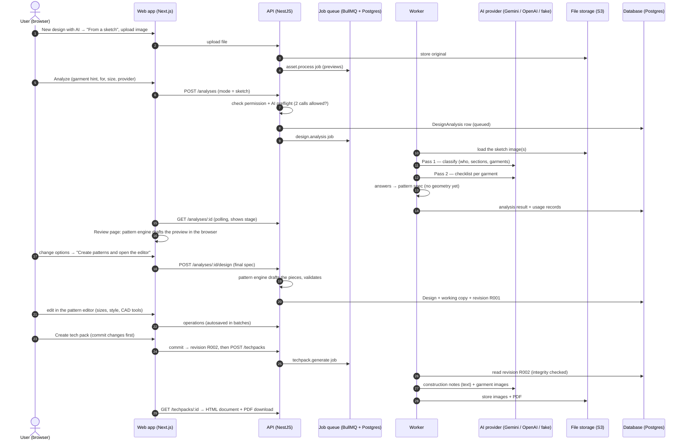

# 1. The journey, start to end

This page follows one design — say the _boy's shirt + shorts_ sketch — through every step. For each
step: what the user sees, what happens behind it, and which part of the system does the work.

## Step 1 — Choose how to start

**Screen:** _New design with AI_ (`apps/web/src/features/studio/new-analysis.tsx`).
Start modes are shown as cards: **From a sketch** (available), _From a photo_ and _From pattern
pieces_ (announced, not available yet), **Blank or template**.

## Step 2 — Upload the sketch and give optional context

The user drops 1 sketch (plus up to 3 more views of the same outfit). Each file is stored in the
**file storage** (S3-compatible) as an **asset**; a background **asset.process** job makes preview
sizes. Optional context:

| Field       | Values                                                                                                | Effect                                                            |
| ----------- | ----------------------------------------------------------------------------------------------------- | ----------------------------------------------------------------- |
| Garment     | Let AI decide, dress, top, skirt, trousers, shorts, set (co-ord), jumpsuit, dungarees, jacket, hoodie | Sent to the AI as "The user says it is: …" — a hint, not an order |
| For         | Let AI decide, women, men, girls, boys                                                                | **Wins** over what the AI reads (a note says if they disagree)    |
| Size        | From that audience's size chart, or "after the reading"                                               | **Wins** over the size the AI suggests                            |
| Notes       | Free text ("back zip, lined bodice")                                                                  | Sent to the AI                                                    |
| AI provider | Configured providers (Gemini, OpenAI) or Demo (fake)                                                  | Which AI is used                                                  |

## Step 3 — Analyze (Component 1 runs in the background)

1. **API** (`apps/api/src/modules/analysis`) checks the user may generate, then runs the **AI
   preflight** (`modules/ai/ai-usage.service.ts`): is the provider configured and does it have a
   model for _image analysis_; is the organization under its daily request limit. A sketch counts
   as **2** calls.
2. It stores a **DesignAnalysis** row (status _queued_) and enqueues a durable **design.analysis**
   job.
3. The **worker** (`apps/worker/src/jobs/ai-studio.ts` → `designAnalysisHandler`) loads the images
   and calls `readSketch` (`packages/design-ai/src/sketch.ts`):
   - _Identifying the garments_ — **pass 1**, classification.
   - _Reading the construction details_ — **pass 2**, a checklist per garment.
   - _Preparing the patterns_ — answers → **pattern spec** (see page 2).
4. Every AI call is metered (a usage record per call: succeeded / failed / outcome unknown).
5. The result (classification, garments, spec, which options came from the sketch, which were
   guesses, notes) is saved on the analysis; status becomes _succeeded_.

The browser polls the analysis and shows the current **stage** text while it runs.

## Step 4 — Review

**Screen:** _Review · Boys' shirt and shorts set_ (`features/studio/sketch-review.tsx`).

- **Left:** the sketch, what the AI read — _For: Male · child (about 8 years)_, _Covers: upper +
  lower_, _Garments: Short-sleeve shirt (shirt), Shorts with belt loops (shorts)_ — the description,
  details no option covers ("add by hand"), and what was not visible.
- **Right:** _Garment / For / Size_, then **one options section per garment**. Options read from the
  sketch carry a blue **sketch** badge; guesses carry an amber **check** badge. Garments can be added
  to or removed from the set here.
- **Pattern preview:** the pattern engine runs **in the browser** on every change and draws the
  pieces exactly as the editor will (cut lines, fold marks, seam lengths), plus the **fit checks**
  (do the seams that are sewn together have matching lengths?).

Nothing is saved until the user clicks **Create patterns and open the editor**.

## Step 5 — Create the design

`POST /analyses/:id/design` with the final spec. The **API** runs the same pattern engine on the
server (never trusting the browser's pieces), validates the resulting design state, and creates the
**Design**, its **working copy** and the first **revision R001**. The sketch stays attached as a
reference image.

## Step 6 — Edit the patterns (Component 2)

**Screen:** the pattern editor (`features/editor/patterns/pattern-workspace.tsx`). Steps bar
_✓ Sketch › 2 Patterns › 3 Tech pack_. Left: pieces grouped by garment and part. Centre: the CAD
canvas with rulers; the sketch on the side. Right: tabs **Piece / Sizes / Style / Fit**.
Two kinds of change (details on page 4):

- **Redraft** — change a body measurement, the size, a style option or a garment of the set: the
  engine drafts all pieces again (pieces edited by hand are kept unless the user asks to redraft
  them).
- **Hand edit** — move points, reshape curves, lengthen/widen, set an exact seam length, change a
  seam allowance, rotate, mirror: only that piece changes and it is marked _edited_.

Every change is one **operation**, saved automatically; undo/redo works on operations.

At any point **Preview look** commits the patterns and asks the image model to draw the garment
from them — worn by a model (front, back, left, right) or as a flat line sketch of each garment
(front, back); the designer picks the views, each drawing is one AI image. Every look is kept in the **Looks** tab with its revision,
so the designer can compare variations and go back to the patterns of any earlier look (page 4).

## Step 7 — Commit and create the tech pack (Component 3)

**Create tech pack** opens a dialog. If there are uncommitted changes, it offers to **commit them as
the next revision** first (on by default). Then it starts a **techpack.generate** job for that
revision. The worker re-reads the revision (and checks its integrity hash), builds the document
from the patterns, asks the AI for construction notes and garment pictures, and prints a **PDF**.

**Screen:** _Tech pack TPK-…_ shows the document (HTML) with a **Download PDF** button.

## Where each step lives

| Step                    | Web (`apps/web/src/features/…`)                   | API (`apps/api/src/modules/…`) | Worker (`apps/worker/src/jobs/…`) | Packages                                            |
| ----------------------- | ------------------------------------------------- | ------------------------------ | --------------------------------- | --------------------------------------------------- |
| Upload                  | `studio/new-analysis.tsx`, `assets/`              | `assets`                       | `asset.process`                   | `media`                                             |
| Analyze (Component 1)   | `studio/`                                         | `analysis`, `ai`               | `ai-studio.ts` (designAnalysis)   | `design-ai` (sketch), `ai`                          |
| Review                  | `studio/sketch-review.tsx`, `patterns/`           | —                              | —                                 | `pattern-model` (runs in the browser)               |
| Create design           | —                                                 | `analysis`, `designs`          | —                                 | `pattern-model`, `garment-model`                    |
| Edit (Component 2)      | `editor/`, `editor/patterns/`, `patterns/cad`     | `operations`, `designs`        | —                                 | `design-operations`, `editor-core`, `pattern-model` |
| Commit                  | `editor/revisions/`                               | `designs`                      | —                                 | `garment-model` (hash, canonical JSON)              |
| Tech pack (Component 3) | `editor/studio/techpack-button.tsx`, `techpacks/` | `techpacks`, `ai`              | `ai-studio.ts` (techPack)         | `design-ai` (techpack*), `pattern-model`            |
