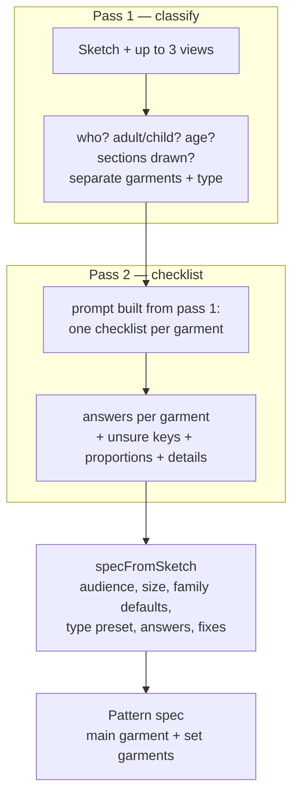

# 2. Component 1 — reading the sketch

**Code:** `packages/design-ai/src/sketch.ts` (`readSketch`, `specFromSketch`), run by the worker job
`design.analysis` (`apps/worker/src/jobs/ai-studio.ts`). Decision record: ADR-058, ADR-061.

## The principle

The AI is used as a **reader, not a drawer**. Image models are good at recognising _what_ a garment
is (a shirt collar, slant pockets, six belt loops) and bad at producing exact geometry. So the AI
only answers questions with values from fixed lists; our pattern engine then drafts every piece
from measurements. That is why every dimension in the editor is exact and editable.

## Pass 1 — classify (`sketch_classify`)

**Instruction to the model (summary):** _You are a senior pattern maker classifying a fashion
sketch. Decide step by step: (1) who wears it — male or female, adult or child (estimate the age from
head-to-body proportions, style and cut); (2) which sections are drawn — upper, lower, or full (one
garment covering both); (3) every SEPARATE garment drawn. A shirt drawn above a pair of shorts is
two garments (a set), not a dress. Never invent garments._

The user's hint, audience and notes are added when given. The model returns:

| Field                                | Values                                                             |
| ------------------------------------ | ------------------------------------------------------------------ |
| `gender`                             | male · female · unisex                                             |
| `ageGroup`                           | adult · child                                                      |
| `ageYears`                           | children only (used to pick the kids' size)                        |
| `sections`                           | upper · lower · full (any combination)                             |
| `garments[]`                         | `{ type, section, label, confidence }`, upper garment first, max 4 |
| `label`                              | name of the outfit ("Boys' shirt and shorts set")                  |
| `views`, `confidence`, `description` | as named                                                           |

**Garment types** the model may name, and the engine family each maps to:

| Types                                                          | Family    | Preset applied before the checklist answers                                                                                                                               |
| -------------------------------------------------------------- | --------- | ------------------------------------------------------------------------------------------------------------------------------------------------------------------------- |
| shirt                                                          | top       | shirt type, shirt collar, front buttons, no darts                                                                                                                         |
| t_shirt, polo                                                  | top       | knit T-shirt (polo: collar + 3 buttons)                                                                                                                                   |
| blouse, top, tank_top                                          | top       | blouse (tank: sleeveless)                                                                                                                                                 |
| hoodie, sweatshirt, jacket, shirt_jacket, blazer, bomber, coat | jacket    | jacket kind defaults (blazer: notched lapel + lining; hoodie: hood, ribs, kangaroo…)                                                                                      |
| dress, gown, frock                                             | dress     | frock: yoke + gathered skirt; gown: floor length                                                                                                                          |
| jumpsuit, romper                                               | jumpsuit  | romper: shorts length                                                                                                                                                     |
| dungarees, shortalls                                           | dungarees | shortalls: shorts length                                                                                                                                                  |
| skirt                                                          | skirt     | —                                                                                                                                                                         |
| trousers, jeans, chinos, joggers, leggings, shorts             | trousers  | jeans: scoop + back patch pockets, 5 loops, fly; chinos: slant + welt; joggers: drawstring, tapered; leggings: elastic, slim; shorts: above knee (kids) / shorts (adults) |

Unknown words are mapped by aliases and keywords: _pants → trousers, half pants / bermuda → shorts,
overalls → dungarees, playsuit → romper, tee → t_shirt, kurta / tunic → top, cardigan → jacket_.

## Pass 2 — the checklist (`sketch_details`)

The second prompt is **built from pass 1**: "The sketch shows an outfit for a male child (about 8
years): Boys' shirt and shorts set", then for each garment its own checklist. The instruction:
_look closely at construction lines — seams, topstitching, darts, pleats, gathers, plackets,
waistbands, belt loops, pocket openings, zips, buttons; choose only allowed values; when a detail is
not visible give the most likely value and list it in "unsure"; count what you can see (the front
shows about half of the belt loops)._

| Garment family        | Questions asked (allowed values in brackets)                                                                                                                                                                                                                                                                                                                                                                              |
| --------------------- | ------------------------------------------------------------------------------------------------------------------------------------------------------------------------------------------------------------------------------------------------------------------------------------------------------------------------------------------------------------------------------------------------------------------------- |
| **Top**               | type (shirt/tshirt/blouse), fit, neckline, collar (none, peter_pan, shirt+stand, mandarin, camp, notched), sleeve length, sleeve style (fitted/straight/puff/bishop/flared), cuff (none/band/shirt), closure, placket (grown_on/separate/hidden), buttons (count), hem shape (straight/curved), yoke, back pleat, chest pockets (patch, 1–2), darts, length (crop/hip/tunic), peplum, wrap, ruffles (hem/neckline/sleeve) |
| **Jacket**            | jacket type (shirt_jacket/blazer/hoodie/bomber/sweatshirt) + all upper questions + hood, lining, rib bands, pockets (patch/kangaroo/side)                                                                                                                                                                                                                                                                                 |
| **Dress**             | upper questions + waist seam, frock yoke, skirt shape (straight, pencil, a_line, flared, gathered, half_circle, circle, tiered, pleated), tiers, length (mini…floor), pockets, wrap, ruffles                                                                                                                                                                                                                              |
| **Skirt**             | skirt shape, tiers, length, waistband + type, belt loops, closure (side/back zip, buttons, none), pockets, wrap, ruffles                                                                                                                                                                                                                                                                                                  |
| **Trousers / shorts** | fit, length (shorts, above_knee, knee, cropped, full), leg (straight/slim/wide/tapered), waistband yes/no, waistband type (fitted/elastic/drawstring/elastic_back), belt loops (count), closure (fly_zip/side_zip/front_buttons/none), front pockets (none/side_seam/slant/scoop/patch), back pockets (none/patch/welt) + count, cargo, pleats (none/single/double), turn-ups, darts                                      |
| **Jumpsuit**          | upper questions + the trouser questions except the waistband                                                                                                                                                                                                                                                                                                                                                              |
| **Dungarees**         | length, leg, pockets (patch = bib pocket), back pockets, waistband                                                                                                                                                                                                                                                                                                                                                        |

Each option comes with a **visual cue**, e.g. _fly_zip = J-shaped topstitch line at the front crotch,
usually with a button on the band_; _slant = diagonal opening from waist to side_; _separate placket =
a visible strip with two stitch lines along the buttons_.

Per garment the model also returns:

- `unsure` — keys it guessed (shown as **check** on the review page);
- `proportions` — ratios measured on the drawing (garment length ÷ shoulder width, skirt ÷ bodice,
  sleeve ÷ shoulder, trouser outseam ÷ hip width), used only when no length option was answered;
- `details` — things no option covers (bows, embroidery, prints) → listed as "add by hand".

## From answers to a pattern spec (`specFromSketch`)

1. **Who** — child + male → _boys_, child + female → _girls_, adult → _men_ / _women_. The user's
   choice wins (a note says when it differs from the reading).
2. **Size** — the user's size if valid; else for children the size nearest the estimated age
   (`kidsSizeForAge`: 2y…14y); else the default (women M, men L, kids 6y).
3. **Per garment**: family defaults (`defaultStyle`) → type preset → every non-empty answer.
   Answered keys are remembered as _from the sketch_.
4. **Fixes** so the engine gets a sensible combination (`fixStyle`):
   - options that do not apply are removed (no collar on shorts…);
   - a back zip on trousers becomes a fly zip; a fly zip on a dress becomes a back zip;
   - a shirt / camp / notched collar needs a front opening → front buttons (note added);
   - a _fitted_ waistband with no opening becomes _elastic_ (it must pull on).
5. **Lengths from proportions** when no length option was read (scaled by the size chart's shoulder
   width or hip).
6. **Set** — the first garment becomes the spec's `family`/`style` (key `main`); the others go into
   `garments[]` with keys like `shorts`, `bottoms`, `jacket`. All share the wearer, size and body
   measurements.

### Worked example (sample 01)

| Pass 1                                                             | Pass 2 (shorts)                                                                                          | Spec                                                                                                                    |
| ------------------------------------------------------------------ | -------------------------------------------------------------------------------------------------------- | ----------------------------------------------------------------------------------------------------------------------- |
| male · child · 8 y · upper + lower · shirt (upper), shorts (lower) | above_knee, waistband fitted, 6 belt loops, fly_zip, slant pockets, back patch ×2 (unsure: back pockets) | `{ family: top, audience: boys, size: 8y, style: {shirt…}, garments: [{ key: shorts, family: trousers, style: {…} }] }` |

## What is stored

The analysis result (`DesignAnalysis.result`) keeps: `classification` (pass 1), `garments` (type,
family, label, details per garment), `spec`, `fromSketch` and `unsure` (per garment key), `notes`,
a display summary `reading`, the provider and models used, and the routing history (which models
were tried). Analyses made before ADR-061 (single pass) still open; the review page reads both shapes.

## Which AI model answers

Both passes are the **image analysis** operation. The provider layer (page 6) picks the model chain
for the organization (e.g. Gemini 2.5 Flash, then fallbacks), retries busy models, and can fall back
to a second provider. In tests and demo mode the **fake provider** answers from fixed tables
(`fake-responders.ts`): the hint _"shirt and shorts set"_ returns sample 01; no hint returns a girls'
party dress.

## What Component 1 does _not_ do (today)

- It does not trace the outline or measure the drawing beyond the few ratios above.
- It cannot express a detail outside the allowed values (e.g. a raglan sleeve, a princess seam) — it
  goes to "details: add by hand".
- It reads one outfit per analysis; photos and existing patterns as starting points are not built.
