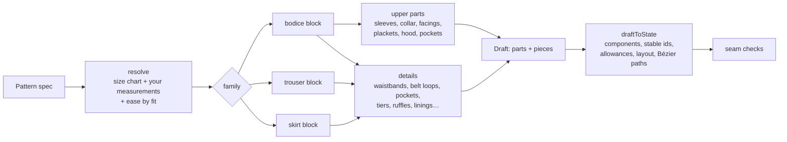

# 3. The pattern engine

**Code:** `packages/pattern-model/src/blocks/` (drafting), `src/cut.ts` (cutting lines),
`src/cad/` (Bézier paths, exports), `src/marker.ts`, `src/sewing-order.ts`. Pure TypeScript, no AI,
no database — the same code runs in the browser (review preview, editor redraft), the API (creating a
design) and the worker (tech pack). Decisions: ADR-058, ADR-059, ADR-060, ADR-061.

**Deterministic:** the same pattern spec always gives exactly the same pieces (coordinates rounded to
0.1 mm). That is what makes "change the bust by 8 cm → redraft" safe.

## 1. Measurements: size chart + your changes + ease

- **Size charts** (`sizes.ts`): one body chart per audience — women XS–XXL, men S–3XL, children
  2y–14y (girls and boys share it) — with every body measurement. **Size standards** (ADR-067) only
  say what their sizes are: **UK** (women 4–22, men chest 34–48", kids by age 2-3y…13-14y), **US**
  (women 0–18 = UK − 4, men by chest, kids 2T–4T and 5–16), **EU** (women 32–50 = UK + 28, men 44–58,
  kids by height 92–164), **International** (the chart's own letter sizes and ages) and **custom**
  organization charts (Settings → Size charts; copied into the spec). A national size sets its
  defining measurements (bust/chest, waist, hip for adults; height for children) and takes the rest
  from the body chart, interpolated. `convertSize` keeps about the same body when the standard
  changes; `specForSize` grades a design to another size, keeping the designer's changes.
- **Your measurements** (`spec.body`) override chart values one by one (Sizes tab).
- **Ease** — extra room added to the body, by fit (`resolve.ts`):

  | Fit       | Bust | Waist | Hip |
  | --------- | ---- | ----- | --- |
  | fitted    | 50   | 30    | 40  |
  | regular   | 90   | 70    | 60  |
  | relaxed   | 150  | 140   | 100 |
  | oversized | 240  | 240   | 160 |

  (mm, full circumference.) Shirts +30, jackets +50…110 depending on kind, knits −30, children ×0.7.
  Ease can be overridden per bust/waist/hip.

- **Lengths** come from the length option (crop, hip, knee, midi, floor, shorts…) relative to the
  body (e.g. knee = waist-to-knee + 30 mm), or an exact `lengthMm`.

## 2. Blocks (the base shapes)

| Block                       | File          | How it is drafted                                                                                                                                                                                                                                                                                                                                                                                                                                                                                 |
| --------------------------- | ------------- | ------------------------------------------------------------------------------------------------------------------------------------------------------------------------------------------------------------------------------------------------------------------------------------------------------------------------------------------------------------------------------------------------------------------------------------------------------------------------------------------------- |
| **Bodice** (front + back)   | `bodice.ts`   | Neck width/depth from neck size and neckline style; shoulder slope; armhole from armhole depth and across back; bust line; waist darts and bust dart (women, darts on) sized from the bust–waist difference; to the waist (dresses, jumpsuits, peplum tops) or to a length (tops, shift dresses, jackets) with hip curve and optional flare or curved hem. Options: button extension + grown-on / separate / hidden placket, front zip, notched lapel, back zip, shirt back yoke, back box pleat. |
| **Sleeve**                  | `sleeve.ts`   | The cap is **solved** so its length = measured armhole + cap ease (ease range by style/fit); width never less than the upper arm; hem shaped by sleeve style (fitted, straight, puff, bishop, flared); cuff or band drafted to the hem.                                                                                                                                                                                                                                                           |
| **Collars & neck finishes** | `collar.ts`   | Drafted to the **measured** neckline: shirt collar + stand, mandarin band, Peter Pan (arc whose inner edge = neckline), camp collar, notched top collar, knit neckband (85 % of the neckline), neck facings, armhole binding.                                                                                                                                                                                                                                                                     |
| **Skirt**                   | `skirt.ts`    | Straight, pencil, A-line, flared, gathered (rectangles × gather ratio), half and full circle (radius from the waist), plus tiered and knife-pleated (`extras.ts`). In a dress, the skirt waist is matched to the bodice waist.                                                                                                                                                                                                                                                                    |
| **Trousers / shorts**       | `trousers.ts` | Front and back legs from waist, hip, rise, knee and ankle; crotch extensions (front H/16, back H/9); raised, slanted centre back; darts or pleats; leg shape; the back side seam adjusted so the outseams match.                                                                                                                                                                                                                                                                                  |

## 3. Garment families (`draft-pattern.ts`)

| Family        | Built from                                                                                                    |
| ------------- | ------------------------------------------------------------------------------------------------------------- |
| **dress**     | bodice to waist + skirt (or shift: one long bodice; or **frock**: bodice cut at a yoke line + gathered skirt) |
| **top**       | bodice to length (+ peplum: bodice to waist + half-circle peplum)                                             |
| **jacket**    | bodice with jacket ease + jacket parts (see below)                                                            |
| **skirt**     | skirt + waistband                                                                                             |
| **trousers**  | legs + waistband + pocket and closure parts                                                                   |
| **jumpsuit**  | bodice to waist + legs whose waist is drafted to equal the bodice waist (+ extra rise), no waistband          |
| **dungarees** | legs (extra rise, side button openings) + front bib + back bib + straps (+ bib pocket)                        |

Then the **upper parts** for any garment with a bodice: sleeves (+ cuffs, + sleeve plackets for
shirt cuffs on long sleeves), collar / stand / neckband / facings, hood, button placket, chest or
kangaroo pocket. And the **details**:

| Detail                                    | Pieces it adds                                                                      | File                      |
| ----------------------------------------- | ----------------------------------------------------------------------------------- | ------------------------- |
| Fitted waistband                          | band with button + buttonhole, 35 mm overlap when the waist opens                   | `bottoms.ts`              |
| Elastic / drawstring waistband            | casing band = hip size (pulls on), elastic length note; drawstring cord piece       | `bottoms.ts`              |
| Elastic back                              | flat front with button, elastic in the back half (back leg has no darts)            | `bottoms.ts`              |
| Belt loops                                | one strip cut into N loops + loop positions marked on the band                      | `bottoms.ts`              |
| Slant / scoop front pockets               | the corner is **cut out of the front leg**; side front (pocket facing) + pocket bag | `trousers.ts`             |
| Side-seam / patch front pockets           | pocket bags / patch pockets                                                         | `collar.ts`, `bottoms.ts` |
| Back pockets                              | patch pockets, or welts + welt bags; placement marked on the back leg               | `bottoms.ts`              |
| Cargo pockets                             | pocket with box pleat + flaps                                                       | `bottoms.ts`              |
| Fly zip                                   | fly facing + fly shield, zip marked                                                 | `trousers.ts`             |
| Front pleats                              | wider front waist, pleat marks                                                      | `trousers.ts`             |
| Turn-ups                                  | deeper hem allowance on the legs (2 × turn-up + 15 mm)                              | `trousers.ts`             |
| Hood                                      | two-piece hood drafted to the neckline (+ lining)                                   | `jacket.ts`               |
| Notched lapel                             | lapel on the front, front facing, top collar, back neck facing                      | `bodice.ts`, `jacket.ts`  |
| Rib bands                                 | hem rib (85 % of the hem) + cuff ribs                                               | `jacket.ts`               |
| Lining                                    | lining copies of front, back, sleeve                                                | `jacket.ts`               |
| Tiers, pleated skirt, ruffles, wrap, ties | tier rectangles, pleated panels, ruffle strips, wrap fronts + ties                  | `extras.ts`               |

## 4. Sets (co-ords)

When `spec.garments` is not empty, each garment is drafted with the **same body** and its own style,
then combined: the extra garments' part keys and piece templates get a prefix (`shorts.legs`,
`shorts.waistband`) and each garment becomes a **set garment** component under the one garment body.
Piece names that repeat between garments get the garment name ("Shirt front" / "Jacket front").

## 5. From draft to design state (`state.ts` → `draftToState`)

- **Components** = the garment parts (Front, Sleeves, Collar, Legs, Waistband…), tagged
  `part:<key>` so a redraft **keeps the same component ids**.
- **Pieces** keep their ids by template (`trouser_front`, `shorts.waistband`).
- **Hand-edited pieces** (`source: user`) are **kept** on redraft unless the user chooses
  _Redraft them from the measurements_.
- **Seam allowances** (ADR-060): the piece's seam allowance (default 10 mm) plus a per-edge override:
  garment hems get the hem allowance (default 30 mm; not on sleeves joined to a cuff or band); edges
  on the **fold get none**; details can set their own (turn-ups). Allowances set by hand survive a
  redraft.
- **Layout**: each piece gets a canvas position, laid out in rows by part.
- **Editable outline**: every drafted outline is converted to a **Bézier path** (curve fitting within
  0.3 mm) so the editor can move nodes and handles (ADR-059).

## 6. Seam checks (`checks.ts`)

"Do the pieces still sew together?" — measured on the pieces **as they are now** (after hand edits):

| Check                         | Acceptable                                                          |
| ----------------------------- | ------------------------------------------------------------------- |
| Shoulder front ↔ back         | back up to 6 mm longer (eased)                                      |
| Side seams front ↔ back       | ± 3 mm                                                              |
| Sleeve cap ↔ armhole          | cap ease range for the style                                        |
| Sleeve underarm seams         | ± 3 mm                                                              |
| Sleeve hem ↔ cuff / band      | cuff = hem + overlap / band = hem                                   |
| Bodice ↔ skirt / legs (waist) | ± 6–8 mm                                                            |
| Waist ↔ waistband             | overlap 25–50 mm (or equal if elastic)                              |
| Neckline ↔ collar / facing    | −8…+4 mm                                                            |
| Inseams, outseams             | inseam back up to 15 mm shorter; outseams ± 5 mm (incl. side front) |

Each result is _fits_, _check_ (near the range) or _does not fit_. In a set every garment is checked
on its own pieces ("Shorts: Waist ↔ waistband").

## 7. Cutting lines, layout and outputs

- `cutOutline(piece)` offsets each seam by **its own** allowance (fold edges stay on the fold). The
  same function draws the editor, review preview, pattern sheet, DXF, 1:1 print and tech pack, so
  they always agree.
- `buildMarkers` packs every piece to cut (quantities, fold pieces opened, pairs mirrored) on 150 cm
  fabric (90 cm interfacing) with the grain along the length → fabric length for the BOM.
- `sewingOrder` proposes a construction sequence from the parts (page 5).
- `piecesToDxf` (DXF R12, mm, layers CUT/SEAM/GRAIN/FOLD/NOTCH/MARK/TEXT) and `tiledPrintHtml`
  (true-size print on A4/Letter with a 10 cm test square).
