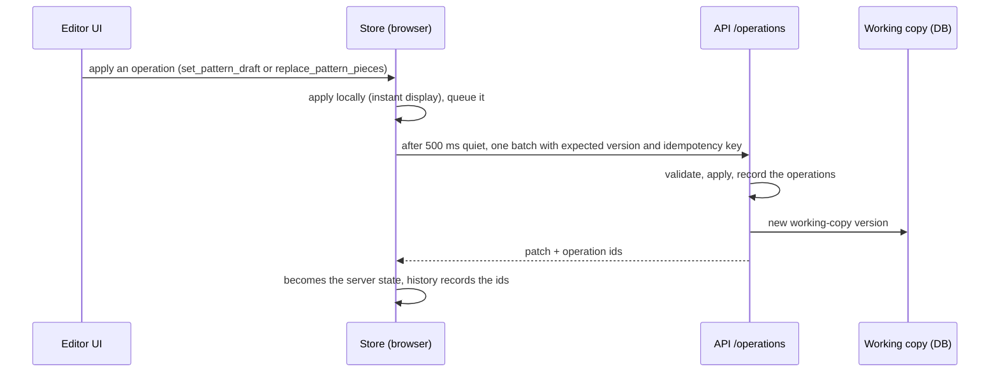

# 4. Component 2 — the pattern editor

**Code:** `apps/web/src/features/editor/` (editor shell, store, revisions, tech pack button),
`features/editor/patterns/pattern-workspace.tsx` (pattern panels), `features/patterns/cad/`
(canvas), `features/patterns/` (forms), `packages/design-operations` (operations),
`packages/editor-core` (undo, queue, save state). Decisions: ADR-050, ADR-058, ADR-059, ADR-060, ADR-062, ADR-064.

## What is being edited: the design state

A design is one JSON document, the **design state** (`packages/garment-model`). For a pattern-first
design the important parts are:

- `patternSpec` — the recipe (family, audience, size, body, style, garments of a set, allowances);
- `components` — the parts tree (garment body → [set garments →] front, back, sleeves, legs…);
- `patternPieces` — every piece: outline, named seam edges, Bézier path, markings, grainline, fold,
  notches, cut quantity, seam allowance(s), canvas position, `source` (generated / user), status;
- `sources` — the sketch as a reference image.

The structured state is the truth; everything you see (canvas, sheet, PDF) is drawn from it.

## Working copy, operations and autosave

- Every change is **one operation**. Pattern work uses mainly:
  - `set_pattern_draft` — replace spec + components + pieces after a **redraft**;
  - `replace_pattern_pieces` — replace the pieces of one part after a **hand edit**.
- Changes are applied immediately in the browser and saved in batches. The save chip shows
  _Saving… / Saved / Unsaved / Save failed / Conflict / Offline_.
- **Undo/redo** send `revert_operation` to the server (history is server operations, not local
  snapshots). Several quick changes with the same group (a drag, a typing burst) undo as one step.
- Only one writer at a time: if someone else changed the working copy you get a conflict dialog.

## Two ways to change patterns

| Redraft (parametric)                                                                                            | Hand edit (geometric)                                                                                   |
| --------------------------------------------------------------------------------------------------------------- | ------------------------------------------------------------------------------------------------------- |
| **Sizes tab**: garment, audience, size, each body measurement, ease, seam and hem allowance                     | **Piece tab / canvas**: width & height, rotate, mirror, lengthen/widen across a line, point X/Y, curves |
| **Style tab**: every option of every garment; add/remove garments of a set                                      | exact seam length, per-seam allowance, cut quantity                                                     |
| → the engine drafts **all** pieces again (`useRedraft` → `draftPattern` → `draftToState` → `set_pattern_draft`) | → only that piece changes (`replace_pattern_pieces`); it becomes **edited** (`source: user`)            |
| Hand-edited pieces are kept (banner: _Redraft them from the measurements_)                                      | A per-seam allowance change does not mark the piece edited                                              |

## The CAD canvas (`features/patterns/cad/`)

- **Real scale**: the canvas works in millimetres; rulers top and left (cm / mm / in); adaptive grid;
  zoom around the cursor; **1:1** shows true size after a one-time **Calibrate** (measure a 10 cm
  bar on screen; stored per browser).
- **Drawing of a piece** (`piece-vector.tsx`): cutting line (allowance per seam), seam line dashed,
  _PLACE ON FOLD_, grainline arrows, notch ticks through the allowance, sewing marks (darts, pleats,
  gathers, zips, buttons, placement), overall width/height, and every seam labelled along itself
  with its length (just the number when the seam is short; full name on hover). Dimensions show on
  the selected piece or on all pieces (toggle).
- **Tools** (ADR-062): categories in the bar above the canvas, the category's tools in the rail on
  its left, a one-line hint and the tool's options in the strip below the bar. Exactly one tool is
  active; switching cancels whatever the previous one had started, and points are shown only by
  the point tools. Esc cancels; Esc again returns to Select.

  | Category        | Tools (key)                                                                                                                                                |
  | --------------- | ---------------------------------------------------------------------------------------------------------------------------------------------------------- |
  | Select          | **V** select and move pieces (arrows nudge 1 mm, Shift 10, Alt 0.1) · **H** pan (Space with any tool)                                                      |
  | Points & curves | **A** edit points/handles (Shift or box select, Delete, arrows) · **P** add point on a seam · **X** delete point · **C** corner ↔ smooth, curve ↔ straight |
  | Size & shape    | **S** scale the whole piece (handles or typed width/height) · **L** lengthen and **W** widen at one or more lines · **F** size by measurement (redraft)    |
  | Transform       | **R** rotate (drag or angle; ±90°, 180°) · flip horizontally/vertically                                                                                    |
  | Measure & mark  | **M** measure · **E** seam: exact length and seam allowance · **N** add/remove notches · **G** draw the grainline                                          |
  | Arrange         | pack on a fabric width (fabric band shown, length needed) · tidy by part — one undo step                                                                   |
  | View & output   | dimensions, seam names, grid, snap, sketch toggles · calibrate · print 1:1 · DXF                                                                           |

  **Size by measurement**: pick a piece, type the width or length you want; the editor lists the
  measurements that drive it (most effective first — e.g. bust/chest for a bodice width, shirt
  length for its height), finds the value that gives that size and redrafts the whole pattern, so
  the front follows the back and seams still match. Scale and spread change only that piece.

- **Outputs**: _Print 1:1_ (tiled A4/Letter with a test square) and _DXF_ (for pattern CAD software
  and plotters).

## Side panels

| Tab       | Contents                                                                                                                                                                                                      |
| --------- | ------------------------------------------------------------------------------------------------------------------------------------------------------------------------------------------------------------- |
| **Piece** | name, source, size, seam allowance, cut quantity, transforms, lengthen/widen, point editing, **seam table** (length, intake, SA per seam, fold)                                                               |
| **Sizes** | garment / for / **size standard** (International, UK, US, EU or an organization size chart) / size; body measurements of every garment of the set (chart value or yours, reset); ease; seam and hem allowance |
| **Style** | one section per garment with all its options; add/remove set garments                                                                                                                                         |
| **Fit**   | the seam checks (fits / check / does not fit), per garment in a set                                                                                                                                           |

The right panel's other tabs: **Looks** (look previews, below), **History** (revisions — compare,
inspect, restore), **Changes** (this session's operations; undo/redo), **Checks** (validation
findings) and **Sketch** (reference images). Left: **pieces grouped by garment, then by part**, with "×2" cut quantity and an _edited_
badge. Right of the canvas: the **sketch** as reference (toggle in View).

## Look preview (ADR-064)

**Preview look** (header button, pattern-first designs) shows the garment sewn from the patterns on
screen. It is not an editing tool. First choose **what it should show**; the views that fit then
appear:

- **On a model** — the whole outfit worn by a real fashion model (woman, man, girl or boy from the
  design's audience; never a dummy). Views: front, back, left side, right side.
- **Line sketch** — a flat technical drawing of the garment on its own: no model, no dummy, no
  hanger. Views: front and back. A set is drawn **garment by garment** — a shirt + shorts set gives a
  shirt front, shirt back, shorts front and shorts back, each with only that garment's pieces.

Each drawing is one AI image, so the dialog shows the count before you start ("4 AI images"; for a
line sketch of a set it is views × garments). Add an optional note ("longer sleeves").

- A look always belongs to a **committed revision**: uncommitted pattern changes are committed first
  (one step). So every look is the record of "these patterns look like this".
- What the model gets — **the patterns only** (`packages/design-ai/src/look.ts`, worker
  `apps/worker/src/jobs/look.ts`): the **pattern sheet** image; every piece with its size, cut and
  seam lengths, marked when edited by hand; the pattern settings and finished measurements; how the
  pieces are sewn together (sewing order); and, after the first drawing, that drawing again so the
  other views match. The **original sketch, reference photos and the AI's reading of them are never
  sent**: the designer edits the patterns, so the look shows what the edited pieces make — it can
  look quite different from the sketch the design started from.
- Colour is not part of the patterns: on a model the garment is in a plain neutral off-white fabric;
  a line sketch is **black lines only** (no colour, fill, print or shading).
- Views appear in the **Looks** tab one by one as they are drawn (one AI image call per drawing,
  counted in the daily allowance; the preflight checks exactly that number). A view that fails shows why; the others still run.
- Every look stays in the list, newest first, with its kind (_on a model_ / _line sketch_), its
  revision (_patterns R003_), note and date;
  _current patterns_ marks the look of what is on screen. **Use these patterns** restores that
  revision into the working copy — the way back to the fifth-last design; **Compare with now**
  shows the differences. Commit after restoring to keep it.
- Stored in `design_looks` (module `apps/api/src/modules/looks`); the images are ordinary assets
  and cannot be deleted while a look uses them.

## Revisions and the step to the tech pack

- **Commit** turns the working copy into an **immutable revision** (R002…), with a canonical-JSON
  **content hash** so it can be verified later. Pattern changes (the spec and the pieces, not where
  a piece sits on the canvas) count as changes to the garment, so they can be committed — before
  ADR-064 they were ignored and a commit after pattern-only edits answered "nothing changed". Revisions are never changed; restoring an old one
  creates a new working copy version.
- **Create tech pack** (header button): if there are uncommitted changes it offers to commit them as
  the next revision first, then starts the tech pack job for that revision (page 5).
- Steps bar in the header: _✓ Sketch › Patterns › Tech pack_.
