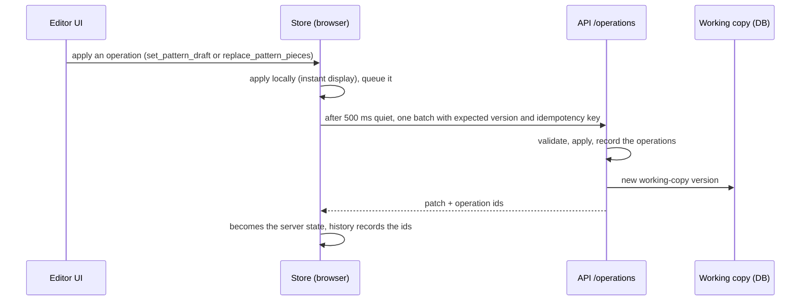

# 4. Component 2 — the pattern editor

**Code:** `apps/web/src/features/editor/` (editor shell, store, revisions, tech pack button),
`features/editor/patterns/pattern-workspace.tsx` (pattern panels), `features/patterns/cad/`
(canvas), `features/patterns/` (forms), `packages/design-operations` (operations),
`packages/editor-core` (undo, queue, save state). Decisions: ADR-050, ADR-058, ADR-059, ADR-060.

## What is being edited: the design state

A design is one JSON document, the **design state** (`packages/garment-model`). For a pattern-first
design the important parts are:

- `patternSpec` — the recipe (family, audience, size, body, style, garments of a set, allowances);
- `components` — the parts tree (garment body → [set garments →] front, back, sleeves, legs…);
- `patternPieces` — every piece: outline, named seam edges, Bézier path, markings, grainline, fold,
  notches, cut quantity, seam allowance(s), canvas position, `source` (generated / user), status;
- `sources` — the sketch as a reference image.

The structured state is the truth; everything you see (canvas, sheet, PDF) is drawn from it.

## Working copy, operations and autosave

- Every change is **one operation**. Pattern work uses mainly:
  - `set_pattern_draft` — replace spec + components + pieces after a **redraft**;
  - `replace_pattern_pieces` — replace the pieces of one part after a **hand edit**.
- Changes are applied immediately in the browser and saved in batches. The save chip shows
  _Saving… / Saved / Unsaved / Save failed / Conflict / Offline_.
- **Undo/redo** send `revert_operation` to the server (history is server operations, not local
  snapshots). Several quick changes with the same group (a drag, a typing burst) undo as one step.
- Only one writer at a time: if someone else changed the working copy you get a conflict dialog.

## Two ways to change patterns

| Redraft (parametric)                                                                                            | Hand edit (geometric)                                                                                   |
| --------------------------------------------------------------------------------------------------------------- | ------------------------------------------------------------------------------------------------------- |
| **Sizes tab**: garment, audience, size, each body measurement, ease, seam and hem allowance                     | **Piece tab / canvas**: width & height, rotate, mirror, lengthen/widen across a line, point X/Y, curves |
| **Style tab**: every option of every garment; add/remove garments of a set                                      | exact seam length, per-seam allowance, cut quantity                                                     |
| → the engine drafts **all** pieces again (`useRedraft` → `draftPattern` → `draftToState` → `set_pattern_draft`) | → only that piece changes (`replace_pattern_pieces`); it becomes **edited** (`source: user`)            |
| Hand-edited pieces are kept (banner: _Redraft them from the measurements_)                                      | A per-seam allowance change does not mark the piece edited                                              |

## The CAD canvas (`features/patterns/cad/`)

- **Real scale**: the canvas works in millimetres; rulers top and left (cm / mm / in); adaptive grid;
  zoom around the cursor; **1:1** shows true size after a one-time **Calibrate** (measure a 10 cm
  bar on screen; stored per browser).
- **Drawing of a piece** (`piece-vector.tsx`): cutting line (allowance per seam), seam line dashed,
  _PLACE ON FOLD_, grainline arrows, notch ticks through the allowance, sewing marks (darts, pleats,
  gathers, zips, buttons, placement), overall width/height, and every seam labelled along itself
  with its length (just the number when the seam is short; full name on hover). Dimensions show on
  the selected piece or on all pieces (toggle).
- **Tools** (keys): **V** select/move pieces · **A** points & curves (click, Shift/box select, drag,
  handles, double-click adds a point, Delete) · **M** measure · **L** lengthen/shorten and **W**
  widen/narrow across a line (slash-and-spread; curves keep their shape) · **H**/Space pan · **0**
  fit · **1** true size · arrows nudge 1 mm (Shift 10, Alt 0.1). Snapping to points and grid.
- **Outputs**: _Print 1:1_ (tiled A4/Letter with a test square) and _DXF_ (for pattern CAD software
  and plotters).

## Side panels

| Tab       | Contents                                                                                                                                        |
| --------- | ----------------------------------------------------------------------------------------------------------------------------------------------- |
| **Piece** | name, source, size, seam allowance, cut quantity, transforms, lengthen/widen, point editing, **seam table** (length, intake, SA per seam, fold) |
| **Sizes** | garment / for / size; body measurements of every garment of the set (chart value or yours, reset); ease; seam and hem allowance                 |
| **Style** | one section per garment with all its options; add/remove set garments                                                                           |
| **Fit**   | the seam checks (fits / check / does not fit), per garment in a set                                                                             |

Left: **pieces grouped by garment, then by part**, with "×2" cut quantity and an _edited_ badge.
Right of the canvas: the **sketch** as reference.

## Revisions and the step to the tech pack

- **Commit** turns the working copy into an **immutable revision** (R002…), with a canonical-JSON
  **content hash** so it can be verified later. Revisions are never changed; restoring an old one
  creates a new working copy version.
- **Create tech pack** (header button): if there are uncommitted changes it offers to commit them as
  the next revision first, then starts the tech pack job for that revision (page 5).
- Steps bar in the header: _✓ Sketch › Patterns › Tech pack_.
