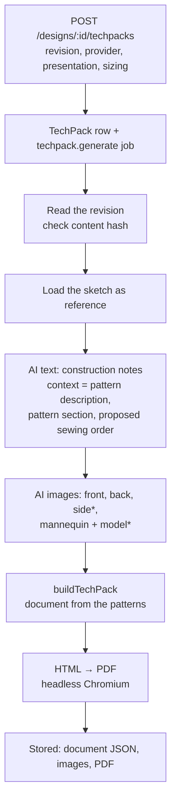

# 5. Component 3 — the tech pack

**Code:** API `apps/api/src/modules/techpacks`; worker `apps/worker/src/jobs/ai-studio.ts`
(`techPackHandler`); document `packages/design-ai/src/techpack.ts` (`buildTechPack`),
`techpack-pattern.ts`, `techpack-vector.ts`, `techpack-html.ts`, prompts in `prompts.ts`; pattern
helpers from `packages/pattern-model` (cut lines, markers, sewing order). Decisions: ADR-056,
ADR-057, ADR-058, ADR-060, ADR-067.

## The rule

A tech pack **documents one committed revision** — never the draft — and never changes the design.
Everything measurable comes from the **patterns**; the AI only writes notes and draws pictures, and
anything unknown is listed as _missing_ rather than invented.

## The job, step by step

(\*side for jackets, dresses, hoodies, trousers; mannequin and model when the user ticks the option.)

| Stage shown                  | What happens                                                                                                                                                                                                                                                                                                                                 |
| ---------------------------- | -------------------------------------------------------------------------------------------------------------------------------------------------------------------------------------------------------------------------------------------------------------------------------------------------------------------------------------------- |
| Reading the committed design | Loads the revision, verifies the canonical-JSON hash, upgrades old schema versions                                                                                                                                                                                                                                                           |
| Drafting construction notes  | One **text** AI call (`techpack_text`): description, construction steps, stitching, finishing, quality checkpoints, care. Given the pattern description, the pattern section and the deterministic sewing order as context. If it fails, the document uses the deterministic order.                                                          |
| Generating the … image       | One **image** AI call per view. Prompt = the garment description built from the patterns ("Shorts for boys, size 8y… Waistband type: fitted; Belt loops: 6…; Finished measurements…; Pieces…") + presentation (model, pose, background); the original sketch is passed as a look reference only. Failures are recorded as "Not generated: …" |
| Assembling the tech pack     | `buildTechPack` (below)                                                                                                                                                                                                                                                                                                                      |
| Printing the PDF             | HTML rendered by headless Chromium (needs Chrome/Chromium on the server or `PDF_CHROMIUM_PATH`)                                                                                                                                                                                                                                              |

## Sizes (ADR-067)

The dialog asks for the **size standard** (International, UK, US, EU or one of the organization's
size charts), the **base size** — the design's size converted to that standard; the patterns are
drawn in it — and the **sizes to produce** (chips, "All sizes" / "Base only"). The API checks every
size belongs to the standard for the design's wearer, orders them small to large, and copies a
custom chart into the tech pack so it never changes later.

The **size chart** (`design-ai/src/techpack-sizes.ts`) has two tables, sizes as columns, base size
highlighted:

- **Finished garment** — chest, waist, hip, centre back length, sleeve length, sleeve opening, skirt
  length, hem width, outseam, inseam, leg opening (whatever the garment has). The base column is
  read off the drawn patterns (hand edits included); every other size is **graded** by drafting that
  size (`specForSize`: chart values of the size + every measurement change the designer made) and
  adding the difference to the base.
- **Body measurements** — height first, then everything the garment is drafted from.

Notes under the tables say what is graded and flag hand-edited pieces (drawn in the base size only).

## What the document contains (pattern-first designs)

Layout (ADR-067): A4, a **cover** (accent band, style no., revision, size range, base size, project,
issue date, a hero drawing), then **numbered sections**; running header (design name — technical
package · style no.) and footer (style no. · revision · project · page x / y) on every page. Tables
have no technical ids or source columns; statuses appear only where they matter (_estimate_,
_missing_).

| Section                                     | Source                                                                                                                                                            |
| ------------------------------------------- | ----------------------------------------------------------------------------------------------------------------------------------------------------------------- |
| Cover                                       | design name, garment, wearer, style no., revision, size range, base size, project, date, hero picture, one-line disclaimer                                        |
| 01 Overview                                 | description; garment, wearer, size standard, base size, size range, allowances; the original sketch as a small reference                                          |
| 02 Specification                            | style options (per garment in a set) as a compact grid; **seam fit checks**                                                                                       |
| Garment views / presentation                | drawings and AI pictures, when there are any (AI pictures are labelled)                                                                                           |
| **03 Size chart — UK** (…)                  | finished garment and body measurements per size (above)                                                                                                           |
| **Bill of materials**                       | main fabric (and lining / interfacing / rib) **length from the cutting layout** + 5 %; zips; buttons; interfacing; thread; labels — _estimate_ / _missing_ marked |
| Flat patterns                               | pattern sheet + table (cut, size in cm, seam allowance with per-seam notes, fabric)                                                                               |
| One page per piece                          | dimensioned vector drawing (seam line, cutting line, fold, grain, notches, markings, seam lengths, 100 mm scale bar)                                              |
| **Cutting layout — main** (+ other fabrics) | marker drawing, length and % used (planning estimate)                                                                                                             |
| **Construction**                            | AI-drafted steps (marked) or the deterministic sewing order; stitching; finishing; quality checkpoints; care                                                      |
| Open items                                  | what is not specified yet, **grouped** — one line per item with every piece or part it applies to                                                                 |

Removed in ADR-067: the AI processing record, technical ids (piece ids), source and status columns
on every row, and long attribute lists per component (component designs get a short table:
component, fabric, key details).

## The deterministic sewing order (`pattern-model/src/sewing-order.ts`)

Built from the parts the pattern actually has, in standard order: cut and mark → interface →
darts / gathers → yoke → shoulders → button placket / front edges → collar or neckband or facing →
hood → sleeve plackets → set in sleeves → side seams → pockets → cuffs → (bottoms: back / welt /
cargo / slant pockets, pleats, fly, outseams + inseams, crotch, bodice–legs join) → zip → belt loops
→ waistband (fitted / elastic / drawstring / elastic back) → secure loops → rib bands → lining →
ruffles → hem → buttonholes and buttons → final press. A set is done garment by garment
("Shirt: …", "Shorts: …") with one cutting and one final step.

## The cutting layout (`pattern-model/src/marker.ts`)

All pieces to cut for one garment (cut quantities; fold pieces opened out; pairs mirrored) are packed
with a deterministic skyline method on the cutting-line boxes, allowing a 180° turn, grain along the
length; one layout per fabric role (main 150 cm, interfacing 90 cm, lining, rib…). Output: length,
% of fabric used, a drawing.

## Where it is shown

`/techpacks/:id` shows the document (HTML in a frame) with status and **Download PDF**
(`POST /techpacks/:id/pdf` re-prints if needed). Earlier tech packs of a design are listed in the
_Create tech pack_ dialog.
