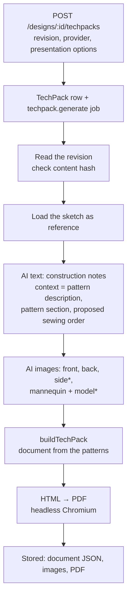

# 5. Component 3 — the tech pack

**Code:** API `apps/api/src/modules/techpacks`; worker `apps/worker/src/jobs/ai-studio.ts`
(`techPackHandler`); document `packages/design-ai/src/techpack.ts` (`buildTechPack`),
`techpack-pattern.ts`, `techpack-vector.ts`, `techpack-html.ts`, prompts in `prompts.ts`; pattern
helpers from `packages/pattern-model` (cut lines, markers, sewing order). Decisions: ADR-056,
ADR-057, ADR-058, ADR-060.

## The rule

A tech pack **documents one committed revision** — never the draft — and never changes the design.
Everything measurable comes from the **patterns**; the AI only writes notes and draws pictures, and
anything unknown is listed as _missing_ rather than invented.

## The job, step by step

(\*side for jackets, dresses, hoodies, trousers; mannequin and model when the user ticks the option.)

| Stage shown                  | What happens                                                                                                                                                                                                                                                                                                                                 |
| ---------------------------- | -------------------------------------------------------------------------------------------------------------------------------------------------------------------------------------------------------------------------------------------------------------------------------------------------------------------------------------------- |
| Reading the committed design | Loads the revision, verifies the canonical-JSON hash, upgrades old schema versions                                                                                                                                                                                                                                                           |
| Drafting construction notes  | One **text** AI call (`techpack_text`): description, construction steps, stitching, finishing, quality checkpoints, care. Given the pattern description, the pattern section and the deterministic sewing order as context. If it fails, the document uses the deterministic order.                                                          |
| Generating the … image       | One **image** AI call per view. Prompt = the garment description built from the patterns ("Shorts for boys, size 8y… Waistband type: fitted; Belt loops: 6…; Finished measurements…; Pieces…") + presentation (model, pose, background); the original sketch is passed as a look reference only. Failures are recorded as "Not generated: …" |
| Assembling the tech pack     | `buildTechPack` (below)                                                                                                                                                                                                                                                                                                                      |
| Printing the PDF             | HTML rendered by headless Chromium (needs Chrome/Chromium on the server or `PDF_CHROMIUM_PATH`)                                                                                                                                                                                                                                              |

## What the document contains (pattern-first designs)

| Section                                     | Source                                                                                                                                                                                                                                                                                              |
| ------------------------------------------- | --------------------------------------------------------------------------------------------------------------------------------------------------------------------------------------------------------------------------------------------------------------------------------------------------- |
| Cover                                       | design name, garment label, category, audience, design id, revision, project, date, AI provider/models, description, disclaimer, two pictures                                                                                                                                                       |
| Original reference                          | the uploaded sketch(es)                                                                                                                                                                                                                                                                             |
| Garment views / on model                    | AI images                                                                                                                                                                                                                                                                                           |
| **Pattern specification**                   | garment(s) / set, audience, size, seam & hem allowance; style table (per garment in a set); **body measurements** (chart or entered); **finished garment** measurements (bust/chest + ease, waist, CB length, sleeve length, skirt length, hip, outseam — read off the pieces); **seam fit checks** |
| **Bill of materials**                       | main fabric (and lining / interfacing / rib) **length from the cutting layout** + 5 %; zips from zip marks; buttons from button marks; interfacing; thread; labels — each with status _estimate_ / _missing_                                                                                        |
| Measurement specification                   | the same measurements as points of measure with source and status                                                                                                                                                                                                                                   |
| Flat patterns                               | pattern sheet of all pieces + table (cut, size, seam allowance, per-seam allowances such as "hem 30 mm", fold edges, source, status)                                                                                                                                                                |
| **Pattern piece — …** (one page each)       | dimensioned vector drawing: seam line, cutting line, fold, grain, notches, markings, every seam with its length (and "SA 30" / "FOLD" where it differs), overall width/height, 100 mm scale bar                                                                                                     |
| **Cutting layout — main** (+ other fabrics) | marker drawing: every piece to cut on 150 cm fabric, grain along the length, marker length and % used (a planning estimate, not a production marker)                                                                                                                                                |
| **Construction**                            | AI-drafted steps (marked _review before production_) or the deterministic sewing order (marked _proposed_); stitching table; finishing; quality checkpoints; care                                                                                                                                   |
| Missing or unconfirmed information          | e.g. fabric composition, provisional patterns to verify, hand-edited pieces to check, seams that do not fit                                                                                                                                                                                         |
| AI processing record                        | which models were tried for each AI part, retries and fallbacks                                                                                                                                                                                                                                     |

## The deterministic sewing order (`pattern-model/src/sewing-order.ts`)

Built from the parts the pattern actually has, in standard order: cut and mark → interface →
darts / gathers → yoke → shoulders → button placket / front edges → collar or neckband or facing →
hood → sleeve plackets → set in sleeves → side seams → pockets → cuffs → (bottoms: back / welt /
cargo / slant pockets, pleats, fly, outseams + inseams, crotch, bodice–legs join) → zip → belt loops
→ waistband (fitted / elastic / drawstring / elastic back) → secure loops → rib bands → lining →
ruffles → hem → buttonholes and buttons → final press. A set is done garment by garment
("Shirt: …", "Shorts: …") with one cutting and one final step.

## The cutting layout (`pattern-model/src/marker.ts`)

All pieces to cut for one garment (cut quantities; fold pieces opened out; pairs mirrored) are packed
with a deterministic skyline method on the cutting-line boxes, allowing a 180° turn, grain along the
length; one layout per fabric role (main 150 cm, interfacing 90 cm, lining, rib…). Output: length,
% of fabric used, a drawing.

## Where it is shown

`/techpacks/:id` shows the document (HTML in a frame) with status and **Download PDF**
(`POST /techpacks/:id/pdf` re-prints if needed). Earlier tech packs of a design are listed in the
_Create tech pack_ dialog.
