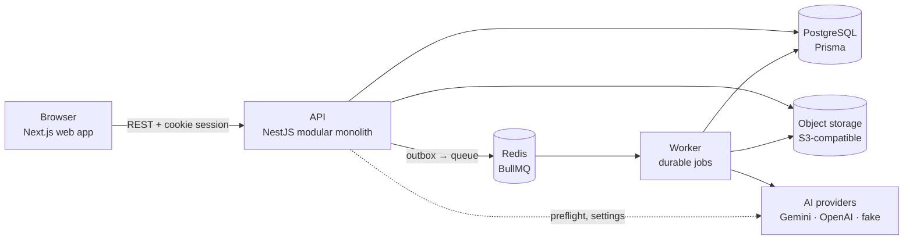
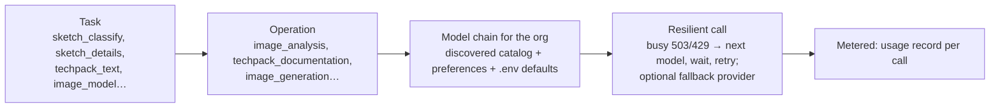

# 6. Platform services

The three components sit on a shared platform. This page explains each service in the order a
request meets them.

## Web app — `apps/web` (Next.js)

Screens, forms, the editor and the CAD canvas. It calls the API only (never an AI provider; no keys
in the browser). The pattern engine also runs here so the review preview and redrafts are instant;
the server re-drafts and validates whatever is saved. Feature folders: `studio/` (start + review),
`editor/` (shell, store, revisions, tech pack button), `patterns/` (forms, CAD), `techpacks/`.

## API — `apps/api` (NestJS)

One process, separate **modules** that do not read each other's tables:

| Module                           | Responsibility                                                                                         |
| -------------------------------- | ------------------------------------------------------------------------------------------------------ |
| `identity`                       | sign-up, sign-in, sessions (Better Auth), CSRF by Origin                                               |
| `organizations`, `authorization` | members, roles, permissions; every route declares a permission (deny by default)                       |
| `projects`                       | projects that hold designs                                                                             |
| `assets`                         | uploads to storage, previews, reference checks                                                         |
| `analysis`                       | Component 1 requests (`POST /projects/:id/analyses`, `GET /analyses/:id`, `POST /analyses/:id/design`) |
| `designs`                        | designs, working copies, commit / restore / compare revisions                                          |
| `operations`                     | applying operations to working copies, undo (revert)                                                   |
| `validation`                     | design-structure checks (findings never block)                                                         |
| `techpacks`                      | Component 3 requests (`POST /designs/:id/techpacks`, `GET /techpacks/:id`, `POST …/pdf`)               |
| `ai`                             | provider status, organization keys, model discovery and preferences, usage preflight                   |
| `artifacts`                      | reusable library items (from the older image-reconstruction flow)                                      |
| `audit`                          | append-only audit trail                                                                                |

Every state change writes its **audit record** and an **outbox event** in the same database
transaction, so nothing is lost if a process stops.

## Worker and durable jobs — `apps/worker`

Long work never runs inside a web request. The API creates a job record; the worker's outbox
dispatcher picks it up (BullMQ on Redis), runs the handler, retries with back-off on failure and
records the outcome. Jobs survive restarts and are idempotent.

| Job kind            | Handler                                                    | Used by     |
| ------------------- | ---------------------------------------------------------- | ----------- |
| `asset.process`     | check, scan, make previews of an upload                    | uploads     |
| `design.analysis`   | `designAnalysisHandler` → `readSketch` (sketch mode)       | Component 1 |
| `techpack.generate` | `techPackHandler` → AI text + images, `buildTechPack`, PDF | Component 3 |

Jobs report a **stage** text the browser polls ("Reading the construction details").

## Database — PostgreSQL via Prisma (`packages/db`)

Key tables for this flow: `design_analyses` (inputs, mode, audience, size, status, stage, result),
`designs`, `working_copies` (current state + version), `design_revisions` (immutable snapshot +
content hash), `design_operations`, `tech_packs` (document, status, PDF asset),
`ai_usage_records`, `assets`, `audit_events`, `outbox_events`, `jobs` / `job_attempts`. Every row carries its organization (tenant
isolation; cross-tenant access answers 404).

## File storage — S3-compatible (`packages/media`)

Originals and previews of uploads, AI-generated images, PDFs. Files are referenced by asset id;
deleting checks references first.

## AI provider layer — `packages/ai`

- **Tasks → operations**: each AI request names a _task_; tasks map to _operations_ with required
  capabilities (vision, multi-image, structured output, image generation). Both sketch passes are
  _image analysis_.
- **Adapters**: Gemini, OpenAI, and a **fake** provider (fixed answers for tests and demos).
  Defaults in `.env` (e.g. `gemini-2.5-flash` for text/vision, `gemini-2.5-flash-image` for images;
  `gpt-4.1-mini` / `gpt-image-1`).
- **Model discovery & preferences**: the organization's connected providers are queried for their
  models; admins choose preferred models per operation (Settings → AI). A run uses that chain.
- **Resilience**: overloaded or rate-limited models are skipped to the next in the chain, with
  waits and extra rounds (`AI_BUSY_RETRIES`, `AI_BUSY_WAIT_MS`) and an optional second provider.
  The tried attempts are kept and shown in the tech pack's _AI processing record_.
- **Structured output**: every answer is validated against a schema (`zod`) that is deliberately
  tolerant (unknown values become "not answered" instead of failing).

## Keys, usage and limits

- **Organization keys** (`packages/secrets`): an organization can store its own Gemini / OpenAI key;
  it is encrypted (AES-256-GCM, wrapped by a master key) and only decrypted in the worker/API; never
  sent to the browser or written to logs. Otherwise the platform key from `.env` is used.
- **Preflight** before any AI job: provider configured, a model exists for the needed operations,
  organization under its daily limit (`AI_DAILY_REQUEST_LIMIT`, default 300). A sketch reading counts
  as 2 calls.
- **Usage records**: one per AI call with outcome _succeeded / failed / outcome unknown_ (unknown is
  never treated as free).

## Access control

Every route declares a permission (`design.generate`, `design.edit`, `project.view`…); a global guard
denies anything undeclared, checks membership of the organization in the path and the user's roles.
Read-only users see the editor without editing tools.
