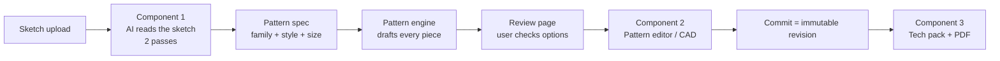

# How AI Designer works (today)

A plain-language guide to what happens inside the product, from the moment someone uploads a sketch
to the moment they download a tech pack. It describes the **current** behaviour (decisions up to
ADR-061, November 2026) so you can judge it, propose a better strategy, or ask for changes.

> These pages explain _how it works_. The formal rules and decisions live in `docs/plan/`
> (especially `05-decisions.md`) and the developer references in `docs/architecture/`.

## The one-paragraph version

The user uploads a **sketch**. An **AI model reads it** in two passes — first _who and what_
(male/female, adult/child, which garments), then a _checklist per garment_ (collar, pockets,
waistband, belt loops…). The AI never draws anything: its answers become a **pattern
specification**, and our own **pattern engine** drafts every pattern piece mathematically from a
standard size chart. The user reviews the options, opens the **pattern editor** (a small CAD
program) to change measurements, styles or the pieces themselves, **commits** a revision, and
generates a **tech pack**: a document built from the patterns (measurements, cutting layout, bill
of materials, sewing order) plus AI-generated pictures of the finished garment.

## Pages

| #   | Page                                                         | What it explains                                                                  |
| --- | ------------------------------------------------------------ | --------------------------------------------------------------------------------- |
| 1   | [The journey, start to end](01-journey.md)                   | Every screen and every request, in order, with which service handles it           |
| 2   | [Component 1 — reading the sketch](02-sketch-reading.md)     | The two AI passes, prompts, what is asked, how answers become a pattern spec      |
| 3   | [The pattern engine](03-pattern-engine.md)                   | How pieces are drafted: size charts, ease, blocks, details, sets, seam checks     |
| 4   | [Component 2 — the pattern editor](04-pattern-editor.md)     | Design state, operations, autosave, redraft vs hand edits, CAD tools, revisions   |
| 5   | [Component 3 — the tech pack](05-tech-pack.md)               | The generation job, every section, cutting layout, sewing order, images, PDF      |
| 6   | [Platform services](06-platform-services.md)                 | API, worker, jobs, database, file storage, AI provider layer, keys, usage, access |
| 7   | [Key data structures](07-data-model.md)                      | Pattern spec, pattern piece, components, revisions — with examples                |
| 8   | [Limits and where to change things](08-limits-and-levers.md) | What is approximate today and which "lever" to pull for each kind of improvement  |

## Vocabulary

| Word               | Meaning here                                                                                                   |
| ------------------ | -------------------------------------------------------------------------------------------------------------- |
| **Sketch reading** | Component 1: the AI looks at the sketch and answers questions. It produces _answers_, never geometry.          |
| **Pattern spec**   | The editable recipe of the garment: family, who it is for, size, body measurements, style options.             |
| **Pattern engine** | Our own code (`packages/pattern-model`) that turns a spec into exact pattern pieces. Deterministic, no AI.     |
| **Piece**          | One flat pattern piece (Front, Sleeve, Waistband…) with a seam line, named seam edges, marks and allowances.   |
| **Family**         | Garment kind the engine drafts: dress, top, skirt, trousers, jumpsuit, jacket, dungarees.                      |
| **Set (co-ord)**   | Several garments drawn together (shirt + shorts). One design, same body measurements, a style per garment.     |
| **Working copy**   | The draft of a design being edited. Every change is saved here automatically.                                  |
| **Revision**       | An immutable snapshot of the design (R001, R002…), created by _Commit_. Tech packs always document a revision. |
| **Operation**      | One recorded change to the working copy (redraft, move a point, change an allowance…). Undo reverts one.       |
| **Tech pack**      | The production document generated from a revision (HTML in the app, PDF to download).                          |
| **Fake provider**  | A built-in pretend AI used in tests and demos; returns fixed answers, costs nothing.                           |
