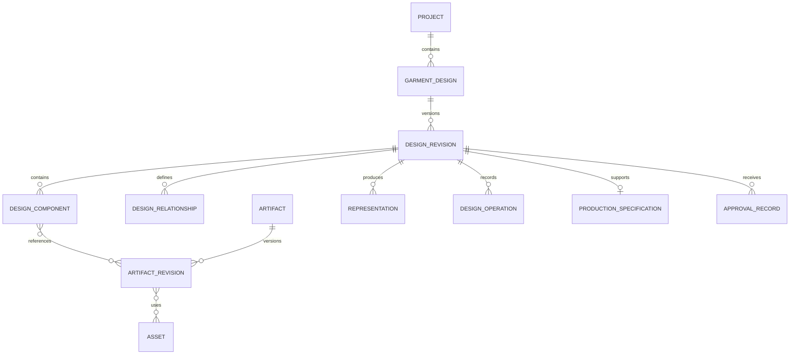

# Garment Design Model and Artifact Schema Specification

**Document ID:** SPEC-GDP-003  
**Version:** 0.1  
**Status:** Initial Draft  
**Parent Document:** ARCH-GDP-002 — Subsystem Requirements Breakdown and Dependency Specification  
**Product:** AI-Powered Garment Design and Development Platform

---

## 1. Purpose

This specification defines the canonical data model for garment designs and reusable design artifacts.

It establishes how the platform represents garment structure, component properties, design relationships, reusable assets, design revisions, visual representations, manufacturing constraints, and artifact provenance.

The model must support users who create garments from sketches, fabric images, reference photographs, reusable components, and AI-assisted modifications without requiring them to understand technical design schemas or write prompts.

The platform shall maintain a distinction between:

1. **Design definition:** The structured description of what the garment is intended to be.
2. **Visual representation:** Images, vector drawings, 3D geometry, and other renderable outputs.
3. **Production specification:** Manufacturing-relevant facts, measurements, construction instructions, and validated technical details.

These are related but are not interchangeable.

## 2. Scope

This specification covers:

- Canonical garment design entities and component hierarchy.
- Component types, properties, relationships, and constraints.
- Artifact Registry data structures and versioning.
- Fabric, trim, embroidery, lace, artwork, and reusable construction details.
- Input references, generated assets, and derived visual representations.
- Confirmed, inferred, missing, and review-required information.
- Design revisions, operation history, and artifact provenance.
- 2D and 3D representation references.
- Validation rules and schema evolution.
- Interfaces to AI execution, rendering, and tech pack generation.

This document does not fully specify user-interface behavior, AI provider selection, billing calculations, pattern drafting, or a complete garment simulation engine. Those concerns are addressed by their respective subsystem specifications.

## 3. Normative terminology

The words **MUST**, **MUST NOT**, **SHOULD**, **SHOULD NOT**, and **MAY** express requirement priority.

- **Garment Design:** A versioned structured representation of a garment concept.
- **Component:** A logical part of a garment, such as a sleeve, collar, cuff, pocket, or placket.
- **Artifact:** A reusable design resource, such as a fabric, lace border, embroidery motif, collar design, or sleeve template.
- **Artifact Revision:** An immutable, identifiable version of an artifact.
- **Design Revision:** A versioned snapshot of a garment's structured design state.
- **Asset:** A stored file or data object, such as a PNG image, SVG drawing, texture map, or 3D mesh.
- **Relationship:** A structured connection between design entities.
- **Evidence:** A source that supports a property value, such as an uploaded image, user confirmation, measurement record, or approved specification.
- **Canonical State:** The authoritative structured state used to derive views, operations, and downstream outputs.

## 4. Design principles

### 4.1 Structured state is authoritative

The platform MUST NOT treat a flattened generated image as the sole source of truth when structured design information is available.

A generated image may serve as a preview, but it does not automatically establish editable geometry, garment construction, measurements, fabric composition, or manufacturing feasibility.

### 4.2 Stable identity and immutable revisions

Entities MUST have stable identifiers. Revisions MUST be independently identifiable.

Changing an artifact's current version MUST NOT silently alter designs that reference an earlier artifact revision.

### 4.3 Explicit uncertainty

Every manufacturing-critical or design-critical property MUST be capable of expressing whether it is confirmed, inferred, proposed, missing, or awaiting review.

A plausible AI-generated value MUST NOT be treated as a confirmed production fact without the required evidence or approval.

### 4.4 Modularity

The schema MUST support adding component types, artifact categories, properties, relationship types, and representation formats without requiring a redesign of the entire data model.

### 4.5 Traceability

A design property or visual output MUST be traceable to its originating user input, artifact, operation, or generation job when such provenance is available.

### 4.6 Separate identity from representation

A sleeve component, for example, retains its logical identity whether it is represented by a technical flat, a raster preview, a 3D mesh, or a production pattern.

## 5. Conceptual data model

The platform SHALL maintain the following principal entities:

| Entity | Purpose |
|---|---|
| Project | Organizes a garment-development effort and its participants |
| Garment Design | Defines a garment concept within a project |
| Design Revision | Captures an immutable structured design snapshot |
| Design Component | Represents a logical garment part |
| Design Relationship | Defines attachment, placement, layering, or dependency |
| Artifact | Defines a reusable design resource |
| Artifact Revision | Captures a specific immutable artifact definition |
| Asset | References a stored file or structured data resource |
| Property Value | Stores a typed value and its confidence/provenance |
| Constraint | Defines compatibility, dimensional, or design rules |
| Design Operation | Records a requested or completed modification |
| Representation | References a derived 2D, 3D, or raster output |
| Production Specification | Stores manufacturing-facing information |
| Approval Record | Records an approval against a specific revision |

### 5.1 Relationship overview



This diagram is conceptual. A production implementation may use relational tables, document storage, graph structures, or a hybrid persistence model.

---

## 6. Common schema conventions

### 6.1 Identifiers

All persisted entities MUST have globally unique or appropriately scoped stable identifiers.

Recommended identifier formats:

| Entity | Example |
|---|---|
| Project | `PRJ-000123` |
| Garment design | `DSN-000456` |
| Design revision | `DSN-000456-R003` |
| Component | `CMP-000789` |
| Artifact | `SLV-0007` |
| Artifact revision | `SLV-0007-R004` |
| Asset | `AST-000321` |
| Operation | `OPR-000654` |
| Generation job | `JOB-000987` |

These formats are illustrative. Internal database primary keys MAY use UUIDs or another scalable identifier scheme. Human-readable identifiers SHOULD remain stable.

### 6.2 Timestamps and ownership

Persisted entities SHOULD include applicable metadata:

- `created_at`
- `created_by`
- `updated_at`
- `updated_by`
- `organization_id`
- `schema_version`

Immutable revision records MUST preserve creation metadata and MUST NOT be overwritten by ordinary updates.

### 6.3 Units

Measurements MUST include explicit units.

The platform SHOULD use a canonical internal unit system and convert values for display. For apparel dimensions, millimeters or centimeters are suitable canonical choices, provided conversions are deterministic.

Unitless numbers MUST NOT be used for physical measurements without an explicit property definition establishing the unit.

### 6.4 Enumerations and extension values

Core status values and relationship types SHOULD be enumerated and validated.

Extension properties MAY use registered custom identifiers. Arbitrary untyped strings MUST NOT replace required core properties.

---

## 7. Canonical Garment Design schema

### 7.1 Root object

A garment design represents a named design concept. It does not itself imply production readiness.

Illustrative JSON:

```json
{
  "schema_version": "1.0.0",
  "design_id": "DSN-000456",
  "project_id": "PRJ-000123",
  "name": "Embroidered Occasion Shirt",
  "garment_type": "shirt",
  "status": "in_development",
  "current_revision_id": "DSN-000456-R003",
  "approved_revision_id": null,
  "created_at": "2026-10-21T12:00:00Z",
  "created_by": "USR-001",
  "tags": ["occasionwear", "embroidered"],
  "metadata": {
    "target_market": null,
    "season": null,
    "collection": null
  }
}
```

#### Requirements

- `DSN-001`: The system MUST assign a stable identifier to each garment design.
- `DSN-002`: A design MUST reference its parent project.
- `DSN-003`: A design MUST identify its garment category when known.
- `DSN-004`: The current revision MUST be explicitly identifiable.
- `DSN-005`: An approved revision MUST be referenced separately from the current revision.
- `DSN-006`: The system MUST support an unapproved design with no approved revision.
- `DSN-007`: Project metadata MUST NOT be treated as manufacturing evidence unless explicitly designated as such.

### 7.2 Design revision schema

A design revision is an immutable snapshot of structured design state.

```json
{
  "revision_id": "DSN-000456-R003",
  "design_id": "DSN-000456",
  "revision_number": 3,
  "parent_revision_id": "DSN-000456-R002",
  "created_at": "2026-10-21T12:30:00Z",
  "created_by": "USR-001",
  "change_summary": "Updated sleeve trim and collar shape",
  "component_ids": [
    "CMP-BODY-001",
    "CMP-SLEEVE-L-001",
    "CMP-SLEEVE-R-001",
    "CMP-COLLAR-001"
  ],
  "relationship_ids": [
    "REL-001",
    "REL-002",
    "REL-003"
  ],
  "state_hash": "sha256:illustrative-placeholder",
  "validation_status": "needs_review",
  "approval_status": "not_approved"
}
```

The hash above is illustrative, not a valid content hash.

Revision requirements:

- `DSN-008`: Each committed design revision MUST be immutable.
- `DSN-009`: Each revision MUST identify its parent revision where applicable.
- `DSN-010`: The platform MUST preserve enough structured data to reconstruct the revision.
- `DSN-011`: Revision comparison MUST identify changed components, properties, relationships, and artifact references.
- `DSN-012`: Undo and redo MAY use operation history, revision restoration, or both; they MUST NOT corrupt committed revision history.
- `DSN-013`: An approval MUST refer to an exact revision identifier.
- `DSN-014`: Changes after approval MUST NOT modify the previously approved snapshot.

---

## 8. Design Component schema

### 8.1 Component definition

A component is a logical garment part. It may have geometry, visual assets, properties, and relationships to other components.

Illustrative JSON:

```json
{
  "component_id": "CMP-SLEEVE-L-001",
  "component_type": "sleeve",
  "display_name": "Left Sleeve",
  "parent_component_id": "CMP-BODY-001",
  "side": "left",
  "properties": {
    "silhouette": {
      "value": "straight",
      "status": "confirmed",
      "unit": null
    },
    "length": {
      "value": 580,
      "status": "proposed",
      "unit": "mm"
    },
    "cuff_type": {
      "value": "plain",
      "status": "confirmed",
      "unit": null
    }
  },
  "artifact_bindings": [],
  "geometry_refs": [],
  "asset_refs": [],
  "tags": ["sleeve", "left-side"]
}
```

This is an illustrative data shape. The implementation SHOULD normalize frequently queried properties and MAY use typed property records rather than embedding all values in a JSON document.

### 8.2 Core component types

The initial component catalog SHOULD include:

- Garment body
- Front body panel
- Back body panel
- Sleeve
- Cuff
- Collar
- Neckline
- Placket
- Pocket
- Waistband
- Hem
- Yoke
- Hood
- Lining
- Facing
- Gusset
- Seam or seam group
- Decorative region
- Artwork placement region
- Custom component

The catalog MUST support extensible types for different garment categories.

### 8.3 Component hierarchy

- `CMP-015`: Components MUST have stable identities within the design model.
- `CMP-016`: A component MAY have a parent component where the hierarchy supports it.
- `CMP-017`: The model MUST support repeated components, including left and right sleeves and multiple pockets.
- `CMP-018`: Components MUST be addressable independently for selection and editing.
- `CMP-019`: Deleting a component MUST evaluate dependent relationships, bindings, and constraints before committing.
- `CMP-020`: The system MUST distinguish deleting a component instance from deleting its reusable artifact.
- `CMP-021`: A component MUST NOT be assumed to have manufacturing-valid geometry solely because it exists in the hierarchy.

### 8.4 Component identity versus artifact identity

A component instance represents a part of a particular garment. An artifact is a reusable definition.

For example:

- `CMP-SLEEVE-L-001`: the left sleeve instance in a particular design.
- `SLV-0007-R004`: a reusable sleeve design revision used as a template.

Two sleeve instances MAY reference the same artifact revision while maintaining separate properties and placements.

---

## 9. Property value and evidence schema

### 9.1 Property value structure

Properties MUST support value, unit, status, provenance, and review information.

Illustrative JSON:

```json
{
  "property_id": "PROP-000045",
  "property_key": "fabric_composition",
  "value": null,
  "data_type": "composition",
  "unit": null,
  "status": "missing",
  "source_type": "none",
  "source_refs": [],
  "confidence": null,
  "review_required": true,
  "last_confirmed_by": null,
  "last_confirmed_at": null
}
```

### 9.2 Required status vocabulary

The initial status vocabulary SHALL include:

| Status | Meaning |
|---|---|
| `confirmed` | Explicitly established by an authorized user or accepted authoritative source |
| `inferred` | Derived from available evidence but not explicitly confirmed |
| `proposed` | Suggested by AI, a template, or a design workflow |
| `missing` | No usable value is available |
| `needs_review` | A value exists but requires review before its intended use |
| `not_applicable` | The property does not apply to this design or component |

Status changes MUST be traceable where the property affects approval or production.

A numerical AI confidence score MUST NOT by itself convert an inferred value into a confirmed value.

### 9.3 Provenance

A property MAY reference one or more evidence sources:

- User input or explicit confirmation
- Uploaded reference image
- Uploaded specification document
- Reusable artifact revision
- AI interpretation or generation job
- Imported product data
- Approved measurement record
- Authorized external system

Each source reference SHOULD include the source entity ID, relevant revision or file reference, and provenance type.

### 9.4 Type safety

- `PROP-001`: Each property MUST have a defined data type.
- `PROP-002`: Values MUST validate against the declared type.
- `PROP-003`: Physical dimensions MUST include units.
- `PROP-004`: Enumerated properties MUST validate against their permitted values or an explicitly registered extension.
- `PROP-005`: Unknown values MUST be represented explicitly rather than silently replaced with defaults.
- `PROP-006`: Manufacturing-critical fields MUST retain evidence and review status.
- `PROP-007`: A generated visual appearance MUST NOT automatically establish an exact material composition, GSM, dimensional measurement, tolerance, or construction method.

### 9.5 Suggested property namespaces

Properties SHOULD be grouped by domain:

- `appearance.*` — color, visual finish, pattern, silhouette
- `construction.*` — seams, fastening, joining, finishing
- `dimension.*` — length, width, circumference, thickness
- `material.*` — fiber composition, fabric construction, GSM, lining
- `placement.*` — coordinates, orientation, scale, attachment region
- `production.*` — POM references, tolerances, grading, workmanship
- `simulation.*` — physical parameters used by a 3D engine

These namespaces do not make a value authoritative; provenance and status remain necessary.

---

## 10. Design Relationship schema

### 10.1 Purpose

Relationships represent semantic connections between components and artifacts. They MUST NOT exist only as visual overlap in a flattened image when the relationship is needed for editing, validation, or production.

Examples include:

- Sleeve attached to body armhole
- Cuff attached to sleeve end
- Lace applied along sleeve hem
- Embroidery positioned on front panel
- Pocket placed on garment front
- Lining associated with a shell component
- Button aligned with a placket

### 10.2 Relationship structure

```json
{
  "relationship_id": "REL-001",
  "relationship_type": "decorative_trim_applied_to",
  "source_entity": {
    "entity_type": "artifact_revision",
    "entity_id": "LAC-0012-R002"
  },
  "target_entity": {
    "entity_type": "design_component",
    "entity_id": "CMP-SLEEVE-L-001"
  },
  "placement": {
    "region": "hem",
    "anchor": "edge",
    "offset_mm": 0,
    "orientation": "follow_boundary"
  },
  "constraints": [
    "trim_compatible_with_target_edge"
  ],
  "status": "confirmed",
  "provenance_refs": ["OPR-000654"]
}
```

The example assumes the platform has sufficient boundary geometry to define the hem placement. Where it does not, the placement MUST be marked approximate or require review.

### 10.3 Initial relationship types

The initial registry SHOULD support:

- `attached_to`
- `contains`
- `overlays`
- `applied_to`
- `decorative_trim_applied_to`
- `embroidery_placed_on`
- `lining_for`
- `aligned_with`
- `derived_from`
- `constrained_by`
- `connected_to`
- `replaces`
- `references`

Each relationship type MUST define its allowed source and target entity types, cardinality where relevant, and validation rules.

### 10.4 Relationship requirements

- `REL-001`: Relationships MUST have stable identifiers.
- `REL-002`: Relationship endpoints MUST reference valid entities and revisions.
- `REL-003`: The model MUST support relationships between design components and artifact revisions.
- `REL-004`: Placement information MUST be represented structurally when the relevant editing operation depends on it.
- `REL-005`: Relationships MUST be validated against component compatibility and placement constraints.
- `REL-006`: Removing a relationship MUST NOT automatically delete either endpoint unless a separate authorized operation requests that deletion.
- `REL-007`: The system MUST preserve provenance for AI-created or user-created relationships.
- `REL-008`: Unsupported or approximate relationships MUST be visibly distinguishable from validated relationships.

---

## 11. Artifact Registry schema

### 11.1 Artifact definition

An artifact is a reusable resource managed independently of any one garment design.

Artifact categories SHOULD include:

- Garment components and templates
- Sleeves, collars, cuffs, pockets, and plackets
- Fabrics and surface textures
- Lace, borders, trims, and piping
- Embroidery and decorative motifs
- Buttons, zippers, fasteners, and accessories
- Artwork, prints, logos, and placement templates
- Technical drawing symbols and reusable construction details

### 11.2 Artifact root schema

```json
{
  "artifact_id": "LAC-0012",
  "artifact_type": "lace_trim",
  "name": "Scalloped Sleeve Border",
  "owner_scope": "organization",
  "organization_id": "ORG-001",
  "created_by": "USR-001",
  "current_revision_id": "LAC-0012-R002",
  "lifecycle_status": "active",
  "tags": ["lace", "scalloped", "sleeve-hem"],
  "created_at": "2026-10-01T09:00:00Z"
}
```

### 11.3 Artifact revision schema

```json
{
  "artifact_revision_id": "LAC-0012-R002",
  "artifact_id": "LAC-0012",
  "revision_number": 2,
  "parent_revision_id": "LAC-0012-R001",
  "definition": {
    "repeatable": true,
    "preferred_placement_regions": ["sleeve_hem", "garment_hem"],
    "compatible_target_types": ["sleeve", "hem"],
    "geometry_ref": "AST-LACE-VECTOR-002",
    "preview_asset_ref": "AST-LACE-PREVIEW-002"
  },
  "properties": {
    "visual_style": {
      "value": "scalloped",
      "status": "confirmed"
    },
    "physical_width_mm": {
      "value": null,
      "status": "missing"
    },
    "material_composition": {
      "value": null,
      "status": "missing"
    }
  },
  "validation_status": "design_asset_validated",
  "created_at": "2026-10-10T11:00:00Z",
  "created_by": "USR-001"
}
```

The artifact can be valid as a visual design asset while still lacking physical specifications needed for manufacturing.

### 11.4 Artifact requirements

- `ART-001`: Every reusable artifact MUST have a stable identity.
- `ART-002`: Artifact revisions MUST be immutable.
- `ART-003`: Each revision MUST reference its parent revision where applicable.
- `ART-004`: Designs MUST pin artifact references to explicit revisions.
- `ART-005`: Updating the current artifact MUST NOT silently modify existing design revisions.
- `ART-006`: The system MUST support organization-owned and user-owned artifacts, subject to access policies.
- `ART-007`: Built-in artifacts MUST have an identifiable platform owner or publisher.
- `ART-008`: Artifact metadata MUST distinguish visual properties from physical and manufacturing properties.
- `ART-009`: Artifact reuse MUST preserve provenance.
- `ART-010`: The system MUST support deactivating an artifact without destroying historical revisions.
- `ART-011`: Artifact deletion MUST respect references, retention policy, and authorization.
- `ART-012`: Artifact compatibility rules MUST be machine-readable where automated validation is expected.
- `ART-013`: Artifact revisions MUST identify the assets and structured definitions needed to reconstruct their supported representations.
- `ART-014`: An artifact MUST NOT be labeled production-validated unless the applicable validation criteria have been met.

### 11.5 Artifact ownership and visibility

The system SHOULD support these visibility scopes:

- Platform library
- Organization library
- User-private library
- Project-scoped library, if required by the product

Visibility and ownership MUST be separate concepts. A user may have permission to use an artifact without permission to edit, republish, or delete it.

### 11.6 Artifact update policy

When an artifact is revised:

1. The system creates a new immutable revision.
2. Existing design references remain pinned to the prior revision.
3. Users MAY explicitly replace the reference in a new design revision.
4. The system validates compatibility and reports any affected properties or placements.
5. No silent migration of approved designs is permitted.

---

## 12. Asset schema and representation management

### 12.1 Asset definition

An asset is a stored file or data resource. Assets are distinct from the semantic entities that use them.

Illustrative asset record:

```json
{
  "asset_id": "AST-000321",
  "asset_type": "vector_geometry",
  "storage_ref": "internal-object-reference",
  "media_type": "image/svg+xml",
  "checksum": "sha256:illustrative-placeholder",
  "dimensions": {
    "width": 1200,
    "height": 800,
    "unit": "px"
  },
  "created_at": "2026-10-21T12:15:00Z",
  "created_by": "USR-001",
  "provenance": {
    "source_type": "user_upload",
    "source_entity_id": null
  }
}
```

The storage reference MUST be resolved through authorized asset services. Publicly accessible URLs MUST NOT be required for private assets.

### 12.2 Supported asset categories

The platform SHOULD support:

- Original uploaded photographs
- Reference sketches
- Raster previews and textures
- SVG technical flats and editable vectors
- Masks and region annotations
- Texture maps and material maps
- Meshes and 3D scene files, including glTF/GLB where applicable
- Pattern or geometry files supported by an integrated pattern engine
- Measurement documents and supporting production files
- Exported tech pack documents

Each asset MUST declare its format and applicable metadata.

### 12.3 Representation schema

A representation is a derived view of a design revision.

```json
{
  "representation_id": "REP-000120",
  "design_revision_id": "DSN-000456-R003",
  "representation_type": "technical_flat",
  "format": "svg",
  "asset_ref": "AST-000321",
  "source_revision_id": "DSN-000456-R003",
  "generation_method": "vector_renderer",
  "created_at": "2026-10-21T12:35:00Z",
  "validation_status": "rendered",
  "is_authoritative_design_state": false
}
```

The representation is derived from the design revision; it does not replace the revision.

### 12.4 Representation requirements

- `AST-001`: Assets MUST have stable identifiers and access-controlled storage references.
- `AST-002`: The system MUST record format, provenance, and applicable metadata.
- `AST-003`: Checksums SHOULD be used to detect corruption and support deduplication.
- `AST-004`: A derived representation MUST identify its source design revision.
- `AST-005`: The system MUST distinguish source assets from generated or transformed assets.
- `AST-006`: Asset replacement MUST NOT silently rewrite immutable design revisions.
- `AST-007`: The system MUST support multiple representations for the same design revision.
- `AST-008`: Unsupported formats MUST be rejected or quarantined according to file-processing policy.
- `AST-009`: Asset access MUST enforce tenant and project permissions.
- `AST-010`: The platform MUST NOT claim that a 3D-looking raster image constitutes an editable 3D garment model.

---

## 13. 2D and 3D representation contract

### 13.1 Shared design state

The 2D editor and any 3D editor MUST reference the same canonical design revision and component identities.

Supported changes MUST be synchronized through structured operations rather than maintaining unrelated independent design states.

### 13.2 Representation fidelity levels

The platform SHOULD identify representation fidelity explicitly.

| Level | Meaning | Permitted claim |
|---|---|---|
| F0 — Reference image | Uploaded or generated image | Visual reference only |
| F1 — Layered visual | Image with masks or editable visual regions | Partial region editing |
| F2 — Structured 2D | Components and editable vector or parametric shapes | Structured 2D editing |
| F3 — Editable 3D | Identifiable geometry and material assignments | Geometry-level 3D editing |
| F4 — Validated production geometry | Geometry validated for a defined production workflow | Only the specific validations actually passed |

A representation MAY be valid at one fidelity level without meeting the next.

### 13.3 Synchronization requirements

- `VIS-001`: Each view MUST identify the design revision it displays.
- `VIS-002`: A view MUST NOT silently apply changes to a different revision than the one being edited.
- `VIS-003`: Supported component properties SHOULD synchronize across views through the canonical model.
- `VIS-004`: Unsupported cross-view changes MUST be identified rather than silently discarded.
- `VIS-005`: Rendered outputs MUST be invalidated or regenerated when their declared dependencies change.
- `VIS-006`: The platform MUST distinguish an approximate visual preview from validated geometry.
- `VIS-007`: A flattened reference image MUST NOT be represented as structured geometry unless a conversion process actually creates and validates that geometry.

---

## 14. Geometry, placement, and coordinate systems

### 14.1 Coordinate spaces

The system SHOULD explicitly identify the coordinate space of every geometry and placement value.

Possible spaces include:

- Image pixel coordinates
- Normalized image coordinates
- 2D garment design coordinates
- Component-local coordinates
- 3D world coordinates
- Pattern-piece coordinates

Conversions between coordinate spaces MUST be explicit and reproducible.

### 14.2 Placement definition

A placement definition MAY contain:

- Target component or region
- Anchor point or boundary reference
- Translation
- Rotation
- Scale
- Orientation
- Offset and units
- Coordinate space
- Geometry revision reference
- Placement confidence or validation status

The schema MUST support approximate placement when only a photograph or flattened image is available.

### 14.3 Geometry requirements

- `GEO-001`: Geometry MUST declare its coordinate space.
- `GEO-002`: Physical dimensions MUST NOT be inferred from image pixels without a declared calibration or scale source.
- `GEO-003`: Geometry references MUST identify the geometry revision or immutable asset version.
- `GEO-004`: Placement rules MUST identify the target coordinate space.
- `GEO-005`: Transformations MUST be reproducible from stored values.
- `GEO-006`: Unsupported geometric operations MUST be reported to the caller.
- `GEO-007`: The system MUST distinguish a visual placement approximation from a production-valid attachment.

---

## 15. Constraints and compatibility rules

### 15.1 Constraint schema

```json
{
  "constraint_id": "CST-000012",
  "constraint_type": "artifact_target_compatibility",
  "scope": {
    "artifact_revision_id": "LAC-0012-R002",
    "target_component_type": "sleeve"
  },
  "rule": {
    "allowed_regions": ["hem"],
    "placement_mode": "follow_boundary"
  },
  "severity": "error",
  "validation_status": "valid"
}
```

### 15.2 Constraint categories

The initial system SHOULD support:

- Type compatibility
- Allowed placement regions
- Component dependency
- Geometric bounds
- Required property presence
- Mutually exclusive options
- Material compatibility
- Rendering capability
- Production specification completeness
- Organization or user permissions

### 15.3 Validation outcomes

Validation SHOULD return structured findings:

- `valid`
- `warning`
- `error`
- `not_evaluated`
- `requires_manual_review`

Every finding SHOULD identify the affected entity, rule, explanation, and recommended resolution where available.

A warning MUST NOT be silently converted to a pass. A manual-review requirement MUST remain visible until resolved or explicitly accepted under a permitted policy.

### 15.4 Validation requirements

- `CST-001`: Constraints MUST identify their scope and applicable entity types.
- `CST-002`: Validation findings MUST identify the affected entity or relationship.
- `CST-003`: The system MUST distinguish blocking errors from warnings.
- `CST-004`: Validation MUST be repeatable against a specific revision and constraint-set version.
- `CST-005`: A change to a dependent component or artifact MUST trigger revalidation of affected constraints.
- `CST-006`: Passing design-structure validation MUST NOT automatically imply manufacturing feasibility.
- `CST-007`: The system MUST retain validation findings required for audit or approval.

---

## 16. Design operations and provenance

### 16.1 Operation schema

Design operations record meaningful modifications to canonical state.

```json
{
  "operation_id": "OPR-000654",
  "operation_type": "attach_artifact",
  "design_id": "DSN-000456",
  "base_revision_id": "DSN-000456-R002",
  "target_component_id": "CMP-SLEEVE-L-001",
  "artifact_revision_id": "LAC-0012-R002",
  "parameters": {
    "target_region": "hem",
    "placement_mode": "follow_boundary"
  },
  "requested_by": "USR-001",
  "execution_method": "structured_operation",
  "status": "completed",
  "result_revision_id": "DSN-000456-R003",
  "created_at": "2026-10-21T12:30:00Z"
}
```

The schema is illustrative; actual operation parameters MUST validate against the operation type.

### 16.2 Operation requirements

- `OPR-001`: Each committed operation MUST identify its target and base revision.
- `OPR-002`: Operations MUST be validated before modifying canonical state.
- `OPR-003`: The system MUST distinguish requested, running, completed, failed, and cancelled operations where asynchronous processing is used.
- `OPR-004`: The system MUST preserve the relationship between an operation and the revision it produces.
- `OPR-005`: Operations that invoke AI MUST link to the relevant generation job and execution metadata.
- `OPR-006`: The system SHOULD record which constraints and preservation instructions applied.
- `OPR-007`: Failed operations MUST NOT silently produce a committed partial revision.
- `OPR-008`: Retrying an operation MUST use idempotency controls or otherwise prevent unintended duplicate changes.

### 16.3 Preservation instructions

An operation MAY include structured preservation requirements, such as:

- Preserve collar geometry.
- Keep sleeve length unchanged.
- Change only the selected cuff region.
- Preserve the existing embroidery placement.
- Do not alter the garment silhouette.

The platform MUST distinguish a requested preservation constraint from a guarantee. AI image generation may not be able to preserve every pixel or structural detail exactly.

Where exact preservation is required, the system SHOULD use deterministic component-level edits or structured geometry operations when supported.

---

## 17. Production Specification data model

### 17.1 Separation from visual design

Production specifications are manufacturing-facing records associated with a particular design revision.

A design may be visually complete while its production specification remains incomplete.

The platform MUST support a production specification that references the exact design revision and artifact revisions from which it was prepared.

### 17.2 Production specification structure

The production specification SHOULD include:

- Style and revision identification
- Technical flats and approved visual references
- Bill of materials (BOM)
- Fabric and trim records
- Points of measurement (POM)
- Base-size measurements
- Tolerances and grading rules
- Construction and finishing instructions
- Artwork and embroidery placements
- Colorways
- Quality requirements
- Production notes
- Approval and review records
- Outstanding questions and missing values

### 17.3 Measurement record

Illustrative structure:

```json
{
  "measurement_id": "POM-000042",
  "name": "Sleeve Length",
  "measurement_method": "from_shoulder_point_to_cuff_edge",
  "base_size": "M",
  "value": null,
  "unit": "cm",
  "tolerance_plus": null,
  "tolerance_minus": null,
  "grading_rule_ref": null,
  "status": "missing",
  "evidence_refs": [],
  "review_required": true
}
```

The system MUST NOT fill missing measurements with values inferred solely from an attractive rendering.

### 17.4 Production requirements

- `PROD-001`: Each production specification MUST reference an exact design revision.
- `PROD-002`: Each BOM line MUST identify its material or trim record and the status of required attributes.
- `PROD-003`: Measurement records MUST include units and measurement definitions.
- `PROD-004`: Tolerances and grading rules MUST be explicit when required.
- `PROD-005`: The system MUST distinguish proposed production values from confirmed values.
- `PROD-006`: Missing required values MUST remain visible in completeness reports.
- `PROD-007`: A tech pack MUST preserve the provenance of values derived from uploaded or approved source documents.
- `PROD-008`: A design revision change MUST NOT silently rewrite an already issued tech pack.
- `PROD-009`: Issuing a revised tech pack MUST create a new identifiable version.
- `PROD-010`: Production readiness MUST be based on defined validation and approval rules, not visual quality alone.

---

## 18. Approval and readiness states

### 18.1 Separate state dimensions

The platform MUST NOT collapse design approval, data validation, and production readiness into one status.

The following dimensions SHOULD be maintained independently:

| Dimension | Example values |
|---|---|
| Design lifecycle | `in_development`, `in_review`, `approved`, `archived` |
| Structural validation | `not_evaluated`, `valid`, `warnings`, `errors` |
| Production completeness | `incomplete`, `ready_for_review`, `complete` |
| Production approval | `not_submitted`, `pending`, `approved`, `rejected` |
| Export status | `not_generated`, `generated`, `failed`, `superseded` |

The exact vocabulary MAY be refined during workflow specification.

### 18.2 Approval record

An approval record SHOULD contain:

- Approval identifier
- Entity and revision approved
- Approval type
- Approver identity
- Timestamp
- Outcome
- Comments or review findings
- Applicable policy or checklist version

### 18.3 Approval requirements

- `APR-001`: Every approval MUST reference a specific revision.
- `APR-002`: The system MUST distinguish design approval from production approval.
- `APR-003`: Approval MUST NOT silently carry over to a materially changed revision.
- `APR-004`: Approval permissions MUST be enforced by the identity and access subsystem.
- `APR-005`: The system MUST preserve approval history for issued or otherwise controlled deliverables.

---

## 19. Versioning and schema evolution

### 19.1 Versioning layers

The platform MUST distinguish:

1. **Schema version:** The format of the data structure.
2. **Design revision:** A change to the garment design.
3. **Artifact revision:** A change to a reusable artifact.
4. **Asset version:** A specific stored file or immutable content instance.
5. **Constraint-set version:** The rules used for validation.
6. **Export version:** A generated deliverable, such as a tech pack.

These versions MUST NOT be conflated.

### 19.2 Schema compatibility

The schema SHOULD follow semantic versioning principles:

- Patch: backward-compatible corrections or clarifications.
- Minor: backward-compatible additions.
- Major: breaking structural or semantic changes.

### 19.3 Migration requirements

- `VER-001`: Persisted entities MUST identify the schema version used to serialize them.
- `VER-002`: Schema migrations MUST be deterministic and auditable.
- `VER-003`: A migration MUST NOT silently convert unknown manufacturing values into confirmed values.
- `VER-004`: The platform MUST preserve historical revisions in a readable or explicitly archived form.
- `VER-005`: Unknown extension properties SHOULD be preserved when a compatible reader can safely retain them.
- `VER-006`: Breaking schema changes MUST include migration and rollback plans.

---

## 20. Canonical serialization and API contracts

### 20.1 Serialization

The platform SHOULD use a documented JSON-based canonical representation for API exchange, with schema validation at service boundaries.

Storage optimization MAY use relational tables, JSON columns, object storage, or graph relationships, provided the logical contract remains consistent.

### 20.2 API operations

The model API SHOULD support operations equivalent to:

- Create garment design
- Retrieve design metadata
- Retrieve a specific design revision
- Create a new draft revision
- Add, update, or remove a component
- Add, update, or remove a relationship
- Bind or replace an artifact revision
- Validate a design revision
- Compare revisions
- Approve a revision
- Create or revise a production specification
- Retrieve asset and representation metadata

Exact routes, authentication mechanisms, pagination, concurrency control, and error schemas SHALL be defined in the API specification.

### 20.3 Concurrency

- `API-001`: Mutation requests MUST identify the revision or concurrency token against which they were prepared.
- `API-002`: Conflicting updates MUST be rejected or reconciled explicitly; they MUST NOT silently overwrite newer committed changes.
- `API-003`: Mutation APIs SHOULD support idempotency keys where retries may duplicate operations.
- `API-004`: Read APIs MUST enforce entity-level access control.
- `API-005`: API responses MUST distinguish validation errors, authorization failures, missing entities, and version conflicts.

---

## 21. Security, tenancy, and data integrity

- `SEC-001`: Organization-owned artifacts MUST enforce organization-level authorization.
- `SEC-002`: Private asset storage references MUST NOT be exposed as unrestricted public URLs.
- `SEC-003`: Artifact use, edit, publish, and delete permissions MUST be independently enforceable.
- `SEC-004`: Uploaded files MUST pass applicable file validation and security scanning before processing.
- `SEC-005`: Design and artifact references MUST be validated against tenant boundaries.
- `SEC-006`: Audit records MUST identify the actor or system process responsible for important state changes.
- `SEC-007`: Deletion policies MUST account for retained revisions, issued tech packs, and legal or contractual retention requirements.
- `SEC-008`: Checksums and referential integrity checks SHOULD be used to detect missing or corrupted referenced assets.
- `SEC-009`: Secrets and provider credentials MUST NOT be stored in garment design or artifact payloads.
- `SEC-010`: Imported metadata and asset content MUST be treated as untrusted input until validated.

---

## 22. Subsystem responsibilities and dependencies

This specification implements data contracts for the following subsystems defined in `ARCH-GDP-002`.

| Subsystem | Responsibility under this specification |
|---|---|
| SS-02 Project Lifecycle | Project and design ownership context |
| SS-03 Garment Design Model | Canonical design, components, relationships, revisions |
| SS-04 Editor Interaction | Selection and editing of model entities |
| SS-05 Artifact Registry | Artifact identity, revisioning, compatibility, reuse |
| SS-06 Design Operation and Execution Router | Structured operations against the canonical model |
| SS-07 Prompt and Request Compilation | Translation of structured design state into provider requests |
| SS-09 Generation Job Management | Association of generated results with jobs and source revisions |
| SS-10 Rendering and Visualization | Creation of derived representations |
| SS-11 Asset and Storage | Durable asset storage and access |
| SS-12 Validation and Quality | Constraint checks and validation findings |
| SS-15 Tech Pack and Production Specification | Manufacturing-facing data and versioned deliverables |
| SS-17 Audit and Observability | Traceability of important operations and state changes |
| SS-18 Platform Administration | Schema-compatible catalogs and controlled configuration |

The canonical model MUST NOT directly depend on a specific AI provider's private request or response schema. Provider-specific formats belong in the AI orchestration and compilation layers.

---

## 23. Reference workflow: attach lace to a sleeve

This workflow illustrates how the schema supports a reusable design operation.

1. The user selects the left sleeve component in design revision `DSN-000456-R002`.
2. The user selects lace artifact revision `LAC-0012-R002`.
3. The editor requests an operation targeting `CMP-SLEEVE-L-001`, specifying the sleeve hem as the intended placement region.
4. The operation router validates the base revision, permissions, artifact reference, and placement compatibility.
5. The model checks whether the sleeve boundary and lace geometry support the requested placement.
6. If deterministic geometry operations are available, the system creates a structured relationship and updates the relevant representation without requiring AI generation.
7. If a visual approximation is necessary, the system may invoke a suitable image-editing or rendering workflow and record the result as a derived representation.
8. Validation findings are returned to the editor.
9. A new design revision is committed only after the applicable operation succeeds.
10. The new revision references the explicit lace artifact revision.
11. The earlier design revision and its artifact references remain unchanged.

If the sleeve exists only in a flattened reference image, the platform MUST identify the limitations of the placement and MUST NOT claim that an exact editable attachment was established unless the necessary structured geometry was actually created.

---

## 24. Reference workflow: AI interpretation of a garment photograph

1. The user uploads a reference photograph.
2. The platform creates an immutable source asset record.
3. The interpretation process proposes garment type, component structure, visible properties, and potential artifact matches.
4. Proposed values are stored with their source asset and AI job references.
5. The platform assigns `inferred`, `proposed`, or `needs_review` statuses as appropriate.
6. The user confirms, rejects, or edits proposed properties.
7. Confirmed changes are committed to a design revision.
8. The platform may produce a structured 2D model or approximate visual representation, depending on supported extraction capabilities.
9. Any unsupported geometry or missing production data remains explicitly identified.

The system MUST NOT imply that photograph interpretation can reliably recover hidden construction, exact dimensions, fiber composition, fabric weight, or other information that the image does not establish.

---

## 25. Acceptance criteria

The initial implementation of this specification SHALL be accepted when the following tests pass.

### AC-01: Stable design revision

Given an existing garment design, when a user commits a change, the system creates a new revision and preserves the previous revision unchanged.

### AC-02: Artifact revision pinning

Given a design that references `LAC-0012-R001`, when the artifact is updated to `LAC-0012-R002`, the existing design continues to reference `R001` until an explicit replacement is performed.

### AC-03: Reusable component instances

Given two sleeve components that reference the same reusable sleeve artifact, changing the properties of one sleeve instance does not automatically modify the other.

### AC-04: Structured attachment

Given compatible sleeve geometry and a lace artifact, attaching lace creates a persistent, queryable relationship with placement information.

### AC-05: Unsupported attachment

Given a flattened image without reliable sleeve-boundary geometry, the system reports that placement is approximate or requires review instead of claiming a validated structured attachment.

### AC-06: Explicit uncertainty

Given an AI-generated suggestion for fabric composition without authoritative evidence, the property remains proposed, inferred, missing, or under review and is not automatically marked confirmed.

### AC-07: Representation provenance

Given a generated technical flat, the representation record identifies its source design revision and asset.

### AC-08: Revision comparison

Given two design revisions, the platform identifies relevant changes in components, properties, relationships, and artifact references.

### AC-09: Manufacturing completeness

Given a visually approved design with missing measurements or fabric composition, the production specification remains incomplete when those values are required by the applicable readiness rules.

### AC-10: Approval integrity

Given an approved design revision, creating a new revision does not alter the earlier approval record or imply that the new revision is approved.

### AC-11: Tenant isolation

Given an artifact owned by one organization, unauthorized users from another organization cannot retrieve or modify its restricted metadata or assets.

### AC-12: Schema migration

Given a supported schema migration, historical revisions remain readable and unknown manufacturing values do not become confirmed as a side effect of migration.

---

## 26. Implementation priorities

### Phase 1 — Canonical model foundation

Implement:

- Project and garment design identities
- Immutable design revisions
- Component hierarchy
- Typed properties and status/provenance
- Design relationships
- Asset references
- Artifact identities and revisions
- Basic validation
- Revision comparison

### Phase 2 — Editor and AI integration

Implement:

- Structured design operations
- Artifact attachment and replacement
- Operation provenance
- Generation job references
- Derived representation records
- AI interpretation status handling
- Preservation constraints
- Revalidation after changes

### Phase 3 — Production data

Implement:

- BOM
- Measurement/POM definitions
- Tolerances and grading
- Construction and finishing records
- Production completeness checks
- Approval records
- Versioned tech pack references

### Phase 4 — Advanced geometry and collaboration

Implement as product scope requires:

- Parametric 2D geometry
- Editable 3D geometry and material assignments
- Advanced placement constraints
- Geometry-aware component operations
- Multi-user editing and conflict resolution
- Pattern-engine integration
- Advanced garment simulation and production validation

---

## 27. Open decisions

The following decisions require product and engineering agreement before schema stabilization.

1. **Persistence strategy:** Relational model with JSON fields, document model, or hybrid architecture.
2. **Geometry representation:** SVG conventions, internal parametric geometry schema, and supported pattern formats.
3. **3D fidelity:** Whether the first release requires true editable meshes or begins with 2D structured design and approximate 3D previews.
4. **Property catalog governance:** Which properties are platform-defined and which can be organization-defined.
5. **Garment taxonomy:** Initial garment categories and their component templates.
6. **Artifact sharing:** Whether cross-organization sharing and marketplace distribution are in initial scope.
7. **Approval policies:** Which roles may approve designs and production specifications.
8. **Production completeness rules:** How required measurements, tolerances, material details, and construction fields vary by garment category.
9. **External standards:** Whether the initial release must import or export specific apparel PLM, CAD, pattern, or technical specification formats.
10. **Collaboration model:** Whether simultaneous editing is required in the first release or revision-based single-writer editing is sufficient.

These decisions SHOULD be resolved before the canonical schema is treated as stable across production services.

---

## 28. Completion statement

This specification establishes the initial canonical data contract for garment designs, component instances, reusable artifacts, relationships, assets, representations, provenance, and production-facing records.

The core architectural requirement is that **the garment's structured design state remains distinct from both its rendered appearance and its manufacturing specification**.

This separation allows the platform to provide a visual-first experience while preserving traceability, reusable components, controlled revisions, explicit uncertainty, and a reliable foundation for AI-assisted design and production documentation.

**Next recommended document:** *AI Execution, Prompt Compilation, and Provider Integration Specification* (`SPEC-GDP-004`).