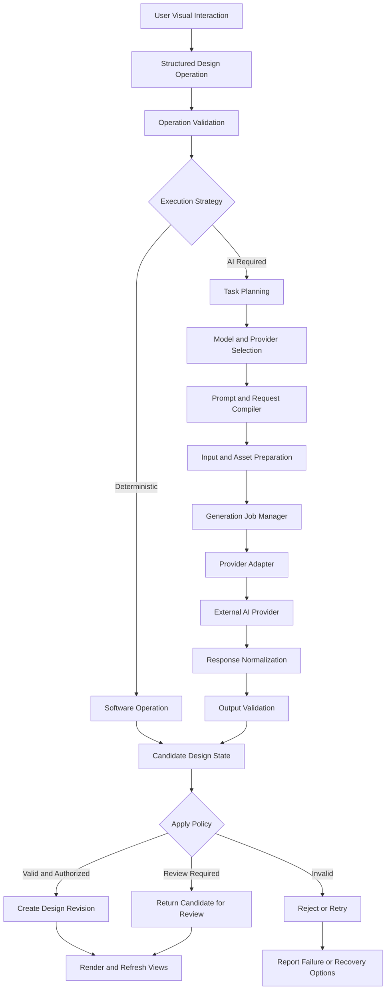

# AI Execution, Prompt Compilation, and Provider Integration Specification

**Document ID:** SPEC-GDP-004  
**Version:** 0.1  
**Status:** Initial Draft  
**Parent Documents:**
- `ARCH-GDP-002 v0.1` — Subsystem Requirements Breakdown and Dependency Specification
- `SPEC-GDP-003 v0.1` — Garment Design Model and Artifact Schema Specification

**Product:** AI-Powered Garment Design and Development Platform

---

## 1. Purpose

This specification defines the architecture, functional requirements, data contracts, execution workflows, and failure-handling rules for AI-powered garment design operations.

It establishes how the platform translates user interactions and structured garment state into executable AI tasks, selects suitable providers and models, compiles provider-specific requests, manages asynchronous execution, validates returned results, and integrates accepted outputs into the canonical garment design model.

The platform is intended for apparel industry users who understand visual design and garment requirements but may not have professional design software expertise or prompt-engineering skills.

Accordingly, users interact through visual controls, garment components, reference images, drawing tools, artifact selection, and explicit generation actions. The platform manages prompt construction, model-specific parameters, request formatting, provider credentials, and execution complexity internally.

## 2. Scope

This specification covers:

- Structured design-operation intake.
- Operation validation and execution strategy selection.
- Internal prompt and request compilation.
- AI provider and model capability registry.
- Provider adapters and normalized interfaces.
- Reference-image, mask, geometry, and artifact preparation.
- Text-to-image, image-to-image, targeted editing, interpretation, and multimodal tasks.
- Generation job management and asynchronous execution.
- Result normalization, validation, and application.
- Revision preservation and conflict handling.
- Platform-managed and customer-provided API credentials.
- Provider failures, timeouts, retries, and unknown outcomes.
- Usage metadata, traceability, security, and observability.
- Testing and acceptance criteria.

The following are outside the detailed scope of this document and are defined elsewhere:

- Canonical garment entities and artifact schemas: `SPEC-GDP-003`.
- Subscription pricing, charge calculation, invoices, and payment collection: the AI Usage Metering, Subscription, and Billing specification.
- Editor visual behavior: the Editor Interaction and Visualization specification.
- Production readiness and tech pack content: the Tech Pack and Production Specification.
- Identity, organization membership, and authorization policies: the Security, Identity, and Organization Access specification.

This document defines the execution interfaces those subsystems must support.

---

## 3. Normative terminology

The terms **MUST**, **MUST NOT**, **SHOULD**, **SHOULD NOT**, and **MAY** express requirement priority.

| Term | Definition |
|---|---|
| Design Operation | A structured request to modify, interpret, validate, or generate garment design information |
| Execution Strategy | The selected method for performing an operation, such as deterministic software processing or AI generation |
| Prompt Compiler | The internal subsystem that transforms structured task context into provider-ready instructions |
| Provider Adapter | An integration layer that implements a normalized interface for a specific AI provider or API family |
| Model Capability Profile | A versioned description of a model's supported inputs, outputs, constraints, and operational characteristics |
| Generation Job | A managed execution instance with state, ownership, inputs, results, and lifecycle metadata |
| Provider Attempt | A specific attempt to execute a job against a provider endpoint |
| Normalized Result | A provider-independent representation of returned outputs and execution metadata |
| Candidate Revision | A proposed design revision that has not yet been committed or approved |
| Platform-managed credentials | Provider credentials controlled by the platform, with provider usage normally paid by the platform |
| Customer-provided credentials | Provider credentials supplied by a customer, with provider usage normally billed directly by that provider |

---

## 4. Architectural principles

### 4.1 Structured operations before prompts

The platform MUST represent meaningful user requests as structured operations before constructing AI instructions.

For example, a user selecting a sleeve and attaching a saved lace border produces an operation describing the target component, artifact revision, intended placement, and preservation requirements.

The system MUST NOT depend on free-form user prompts as its only representation of that request.

### 4.2 AI is an execution capability, not the source of truth

AI-generated results are candidate outputs. The canonical garment model defined in `SPEC-GDP-003` remains the authoritative structured design state.

A returned image MUST NOT automatically become an approved design revision.

### 4.3 Deterministic operations take priority when appropriate

The platform SHOULD use deterministic software operations when they can satisfy the requested change with suitable fidelity.

Examples include:

- Changing a stored property.
- Replacing an artifact revision.
- Updating a vector fill.
- Moving a structured artwork placement.
- Rerendering an existing structured design.
- Updating labels or technical annotations.

AI SHOULD be invoked when the task requires capabilities that the available deterministic tools cannot adequately provide.

### 4.4 Provider independence

Business logic MUST NOT depend directly on the proprietary request or response format of a single AI provider.

Provider-specific logic belongs in adapters and model-specific compilation profiles.

### 4.5 Explicit user intent

Generation MUST occur through an explicit user action or an explicitly authorized workflow.

Ordinary selection, navigation, property inspection, and reversible UI changes MUST NOT automatically trigger expensive AI generation unless the product defines a clearly disclosed automatic workflow.

### 4.6 Reproducible execution records

The platform MUST record sufficient execution metadata to explain how a result was produced, subject to privacy, security, retention, and provider-policy constraints.

Reproducibility is best-effort when providers use nondeterministic models, change model versions, or do not support deterministic execution.

### 4.7 No false guarantees

The system MUST NOT promise that an AI operation will preserve every unchanged pixel or produce production-valid geometry unless the selected workflow actually supports and validates those guarantees.

---

## 5. Subsystem responsibilities

The execution architecture builds on the subsystem boundaries established in `ARCH-GDP-002`.

| Subsystem | Responsibility |
|---|---|
| SS-04 Editor Interaction | Captures explicit user intent and displays execution status |
| SS-03 Garment Design Model | Provides the canonical design state and receives committed revisions |
| SS-06 Design Operation and Execution Router | Validates operations and selects the execution strategy |
| SS-07 Prompt and Request Compilation | Builds structured, provider-compatible requests |
| SS-08 AI Provider and Orchestration | Selects providers, manages credentials, invokes adapters, and normalizes responses |
| SS-09 Generation Job Management | Manages asynchronous jobs, attempts, cancellation, and recovery |
| SS-10 Rendering and Visualization | Produces and displays visual representations |
| SS-11 Asset and Storage | Stores source assets, intermediate assets, and results |
| SS-12 Validation and Quality | Validates operation outputs and design consistency |
| SS-13 Usage Metering | Records attributable provider and platform usage |
| SS-17 Audit and Observability | Provides execution traceability and operational diagnostics |
| SS-18 Platform Administration | Configures providers, models, capabilities, policies, and supported configurations |

The editor MUST NOT invoke external provider APIs directly.

All AI executions MUST pass through the platform's orchestration boundary.

---

## 6. High-level execution architecture



### 6.1 Execution boundary

The platform MUST distinguish these stages:

1. Operation capture.
2. Operation validation.
3. Strategy selection.
4. Task planning.
5. Provider and model selection.
6. Prompt compilation.
7. Input preparation.
8. Job execution.
9. Response normalization.
10. Result validation.
11. Candidate creation.
12. Revision application or user review.
13. Usage finalization and audit recording.

These stages MAY be implemented as modules in a modular monolith or as separate services. The logical contracts MUST remain explicit.

---

## 7. Design Operation contract

### 7.1 Purpose

A design operation represents what the user or authorized workflow intends to accomplish independently of how that operation is executed.

An operation MAY result in a deterministic update, an AI generation job, a validation task, or a combination of these.

### 7.2 Required operation fields

Every operation MUST contain or resolve the following information where applicable:

| Field | Purpose |
|---|---|
| `operation_id` | Stable operation identifier |
| `operation_type` | Registered operation type |
| `design_id` | Target garment design |
| `base_revision_id` | Revision against which the operation was prepared |
| `requested_by` | User or authorized system actor |
| `target_entities` | Components, regions, relationships, or artifacts affected |
| `requested_changes` | Structured description of the intended change |
| `preservation_constraints` | Properties or regions that should remain unchanged |
| `source_references` | Relevant images, artifacts, and supporting assets |
| `execution_policy` | Permitted strategies, quality requirements, and review rules |
| `idempotency_key` | Retry identity where required |
| `created_at` | Operation creation time |

Optional information includes output format, quality target, generation mode, user-facing instructions, and applicable organization policy.

### 7.3 Illustrative operation

```json
{
  "operation_id": "OPR-000654",
  "operation_type": "apply_decorative_trim",
  "design_id": "DSN-000456",
  "base_revision_id": "DSN-000456-R002",
  "requested_by": "USR-001",
  "target_entities": [
    {
      "entity_type": "design_component",
      "entity_id": "CMP-SLEEVE-L-001"
    }
  ],
  "requested_changes": {
    "artifact_revision_id": "LAC-0012-R002",
    "placement_region": "hem",
    "placement_mode": "follow_boundary"
  },
  "preservation_constraints": [
    {
      "target": "garment_silhouette",
      "requirement": "preserve"
    },
    {
      "target": "sleeve_length",
      "requirement": "preserve"
    }
  ],
  "execution_policy": {
    "allow_deterministic_execution": true,
    "allow_ai_execution": true,
    "require_user_review": true
  },
  "idempotency_key": "op-654-attempt-group-1"
}
```

This example does not imply that a flattened image can support exact boundary-following placement. Strategy selection MUST consider available geometry and the capability of the selected execution path.

### 7.4 Operation requirements

- `OPR-AI-001`: The system MUST capture user intent in a structured operation before invoking AI.
- `OPR-AI-002`: Every operation MUST identify its target design and base revision.
- `OPR-AI-003`: The operation router MUST validate entity references, permissions, required inputs, and supported operation types.
- `OPR-AI-004`: The system MUST distinguish user-requested changes from compiler-generated instructions.
- `OPR-AI-005`: Operations MUST support explicit preservation constraints.
- `OPR-AI-006`: The system MUST reject or request clarification when essential inputs are missing or the request cannot be interpreted safely.
- `OPR-AI-007`: The system MUST NOT silently broaden an operation beyond its authorized scope.
- `OPR-AI-008`: Operations MUST be associated with their resulting revision, candidate result, or failure record.

---

## 8. Execution strategy selection

### 8.1 Supported strategies

The execution router SHOULD support the following strategy classes.

| Strategy | Intended use |
|---|---|
| `deterministic_model_update` | Change canonical properties or relationships |
| `vector_operation` | Edit supported SVG or parametric geometry |
| `rule_based_composition` | Assemble compatible structured components |
| `render_only` | Recreate views from canonical state |
| `image_interpretation` | Extract proposed garment attributes from reference images |
| `text_to_image` | Create a new visual concept from structured design requirements |
| `image_to_image` | Generate a revised visual using an existing image as input |
| `targeted_image_edit` | Modify a localized region using masks or other supported controls |
| `multimodal_reasoning` | Interpret combinations of text, images, and structured context |
| `geometry_generation` | Generate structured geometry where a suitable engine or model is available |
| `composite_pipeline` | Combine multiple strategies into a managed workflow |

The available strategy set MUST be configured against actual system capabilities. Listing a strategy does not imply that a compatible provider or engine is enabled.

### 8.2 Selection rules

The router SHOULD consider:

- Requested operation and target component.
- Available structured geometry.
- Required output format and fidelity.
- Availability and quality of reference images.
- Preservation constraints.
- Model capabilities.
- Expected latency and cost.
- Applicable data-handling policies.
- User-selected quality preferences.
- Current provider health and capacity.
- Whether a deterministic path satisfies the request.

### 8.3 Strategy requirements

- `STR-001`: The router MUST evaluate deterministic execution before selecting AI for operations that may be handled without AI.
- `STR-002`: Strategy selection MUST respect the operation's required output type.
- `STR-003`: The router MUST NOT select a model that lacks required input or output capabilities.
- `STR-004`: If no supported strategy meets the minimum requirements, the system MUST report the limitation instead of silently substituting an incompatible result.
- `STR-005`: The selected strategy and its selection rationale MUST be recorded.
- `STR-006`: The router SHOULD consider the expected cost and latency of eligible strategies.
- `STR-007`: A cost or latency optimization MUST NOT override mandatory quality, security, or authorization requirements.
- `STR-008`: The system MUST identify when a strategy can produce only an approximation of the requested result.

---

## 9. Task planning and internal prompt compilation

### 9.1 Purpose

The prompt compiler converts a validated design operation and its relevant design context into an executable provider request.

It is responsible for constructing task instructions, assembling references, translating properties into provider-supported controls, selecting the correct request format, and preserving the distinction between confirmed design facts and uncertain interpretations.

The compiler is an internal platform capability. Ordinary users MUST NOT be required to inspect or edit raw provider prompts.

### 9.2 Compilation inputs

The compiler SHOULD receive a normalized task context containing:

- Operation type and requested change.
- Base design revision.
- Target component or region.
- Relevant component properties.
- Relevant artifact revisions.
- Source image or reference asset identifiers.
- Preservation constraints.
- Output requirements.
- Required fidelity level.
- Property confidence and provenance.
- Model capability profile.
- Organization and platform execution policies.
- Approved user-provided design instructions.
- Data handling and retention restrictions.

The compiler SHOULD include only context relevant to the operation. Unrelated project files, private assets, and irrelevant design history MUST NOT be attached merely because they are available.

### 9.3 Compilation stages

The compiler SHALL perform the following logical steps:

1. Resolve the operation type to a registered task definition.
2. Load the required canonical design state and revision-pinned references.
3. Resolve target component properties and relationships.
4. Separate confirmed facts from inferred or proposed facts.
5. Determine the appropriate task instructions and output schema.
6. Build a provider-independent intermediate request.
7. Apply model-specific request mappings.
8. Resolve and prepare authorized input assets.
9. Validate required inputs, sizes, formats, and capabilities.
10. Produce an immutable or auditable compilation record.
11. Submit the compiled request to the job manager.

### 9.4 Intermediate request representation

The platform SHOULD maintain a provider-independent request object before adapting it to a specific provider.

Illustrative JSON:

```json
{
  "task_id": "TASK-000231",
  "task_type": "targeted_image_edit",
  "operation_id": "OPR-000654",
  "base_revision_id": "DSN-000456-R002",
  "objective": {
    "action": "apply_decorative_trim",
    "target_component_id": "CMP-SLEEVE-L-001",
    "target_region": "hem",
    "artifact_revision_id": "LAC-0012-R002"
  },
  "context": {
    "confirmed_properties": {
      "cuff_type": "plain"
    },
    "uncertain_properties": [],
    "source_asset_refs": [
      "AST-000321"
    ]
  },
  "constraints": {
    "preserve_silhouette": true,
    "preserve_sleeve_length": true,
    "scope": "target_region_only"
  },
  "output_requirements": {
    "format": "image",
    "review_required": true
  },
  "policy": {
    "allow_external_processing": true,
    "sensitivity_class": "standard"
  }
}
```

The compiler MUST NOT assume that every field can be represented directly in every provider API. Provider adapters and capability profiles determine which fields can be mapped and which require a different strategy.

### 9.5 Prompt construction

Prompts and related instructions SHOULD be generated from reusable, versioned templates and structured operation data.

Prompt templates SHOULD separate:

- Task objective.
- Garment context.
- Target region.
- Required visual changes.
- Preservation instructions.
- Relevant material and artifact references.
- Output requirements.
- Uncertainty or limitations.
- Safety and policy constraints.

The system SHOULD avoid adding unsupported manufacturing facts to a prompt merely to make the instruction appear more specific.

### 9.6 Compiler requirements

- `CMP-001`: Prompt compilation MUST consume a validated structured operation.
- `CMP-002`: The compiler MUST support provider-independent intermediate requests.
- `CMP-003`: The compiler MUST support versioned task templates and mappings.
- `CMP-004`: The compiler MUST preserve distinctions between confirmed, inferred, proposed, and missing design values.
- `CMP-005`: The compiler MUST include preservation constraints when required by the operation.
- `CMP-006`: The compiler MUST validate required provider inputs before submission.
- `CMP-007`: The compiler MUST identify unsupported request features before executing the provider call.
- `CMP-008`: The compiler MUST associate each compiled request with its source operation and base revision.
- `CMP-009`: The system SHOULD minimize unnecessary reference assets and irrelevant context.
- `CMP-010`: The compiler MUST NOT expose provider credentials in compiled prompts or logs.
- `CMP-011`: The compiler MUST record the versions of templates, mappings, and capability profiles used.
- `CMP-012`: Changes to compiler templates MUST NOT retroactively rewrite historical execution records.

---

## 10. Reference assets, masks, and context preparation

### 10.1 Asset resolution

The asset preparation subsystem MUST resolve asset references through authorized internal storage services.

The compiler MUST NOT assume that a stored asset has a permanent public URL or can be directly accessed by every provider.

Where provider APIs require uploaded files, the adapter or asset gateway SHOULD manage the necessary upload lifecycle and access controls.

### 10.2 Asset preparation tasks

The platform MAY perform:

- Image format conversion.
- Resolution adjustment.
- Color-space conversion.
- Mask creation or transformation.
- Region cropping.
- Reference ordering.
- Geometry serialization.
- Thumbnail generation.
- Metadata extraction.
- Temporary provider upload and cleanup.

Any transformation that materially changes the input MUST be recorded when it affects interpretation, validation, or reproducibility.

### 10.3 Reference roles

Each input reference SHOULD have a declared role, such as:

- Primary source image.
- Target garment view.
- Style reference.
- Fabric reference.
- Artifact reference.
- Color reference.
- Region mask.
- Geometry reference.
- Negative or exclusion mask, if supported by the selected engine.

Reference roles MUST NOT be inferred solely from upload order when the operation depends on their meaning.

### 10.4 Asset preparation requirements

- `INP-001`: Every input asset MUST be authorized for the current operation.
- `INP-002`: The system MUST validate asset type, size, and format against the selected model's capabilities.
- `INP-003`: Required reference roles MUST be explicit.
- `INP-004`: The platform MUST preserve source asset references even when provider-specific copies or transformed versions are created.
- `INP-005`: Masks and crops MUST retain enough mapping information to interpret their relationship to the source image.
- `INP-006`: Temporary provider uploads MUST follow defined retention and cleanup policies.
- `INP-007`: The system MUST not transmit unrelated assets or data to an external provider.
- `INP-008`: Unsupported input requirements MUST produce a validation error or an explicitly authorized fallback strategy.

---

## 11. Model and provider capability registry

### 11.1 Purpose

The platform MUST maintain a registry of available providers and models, including the capabilities required for task routing and request validation.

Provider availability MUST NOT be determined solely from a hardcoded model name in application code.

### 11.2 Provider record

A provider record SHOULD include:

- Stable provider identifier.
- Provider name and integration type.
- Supported API endpoints.
- Credential configuration requirements.
- Supported regions or deployment modes, where applicable.
- Operational status.
- Data-handling constraints.
- Rate-limit and quota metadata where known.
- Provider-specific error mappings.
- Administrative ownership and configuration history.

### 11.3 Model capability profile

A model profile SHOULD include:

| Capability field | Purpose |
|---|---|
| `model_id` | Stable internal model identifier |
| `provider_id` | Owning provider |
| `provider_model_identifier` | Model or deployment name used by the provider |
| `task_types` | Supported operations |
| `input_modalities` | Text, image, masks, geometry, or other supported inputs |
| `output_modalities` | Image, text, structured data, geometry, or other outputs |
| `input_constraints` | Resolution, size, count, or format limits |
| `output_constraints` | Output dimensions, schema, or file constraints |
| `editing_capabilities` | Masking, region editing, image-to-image, or other controls |
| `structured_output_support` | Whether constrained structured responses are supported |
| `streaming_support` | Whether incremental results are available |
| `async_support` | Whether provider-side asynchronous jobs are available |
| `reference_image_support` | Number and types of references supported |
| `determinism_support` | Whether repeatable generation controls exist |
| `cost_metadata` | Available usage or price attributes |
| `availability_status` | Whether the model is enabled and usable |
| `profile_version` | Version of the capability definition |

Capability values MUST distinguish verified support, provider-documented support, configured support, and unknown support where that distinction affects routing.

### 11.4 Registry requirements

- `REG-001`: The platform MUST maintain a stable internal identity for each configured provider and model.
- `REG-002`: Model selection MUST use registered capability information.
- `REG-003`: Administrators MUST be able to enable or disable a model without modifying editor logic.
- `REG-004`: Capability profile changes MUST be versioned and auditable.
- `REG-005`: The platform MUST distinguish an unavailable model from a model that is not configured or authorized.
- `REG-006`: Provider-specific model identifiers MUST remain encapsulated within integration configuration.
- `REG-007`: The platform SHOULD support controlled model rollouts and fallback configuration.
- `REG-008`: The platform MUST NOT advertise an unverified capability as guaranteed.
- `REG-009`: Routing decisions MUST retain the model and capability profile version used.
- `REG-010`: Provider pricing and capability metadata MUST be treated as time-dependent configuration rather than immutable facts.

---

## 12. Provider adapter interface

### 12.1 Purpose

A provider adapter translates normalized platform requests into provider-specific API calls and translates responses into the platform's normalized execution model.

Adapters MUST isolate provider-specific authentication, request serialization, endpoint conventions, response parsing, rate-limit behavior, and error formats.

### 12.2 Logical interface

Each adapter SHOULD expose equivalent operations for:

- Capability discovery or configured capability verification.
- Request validation.
- Request submission.
- Provider job polling where applicable.
- Result retrieval.
- Cancellation where supported.
- Error normalization.
- Provider usage metadata extraction.
- Health and readiness reporting.

Not every provider supports every operation. Unsupported methods MUST be represented explicitly.

### 12.3 Normalized submission contract

Illustrative request:

```json
{
  "job_id": "JOB-000987",
  "attempt_id": "ATT-000001",
  "provider_id": "PROV-001",
  "model_id": "MODEL-IMAGE-003",
  "request_ref": "REQ-000231",
  "credential_context_ref": "CRED-REF-001",
  "idempotency_key": "job-987-attempt-1"
}
```

The credential context reference is an internal authorization reference, not a credential value. It MUST NOT contain a raw API key.

Illustrative normalized submission result:

```json
{
  "submission_status": "accepted",
  "provider_request_id": "provider-request-reference",
  "provider_job_id": "provider-job-reference",
  "execution_mode": "asynchronous",
  "accepted_at": "2026-10-21T12:40:00Z"
}
```

Provider identifiers are illustrative and MUST be stored according to applicable privacy and retention policies.

### 12.4 Adapter requirements

- `ADP-001`: Every external AI call MUST pass through a provider adapter.
- `ADP-002`: Adapters MUST validate requests against the supported provider API contract.
- `ADP-003`: Adapters MUST normalize provider errors into platform error categories.
- `ADP-004`: Adapters MUST distinguish synchronous completion from asynchronous acceptance.
- `ADP-005`: Adapters MUST preserve provider request and job identifiers when available.
- `ADP-006`: Adapters MUST extract available provider-reported usage data.
- `ADP-007`: Adapters MUST NOT expose raw provider credentials to calling subsystems.
- `ADP-008`: Provider-specific response structures MUST NOT leak into the canonical garment design model.
- `ADP-009`: Adapters MUST support timeouts and cancellation behavior consistent with the provider API.
- `ADP-010`: Adapters MUST report unsupported operations explicitly.
- `ADP-011`: Provider response payloads MUST be treated as untrusted external input.
- `ADP-012`: The platform SHOULD contract-test adapters against provider test environments or controlled fixtures.

---

## 13. Provider selection and routing

### 13.1 Routing inputs

Provider routing MUST consider:

- Task type and required output modality.
- Input and output capability compatibility.
- Organization and user entitlements.
- Credential availability.
- Data handling and regional restrictions.
- Model availability.
- Budget or spending limits.
- Expected latency and quality.
- Provider reliability.
- Required editing controls.
- Required response format.
- User or administrator routing preferences.

### 13.2 Routing policies

The platform SHOULD support configurable routing policies, including:

- Preferred provider and model.
- Least-cost eligible model.
- Preferred quality tier.
- Preferred latency tier.
- Organization-specific provider restrictions.
- Customer-provided credential routing.
- Explicit user-selected model, when permitted.
- Fallback models for recoverable provider failures.

The policy MUST filter out ineligible models before ranking the remaining candidates.

### 13.3 Fallback behavior

Fallback is allowed only when the alternative model satisfies the operation's essential requirements.

A fallback model MUST NOT silently downgrade a required output from editable geometry to a raster image or from targeted editing to unrestricted whole-image generation.

If a fallback changes expected fidelity, cost, data handling, or other material behavior, the system MUST follow the applicable consent and policy rules.

### 13.4 Routing requirements

- `ROUTE-001`: Routing MUST verify capability compatibility before submission.
- `ROUTE-002`: Routing MUST enforce credential and entitlement requirements.
- `ROUTE-003`: Routing MUST honor data handling restrictions.
- `ROUTE-004`: Routing SHOULD use configurable policies rather than hardcoded provider selection.
- `ROUTE-005`: Every routing decision MUST be recorded.
- `ROUTE-006`: Fallback MUST preserve the operation's mandatory output requirements.
- `ROUTE-007`: The platform MUST NOT send a request to a different credential owner without authorization.
- `ROUTE-008`: If no eligible model exists, the platform MUST return a clear actionable failure.
- `ROUTE-009`: A fallback that materially changes cost or output characteristics MUST follow explicit policy and user-consent requirements.

---

## 14. Generation Job Management

### 14.1 Purpose

Generation Job Management provides durable tracking for AI work that may take seconds or minutes, fail, be retried, or return after the user has moved to another task.

The user interface MUST NOT be required to keep an HTTP request open for the entire generation lifecycle.

### 14.2 Job record

A job SHOULD contain:

- Job identifier.
- Operation identifier.
- Source design and base revision.
- Request and compilation record references.
- Provider and model identifiers.
- Credential ownership mode.
- Job status.
- Creation, submission, start, and completion timestamps.
- Attempt records.
- Output asset references.
- Validation status.
- Usage references.
- Cancellation and failure information.
- User-review requirement.

### 14.3 Job states

The initial state model SHOULD include:

| State | Meaning |
|---|---|
| `queued` | Accepted by the platform and awaiting execution |
| `preparing` | Inputs and provider request are being prepared |
| `submitted` | Submission is in progress or has been accepted, depending on recorded substate |
| `running` | Execution is known to be in progress |
| `awaiting_provider` | Waiting for a provider-side asynchronous result |
| `normalizing` | Provider output is being retrieved and normalized |
| `validating` | Output is undergoing validation |
| `awaiting_review` | A candidate is available but requires user or authorized review |
| `succeeded` | The job completed successfully under its execution policy |
| `failed` | The job cannot proceed without a new action or a permitted retry |
| `cancel_requested` | Cancellation has been requested but is not confirmed |
| `cancelled` | The platform has confirmed cancellation of its managed work |
| `outcome_unknown` | The provider may have executed the request, but the platform cannot establish the outcome |

The implementation MAY refine these states, but it MUST distinguish known failure from an unknown provider outcome.

### 14.4 Job requirements

- `JOB-001`: Every accepted AI operation MUST have a durable job record.
- `JOB-002`: Job state changes MUST be persisted and auditable.
- `JOB-003`: The system MUST support asynchronous execution and result retrieval.
- `JOB-004`: Every provider attempt MUST be identifiable separately from the overall job.
- `JOB-005`: The system MUST support cancellation where possible and communicate when cancellation is not guaranteed.
- `JOB-006`: The system MUST NOT report success solely because a provider accepted a request.
- `JOB-007`: The system MUST preserve output references and validation results.
- `JOB-008`: Jobs MUST be isolated by authorization and tenant policies.
- `JOB-009`: The system MUST recover queued or interrupted jobs after worker or service restarts.
- `JOB-010`: A job with an unknown provider outcome MUST NOT be blindly resubmitted without the applicable reconciliation or duplicate-execution policy.
- `JOB-011`: Job completion MUST distinguish successful generation from successful application to the garment model.
- `JOB-012`: The system MUST provide a stable way for authorized clients to query job status.

---

## 15. Response normalization and output contracts

### 15.1 Purpose

Provider results MUST be transformed into a normalized platform representation before they are consumed by the editor, validator, or garment model.

A provider may return one or more images, text, structured data, geometry, file references, usage metadata, or asynchronous job identifiers.

The platform MUST explicitly identify which output types were actually returned.

### 15.2 Normalized result

Illustrative JSON:

```json
{
  "job_id": "JOB-000987",
  "attempt_id": "ATT-000001",
  "provider_id": "PROV-001",
  "model_id": "MODEL-IMAGE-003",
  "result_status": "completed",
  "outputs": [
    {
      "output_id": "OUT-000001",
      "output_type": "image",
      "asset_ref": "AST-GEN-000012",
      "mime_type": "image/png",
      "source_role": "generated_candidate"
    }
  ],
  "provider_usage": {
    "usage_reported": true,
    "usage_record_ref": "USAGE-000231"
  },
  "validation": {
    "status": "not_evaluated",
    "findings": []
  }
}
```

### 15.3 Supported output categories

The normalized result SHOULD support:

- Generated image.
- Edited image.
- Text interpretation.
- Structured JSON or equivalent data.
- SVG or vector geometry.
- 3D geometry or scene reference.
- Mask or segmentation result.
- Multiple related assets.
- Provider usage metadata.
- Warnings and partial-result information.

### 15.4 Normalization requirements

- `RES-001`: All provider results MUST pass through normalization.
- `RES-002`: The normalizer MUST validate response structure and required fields.
- `RES-003`: Generated files MUST be stored through the asset subsystem before being referenced as durable platform assets.
- `RES-004`: Provider-reported usage MUST be retained when available.
- `RES-005`: The system MUST distinguish complete, partial, malformed, and unavailable results.
- `RES-006`: The normalizer MUST NOT infer the existence of structured geometry from a raster image.
- `RES-007`: Outputs MUST retain their source job and attempt references.
- `RES-008`: Provider-supplied metadata MUST be validated before it influences canonical state.
- `RES-009`: Malformed or unsupported outputs MUST be rejected or quarantined.
- `RES-010`: A provider result MUST NOT bypass required content, structural, or policy validation.

---

## 16. Result validation and application

### 16.1 Validation layers

The platform SHOULD validate results at several levels:

**Level 1 — Transport and file integrity**
- Response received.
- File is accessible.
- File format and declared type are consistent.
- File passes applicable security checks.

**Level 2 — Task conformance**
- Required outputs are present.
- Output type matches the request.
- Required schema or structured fields validate.
- Output dimensions and format satisfy constraints.

**Level 3 — Design consistency**
- The output corresponds to the intended target.
- Relevant component and artifact references are valid.
- Preservation constraints have been checked to the extent supported by the strategy.
- Canonical design dependencies have not changed incompatibly.

**Level 4 — Production readiness**
- Manufacturing requirements are complete and validated.
- Measurements, materials, construction details, and tolerances meet applicable rules.
- Required human approvals are recorded.

Passing a lower level MUST NOT imply that a higher level has passed.

### 16.2 Result application modes

The platform SHOULD support these application modes:

- `candidate_only`: Store the result for review without modifying canonical design state.
- `apply_structured_changes`: Apply validated structured changes to a new design revision.
- `attach_representation`: Attach a generated visual representation to an existing or new revision.
- `require_user_approval`: Hold the result until the required approval is received.
- `reject_result`: Do not apply the result because it failed validation or policy.

The correct mode depends on operation type, result fidelity, validation, and user or organization policy.

### 16.3 Application requirements

- `APP-001`: AI results MUST be validated before they modify canonical design state.
- `APP-002`: The system MUST distinguish candidate output from committed design state.
- `APP-003`: A generated visual MAY be attached as a representation without being treated as structured garment geometry.
- `APP-004`: Applying structured changes MUST create a new design revision rather than rewriting an immutable revision.
- `APP-005`: Required user review MUST occur before the operation is treated as approved.
- `APP-006`: Failed validation MUST produce actionable findings.
- `APP-007`: The system MUST retain the association between the output, source operation, and resulting revision.
- `APP-008`: Production readiness MUST be evaluated independently from visual-generation success.
- `APP-009`: Partial results MUST NOT silently overwrite unaffected canonical entities.
- `APP-010`: The platform MUST NOT label an output as validated if the relevant validation was not performed.

---

## 17. Revision conflicts and preservation behavior

### 17.1 Stale base revision

A job may take long enough that a user changes the garment before the result returns.

The job MUST retain its original base revision. The platform MUST NOT silently apply the result to a newer revision without checking compatibility.

### 17.2 Conflict resolution

When the current design revision differs from the job's base revision, the platform SHOULD:

1. Compare the relevant component and property state.
2. Determine whether the operation's target or dependencies changed.
3. Determine whether the result can be safely rebased.
4. Revalidate affected constraints.
5. Apply only if the configured policy permits it.
6. Otherwise present the result as a candidate for manual reconciliation.

### 17.3 Preservation requirements

- `CON-001`: Every AI job MUST retain its base design revision.
- `CON-002`: The system MUST detect relevant conflicts before applying a result to a newer revision.
- `CON-003`: The system MUST NOT overwrite newer user changes silently.
- `CON-004`: Rebase operations MUST be explicit, validated, and auditable.
- `CON-005`: Preservation claims MUST reflect actual capabilities of the selected execution strategy.
- `CON-006`: When exact preservation is required but unsupported, the system MUST disclose the limitation or select a different eligible strategy.
- `CON-007`: The system SHOULD favor deterministic operations for changes requiring exact preservation of unrelated structured components.

---

## 18. Customer-provided and platform-managed credentials

### 18.1 Credential modes

The platform MUST support two distinct execution modes.

**Mode A — Platform-managed provider credentials**

- The platform selects an authorized platform credential.
- Provider usage is attributed to the platform's provider account.
- Usage is metered for the customer under the platform's commercial rules.
- Subscription allowances, overages, or pay-as-you-go charges may apply.

**Mode B — Customer-provided provider credentials**

- The customer connects or supplies an API credential through an authorized secure flow.
- The platform executes eligible requests using that customer's provider account.
- Provider usage is attributed to the customer's provider account where the provider supports that attribution.
- The platform MUST NOT classify the provider's charges as platform-managed provider consumption.
- Any platform execution fee, subscription charge, or other commercial fee MUST be governed by explicit pricing and consent rules.

### 18.2 Credential selection

Credential selection MUST be explicit and auditable.

The platform MUST NOT silently switch from customer-provided credentials to platform-managed credentials if the customer credential fails, unless the customer or authorized organization policy has explicitly permitted that fallback and the cost implications are clear.

### 18.3 Credential security

- `CRED-001`: Raw provider credentials MUST NOT be sent to the browser.
- `CRED-002`: Credentials MUST be encrypted and access-controlled in an approved secret-management mechanism.
- `CRED-003`: Logs MUST NOT contain raw credentials or authentication headers.
- `CRED-004`: Credential references MUST be used in internal execution contracts instead of raw secret values.
- `CRED-005`: Credential ownership MUST be recorded for each provider attempt.
- `CRED-006`: Credential access MUST be restricted to authorized execution components.
- `CRED-007`: Revoked or invalid credentials MUST be detected and reported without uncontrolled retries.
- `CRED-008`: Credential rotation MUST NOT require rewriting historical design revisions.
- `CRED-009`: The platform MUST enforce organization-level permissions for adding, testing, selecting, and revoking credentials.
- `CRED-010`: A credential's configured provider identity MUST be checked against the requested provider integration.
- `CRED-011`: Credential fallback MUST follow explicit authorization and cost-disclosure policy.
- `CRED-012`: Customer-provided credentials MUST be excluded from prompt text, output files, and general-purpose audit payloads.

---

## 19. Usage attribution and execution cost metadata

### 19.1 Separation of responsibilities

This subsystem records execution facts and provider-reported usage. It MUST NOT be the sole authority for subscription charging or payment collection.

The metering and billing subsystem is responsible for translating execution events into billable units, applying pricing versions, enforcing plan rules, and reconciling charges.

### 19.2 Execution usage record

The execution layer SHOULD emit usage data containing:

- Job and attempt identifiers.
- Provider and model identifiers.
- Credential ownership mode.
- Provider request identifier.
- Reported input and output token counts, where applicable.
- Image, video, or other media usage metrics where reported.
- Provider-reported cost where available.
- Request status.
- Retry and duplicate-attempt information.
- Usage confidence or reconciliation status.
- Pricing or model metadata references applicable to the attempt.

The platform MUST distinguish measured provider usage from estimated usage and platform-calculated charges.

### 19.3 Usage requirements

- `USG-001`: Each provider attempt MUST be attributable to a job and execution context.
- `USG-002`: Provider-reported usage MUST be stored separately from platform-calculated billing.
- `USG-003`: The system MUST record whether provider usage is reported, estimated, unavailable, or awaiting reconciliation.
- `USG-004`: Customer-provided credential usage MUST be separately identified.
- `USG-005`: Retried attempts MUST be independently traceable.
- `USG-006`: The system MUST support idempotent usage-event emission.
- `USG-007`: The system MUST NOT assume that a timed-out provider request incurred zero cost.
- `USG-008`: Usage events MUST include sufficient identifiers for billing reconciliation without exposing secrets.
- `USG-009`: A provider's reported cost MUST NOT automatically be treated as the final customer charge.
- `USG-010`: Execution records MUST support later reconciliation when provider usage arrives asynchronously.

---

## 20. Failure handling, retries, and unknown outcomes

### 20.1 Error categories

The platform SHOULD normalize errors into categories such as:

- Invalid operation.
- Unsupported capability.
- Invalid input or asset.
- Authentication failure.
- Authorization failure.
- Rate limit exceeded.
- Provider quota exceeded.
- Provider unavailable.
- Network failure.
- Request timeout.
- Provider rejection.
- Malformed response.
- Output validation failure.
- Storage failure.
- Revision conflict.
- Cancellation.
- Unknown execution outcome.

Each error SHOULD include a stable internal error code, a safe user-facing explanation, diagnostic metadata, and a retry recommendation.

### 20.2 Retry policy

Retries MUST depend on error type and provider semantics.

Potentially retryable cases include transient network errors, some rate limits, and temporary provider failures. Invalid inputs, revoked credentials, unsupported capabilities, and authorization failures normally require correction rather than automatic retry.

### 20.3 Unknown provider outcomes

A request timeout does not prove that the provider failed to execute the request.

When the platform cannot determine whether the provider executed a request, it MUST:

1. Record the attempt as having an unknown outcome.
2. Preserve any available provider request identifier.
3. Query or reconcile the provider status if supported.
4. Use a provider idempotency mechanism where available.
5. Avoid an uncontrolled duplicate submission.
6. Surface a recoverable status if reconciliation is not possible.
7. Preserve any known or later-reported usage.

### 20.4 Failure requirements

- `ERR-001`: Errors MUST be normalized into stable platform categories.
- `ERR-002`: Retry policy MUST consider the failure type and provider behavior.
- `ERR-003`: The platform MUST distinguish a known failure from an unknown outcome.
- `ERR-004`: Retried submissions SHOULD use provider idempotency support where available.
- `ERR-005`: The platform MUST NOT claim that a failed network response means no provider charge occurred.
- `ERR-006`: Exhausted retries MUST produce a terminal or explicitly unresolved job state.
- `ERR-007`: Retry attempts MUST remain linked to the original job.
- `ERR-008`: Automatic retries MUST be bounded by policy.
- `ERR-009`: Repeated failures MUST NOT create uncontrolled duplicate design revisions.
- `ERR-010`: User-facing error messages MUST avoid exposing internal secrets or sensitive provider details.
- `ERR-011`: A result received after cancellation or timeout MUST be handled according to the job's reconciliation policy rather than automatically discarded or applied.
- `ERR-012`: Storage or application failure after successful provider execution MUST be tracked separately from provider failure.

---

## 21. Asynchronous execution and event contracts

### 21.1 Job lifecycle events

The platform SHOULD publish events equivalent to:

- `design.operation.accepted`
- `ai.job.queued`
- `ai.job.started`
- `ai.provider.submission_accepted`
- `ai.provider.outcome_unknown`
- `ai.job.progress_updated`
- `ai.job.output_received`
- `ai.job.validation_completed`
- `ai.job.awaiting_review`
- `ai.job.completed`
- `ai.job.failed`
- `ai.job.cancelled`
- `ai.usage.recorded`
- `design.revision.created`

Events MUST identify the affected job or entity and include event time and schema version.

### 21.2 Delivery and idempotency

The event infrastructure MAY provide at-least-once delivery. Consumers MUST therefore be able to handle duplicate events safely.

The system SHOULD use transactional outbox patterns or equivalent mechanisms where database state changes and event publication must remain consistent.

### 21.3 Event requirements

- `EVT-001`: Job state changes MUST be reflected in durable storage.
- `EVT-002`: Event consumers MUST tolerate duplicate delivery.
- `EVT-003`: Usage-event processing MUST be idempotent.
- `EVT-004`: Events MUST NOT include raw credentials or unnecessary sensitive prompt content.
- `EVT-005`: Events MUST be versioned and validated.
- `EVT-006`: The system MUST support recovery from interrupted event processing.
- `EVT-007`: A job-completion event MUST identify whether the job generated a candidate, committed a revision, or completed without applying a design change.

---

## 22. Security, privacy, and data governance

### 22.1 External processing controls

Before submitting data to an external provider, the platform MUST evaluate whether the request is permitted under:

- Organization policy.
- User authorization.
- Applicable data-handling restrictions.
- Provider configuration.
- Customer-selected credential mode.
- Contractual or regulatory obligations applicable to the deployment.

If external processing is not permitted, the platform MUST reject the external execution path or use an eligible internal alternative.

### 22.2 Prompt and output handling

Uploaded images, reference documents, provider outputs, and embedded text MUST be treated as untrusted data.

The compiler MUST distinguish actual platform instructions from content found inside uploaded images or documents. Text embedded in a reference asset MUST NOT be allowed to override authorization, execution policy, or system-defined constraints.

### 22.3 Security requirements

- `SEC-AI-001`: All provider calls MUST be authenticated through approved credential mechanisms.
- `SEC-AI-002`: The platform MUST enforce access control before resolving private assets for provider submission.
- `SEC-AI-003`: Sensitive project data MUST NOT be transmitted to a provider without authorization.
- `SEC-AI-004`: The system MUST apply configured retention rules to prompts, inputs, intermediate files, and outputs.
- `SEC-AI-005`: Provider request and response payloads MUST be validated before downstream processing.
- `SEC-AI-006`: Uploaded content MUST NOT be treated as trusted executable instructions.
- `SEC-AI-007`: Sensitive payloads MUST be excluded or redacted from general-purpose logs.
- `SEC-AI-008`: Audit metadata MUST be sufficient to trace execution without unnecessarily duplicating private content.
- `SEC-AI-009`: The platform MUST support provider-specific data-handling restrictions.
- `SEC-AI-010`: Access to raw prompt records and full provider payloads MUST be restricted according to role and operational need.
- `SEC-AI-011`: Data deletion and retention workflows MUST account for provider-side copies where the provider contract and API permit control.
- `SEC-AI-012`: The platform MUST NOT promise deletion from a provider when it cannot verify or enforce that deletion.

---

## 23. Observability and audit trail

### 23.1 Required traceability

For each AI execution, the platform SHOULD be able to trace:

1. The originating user or authorized workflow.
2. The design operation.
3. The source design revision.
4. The target components and artifact revisions.
5. The selected execution strategy.
6. The routing decision.
7. The provider and model identifiers.
8. The capability profile and compiler versions.
9. The relevant input asset references.
10. The provider attempt identifiers.
11. The returned outputs.
12. The validation findings.
13. The applied design revision, if any.
14. The usage records.
15. The final job outcome.

### 23.2 Prompt logging

The platform MUST distinguish between storing a prompt for reproducibility and storing a redacted audit summary.

Full prompt and payload retention SHOULD be configurable according to data sensitivity, cost, operational needs, and provider terms.

Logs MUST NOT contain credentials, private access tokens, or unnecessary sensitive content.

### 23.3 Operational metrics

The platform SHOULD monitor:

- Job queue depth.
- Queue wait time.
- Execution latency by provider and model.
- Success and failure rates.
- Unknown-outcome frequency.
- Retry rates.
- Provider rate limiting.
- Input preparation failures.
- Output validation failures.
- Cost and usage attribution completeness.
- Storage and callback failures.
- Time from generation completion to user review.
- Revision conflicts during result application.

### 23.4 Observability requirements

- `OBS-001`: Every job MUST have a correlation identifier.
- `OBS-002`: Provider attempts MUST be traceable to their parent job.
- `OBS-003`: Operational metrics MUST distinguish provider failures from internal platform failures.
- `OBS-004`: The platform MUST record sufficient metadata to investigate a failed or disputed generation.
- `OBS-005`: Sensitive information MUST be redacted from ordinary diagnostic logs.
- `OBS-006`: Historical records MUST identify the model and compiler configuration used.
- `OBS-007`: Usage reconciliation discrepancies SHOULD generate operational alerts.
- `OBS-008`: Logs and metrics MUST respect configured tenant isolation and retention policies.

---

## 24. Performance, scalability, and resilience

### 24.1 Workload characteristics

AI generation latency and provider throughput vary significantly. The system SHOULD isolate AI workloads from latency-sensitive editor interactions.

The editor SHOULD remain responsive while jobs are queued or running.

### 24.2 Scaling strategy

The initial architecture MAY use a modular monolith with a durable job queue and worker processes. The design MUST permit independent scaling of provider execution workers, asset processing, rendering, and result validation as demand grows.

### 24.3 Performance requirements

Exact service-level objectives SHALL be established during capacity planning. At minimum:

- `PERF-001`: The editor MUST NOT wait synchronously for a long-running generation job to complete.
- `PERF-002`: Job state MUST remain queryable during provider execution.
- `PERF-003`: Worker failures MUST NOT permanently lose accepted jobs.
- `PERF-004`: Provider concurrency MUST be controlled according to quotas and configured capacity.
- `PERF-005`: The platform SHOULD support bounded queueing and backpressure.
- `PERF-006`: Asset preparation and rendering workloads SHOULD be independently scalable.
- `PERF-007`: The platform MUST handle provider timeouts without indefinitely blocking worker capacity.
- `PERF-008`: The platform SHOULD cache reusable deterministic results when inputs, permissions, and cache policy permit.
- `PERF-009`: Cache reuse MUST NOT cross tenant or data-isolation boundaries.
- `PERF-010`: The platform SHOULD expose queue and execution status in a form suitable for the editor's progress UI.

---

## 25. End-to-end reference workflows

### 25.1 Workflow A — Deterministic artifact attachment

**Scenario:** A user attaches a saved lace border to a structured sleeve.

1. The editor submits a structured design operation.
2. The router validates the target component, base revision, and artifact revision.
3. The router checks whether structured sleeve boundary geometry exists.
4. If supported, a deterministic operation creates the attachment relationship.
5. The model validates compatibility and placement.
6. A new design revision is committed.
7. Rendering refreshes affected views.
8. The system records the operation and emits appropriate events.
9. Usage metering records any applicable platform processing units; no external AI usage is recorded if no AI call occurred.

**Expected result:** A structured, traceable change without unnecessary AI cost.

### 25.2 Workflow B — AI-assisted local visual edit

**Scenario:** A user requests a new decorative treatment in a selected sleeve region where deterministic geometry operations are insufficient.

1. The editor creates a structured operation referencing the target region and base revision.
2. The router validates the operation and determines that an AI-assisted strategy is eligible.
3. The planner selects a model supporting the required image inputs and editing controls.
4. The compiler prepares instructions, source image, region mask, artifact references, and preservation constraints.
5. The job manager creates a durable job and attempt.
6. The provider adapter submits the request.
7. The platform tracks asynchronous execution or waits for the synchronous result.
8. The normalizer stores returned assets and creates normalized result records.
9. Validation checks output integrity and task conformance.
10. The system presents the candidate for review if required.
11. The user accepts or rejects the candidate.
12. If accepted, the platform creates a new design revision or attaches a derived representation, according to the operation's actual capabilities.
13. Usage records and audit events are finalized.

**Expected result:** An AI-assisted visual change with explicit revision lineage and no false claim of exact structural preservation.

### 25.3 Workflow C — Customer-provided API credentials

**Scenario:** An organization uses its own provider account.

1. An authorized organization administrator connects a supported provider credential.
2. The credential service stores it securely and creates an internal credential reference.
3. The user initiates an eligible AI operation.
4. Routing confirms that the selected provider is authorized for the organization and that the credential is available.
5. The job manager creates an attempt tied to the customer credential reference.
6. The adapter retrieves the credential through the approved secret-access path.
7. The provider executes the request.
8. The platform records provider usage and identifies the credential ownership mode.
9. Any platform subscription or execution fees are evaluated separately under the commercial policy.

**Expected result:** Provider usage is attributable to the customer's provider account and is not incorrectly recorded as platform-managed provider consumption.

### 25.4 Workflow D — Provider timeout with unknown outcome

**Scenario:** The provider may have executed the request, but the platform did not receive a definitive response.

1. The provider attempt times out.
2. The system records an unknown outcome.
3. The job manager checks whether a provider request ID or idempotency key is available.
4. If supported, the platform queries the provider for execution status.
5. If a completed result is found, the normal result-processing workflow continues.
6. If the provider confirms failure, the configured retry policy may permit a new attempt.
7. If the outcome remains unknown, the job remains unresolved or transitions to an explicit recoverable failure state.
8. The platform does not blindly submit another potentially billable request.
9. Later provider usage data is reconciled against the recorded attempt.

**Expected result:** No false assertion that the original attempt was free, unsuccessful, or safe to duplicate.

### 25.5 Workflow E — Stale design revision

**Scenario:** A user changes the garment while a generation job is running.

1. The job records base revision `DSN-000456-R002`.
2. The user creates revision `DSN-000456-R003`.
3. The generation job returns a candidate based on `R002`.
4. The platform detects that the current revision differs from the job's base revision.
5. It checks whether the target component and relevant dependencies changed.
6. If safe application cannot be established, the platform retains the candidate without overwriting `R003`.
7. The user may compare, reconcile, or discard the candidate.

**Expected result:** Newer user changes remain intact.

---

## 26. Configuration and administration

Administrators SHOULD be able to manage:

- Enabled providers and models.
- Provider credentials and credential ownership modes.
- Model capability profiles.
- Default and fallback routing policies.
- Compiler template versions.
- Supported task types.
- Cost and quality policy inputs.
- Rate limits and concurrency.
- Retry and timeout policies.
- Output validation requirements.
- Data handling and retention settings.
- Provider health and temporary disablement.
- Organization-level model restrictions.

Administrative changes MUST be permission-controlled and auditable.

Changes to provider, model, routing, or compiler configuration MUST NOT rewrite historical execution records.

---

## 27. Testing strategy

### 27.1 Unit testing

Unit tests SHOULD cover:

- Operation validation.
- Strategy selection.
- Prompt template rendering.
- Intermediate request validation.
- Capability matching.
- Provider request mapping.
- Response normalization.
- Error classification.
- Retry eligibility.
- Idempotency handling.
- Usage-event creation.
- Revision conflict detection.

### 27.2 Contract testing

Each provider adapter MUST be tested against its normalized adapter contract.

Tests SHOULD cover:

- Valid and invalid requests.
- Authentication failures.
- Rate limits.
- Provider timeouts.
- Malformed responses.
- Synchronous and asynchronous execution.
- Partial results.
- Provider usage extraction.
- Cancellation behavior.
- Unknown execution outcomes.

### 27.3 Integration testing

Integration tests MUST cover the full path from editor operation through job completion and candidate application.

Tests SHOULD include asset authorization, tenant isolation, storage failure, queue recovery, duplicate event delivery, revision conflict, and customer credential revocation.

### 27.4 Evaluation testing

AI output quality SHOULD be assessed against representative garment-design tasks.

Evaluation criteria SHOULD include:

- Whether the requested change was made.
- Whether the target component was respected.
- Whether relevant preservation constraints were satisfied.
- Whether the result uses the supplied reference assets appropriately.
- Whether output format and resolution are correct.
- Whether the output is suitable for user review.
- Whether the system correctly identifies limitations and uncertainty.

Automated image similarity or model confidence MUST NOT be treated as a universal proof of garment correctness or production feasibility.

---

## 28. Acceptance criteria

The initial implementation SHALL be accepted when the following criteria are satisfied.

### AC-01 — Structured operation intake

Given a supported editor action, the system creates a structured operation containing the target and base revision before any AI call.

### AC-02 — Deterministic-first routing

Given an operation fully supported by deterministic model updates, the router selects a non-AI execution path unless an explicit applicable policy requires otherwise.

### AC-03 — Capability-aware model selection

Given an operation requiring image input and masked editing, the router does not select a model that lacks the required supported capabilities.

### AC-04 — Provider-independent compilation

Given the same logical operation, the platform can compile compatible intermediate requests for two distinct supported provider integrations without changing the canonical operation schema.

### AC-05 — Internal prompt handling

Ordinary editor users can complete supported design operations without viewing or manually editing provider-specific prompt syntax.

### AC-06 — Revision provenance

Every generation job records its source design revision and the relevant artifact revision references.

### AC-07 — Asynchronous job tracking

Given a provider that performs asynchronous generation, the system tracks the job until completion, failure, cancellation, or an explicit unresolved state.

### AC-08 — Output normalization

Given a valid provider response, the platform stores the output asset and exposes a provider-independent result record.

### AC-09 — Invalid output rejection

Given a malformed or unsupported provider response, the system rejects or quarantines the output instead of applying it to canonical state.

### AC-10 — Candidate versus committed revision

Given an AI-generated image requiring user review, the system retains it as a candidate and does not automatically treat it as an approved design revision.

### AC-11 — Stale revision protection

Given a generation job based on an older design revision, the system detects relevant conflicts before applying the result.

### AC-12 — Credential isolation

Given customer-provided credentials, the platform never exposes the raw key to the browser or general-purpose logs.

### AC-13 — Correct usage attribution

Given a provider call made using customer-provided credentials, the usage record identifies the customer credential ownership mode separately from platform-managed provider usage.

### AC-14 — Unknown provider outcome

Given a request timeout where execution may have occurred, the system records an unknown outcome and follows the configured reconciliation policy before resubmitting.

### AC-15 — Usage idempotency

Given duplicate delivery of the same usage event, the metering integration does not create duplicate logical usage records.

### AC-16 — Preservation disclosure

Given an AI workflow that cannot guarantee exact preservation of unrelated pixels or garment details, the system does not claim that exact preservation is guaranteed.

### AC-17 — External processing restrictions

Given an operation whose data is not authorized for external processing, the router blocks the external provider path.

### AC-18 — Execution auditability

Given a completed generation, an authorized operator can trace the operation, compilation configuration, provider attempt, output, validation result, and resulting design revision.

---

## 29. Implementation priorities

### Phase 1 — Execution foundation

Implement:

- Structured design-operation contract.
- Deterministic-versus-AI execution router.
- Provider-independent intermediate request.
- One provider adapter.
- Durable generation jobs.
- Normalized image results.
- Basic output validation.
- Source revision and operation provenance.
- Safe credential storage.
- Basic usage-event integration.

### Phase 2 — Multi-provider orchestration

Implement:

- Capability registry.
- Additional provider adapters.
- Configurable routing policies.
- Model fallback rules.
- Customer-provided credentials.
- Provider-specific usage extraction.
- Unknown-outcome reconciliation.
- Advanced retry and timeout policies.
- Provider health and operational dashboards.

### Phase 3 — Garment-aware generation

Implement:

- Component-aware prompt compilation.
- Artifact revision references in AI context.
- Region masks and reference-role management.
- Preservation constraints.
- Structured output handling.
- Design-aware validation.
- Candidate review and conflict resolution.
- Task-specific evaluation datasets.

### Phase 4 — Advanced workflows

Implement as product requirements justify:

- Multi-stage AI pipelines.
- Geometry generation and geometry validation.
- Advanced 2D/3D synchronized workflows.
- Adaptive quality and cost routing.
- Model performance evaluation and controlled rollouts.
- Advanced provider reconciliation and spend reservation.
- More granular organization-level execution policies.

---

## 30. Open architecture decisions

The following decisions MUST be resolved before the integration contracts are considered production-stable.

1. **Initial AI task scope:** Which operations are supported in the first release: image interpretation, concept generation, image editing, or structured geometry generation?
2. **Initial provider set:** Which providers and models meet the required quality, cost, availability, and data-handling requirements?
3. **Output fidelity:** Which operations require raster outputs, editable vectors, or structured 3D geometry?
4. **Prompt retention:** What prompt and intermediate payload information must be retained for audit and debugging?
5. **Credential ownership:** Which providers support customer-owned credentials and how will credential testing and revocation work?
6. **Fallback consent:** Under what conditions may the platform switch providers, models, or credential ownership modes?
7. **Provider idempotency:** Which provider APIs offer reliable idempotency or job-status reconciliation?
8. **Result application policy:** Which operations may apply validated structured changes automatically, and which always require review?
9. **Quality evaluation:** What acceptance datasets and measurable thresholds define acceptable garment-editing quality?
10. **Usage reconciliation:** How will asynchronous provider usage and delayed cost reports be matched to execution attempts?
11. **Data residency:** Which providers and execution regions are permitted for each organization or deployment?
12. **Service-level objectives:** What are the required queue latency, generation latency, availability, and recovery objectives?

---

## 31. Dependencies on subsequent specifications

This specification establishes interfaces rather than fully defining the following dependent concerns.

| Subsequent document | Required coverage |
|---|---|
| AI Usage Metering, Subscription, and Billing Specification | Pricing versions, quota enforcement, spend reservation, usage reconciliation, customer charges |
| Project Lifecycle and Design Versioning Specification | Drafts, revisions, approval transitions, rollback, and concurrency |
| Editor Interaction and Visualization Specification | Generation controls, progress states, candidate review, comparison, and error presentation |
| Tech Pack and Production Specification | Manufacturing validation, specification completeness, and versioned exports |
| Security, Identity, and Organization Access Specification | Roles, tenant boundaries, credential permissions, and data-handling policies |
| Testing and AI Quality Evaluation Plan | Evaluation datasets, quality thresholds, regression testing, and release gates |

These documents MUST remain consistent with the operation, job, provider, result, and provenance contracts defined here.

---

## 32. Completion statement

This specification defines a provider-independent execution architecture for AI-assisted garment design.

The platform receives structured design intent, selects an appropriate execution strategy, compiles internal instructions, invokes eligible providers through controlled adapters, tracks execution durably, normalizes and validates results, and applies them to the canonical garment model under explicit revision and approval rules.

Its primary architectural safeguard is the separation of **user intent, internal prompt construction, provider execution, generated output, and committed design state**.

This separation enables multi-provider integration, customer-owned API credentials, traceable usage, controlled retries, and extensible AI capabilities without making the editor dependent on any single provider or exposing prompt engineering as a required user skill.

**Next recommended document:** *AI Usage Metering, Subscription, and Billing Specification* (`SPEC-GDP-005`).