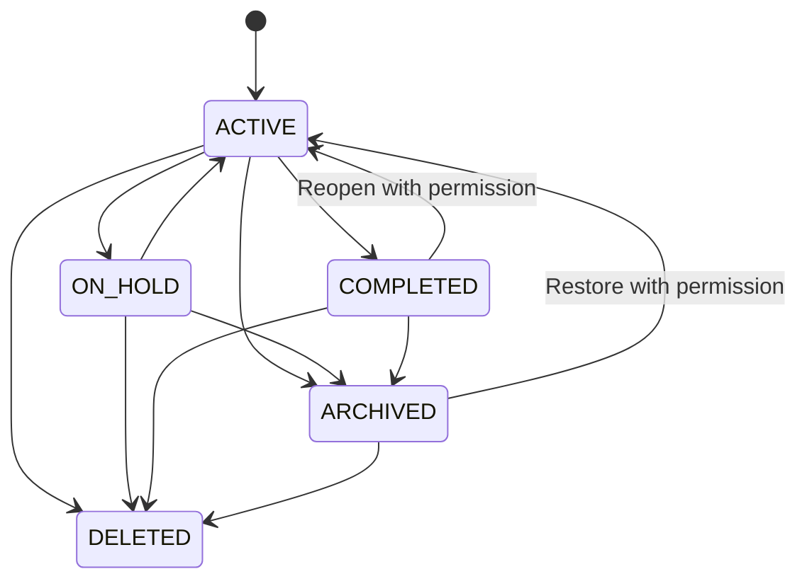

# Project Lifecycle and Design Versioning Specification

**Document ID:** SPEC-GDP-006  
**Version:** 0.1  
**Status:** Initial Draft  
**Product:** AI-Powered Garment Design and Development Platform  
**Parent Architecture Document:** ARCH-GDP-002 v0.1 — Subsystem Requirements Breakdown and Dependency Specification  
**Related Specifications:**
- SPEC-GDP-003 — Garment Design Model and Artifact Schema Specification
- SPEC-GDP-004 v0.1 — AI Execution, Prompt Compilation, and Provider Integration Specification
- SPEC-GDP-005 v0.1 — AI Usage Metering, Subscription, and Billing Specification

---

## 1. Purpose

This document defines the functional and non-functional requirements for managing the lifecycle of garment design projects, design revisions, review and approval workflows, production-readiness status, and versioned deliverables.

The platform must allow users to progress from an initial sketch, fabric reference, or garment image to a reviewed and approved garment design and, subsequently, to a validated production specification and tech pack.

The system must maintain a clear distinction between:

1. The project and its workflow state.
2. The current editable garment design.
3. Immutable design revisions.
4. Review and approval decisions.
5. Production-readiness status.
6. Versioned technical and commercial deliverables.

The project lifecycle must remain reliable even when AI jobs fail, users collaborate concurrently, artifacts change, or production specifications are incomplete.

## 2. Scope

This specification covers:

- Project creation and initialization.
- Project metadata and garment context.
- Project and design lifecycle states.
- Source asset intake and interpretation.
- Draft design management.
- Design revision creation and comparison.
- Save, restore, branch, and rollback behavior.
- AI operation and generation-job association with revisions.
- Review requests, comments, approval, and rejection.
- Approved-design immutability and supersession.
- Production-readiness validation.
- Tech-pack version association.
- Collaborative editing and concurrency control.
- Archiving, duplication, and deletion.
- Audit history and lifecycle events.
- Permissions and acceptance criteria.

This document does not define the detailed garment schema, AI model interface, payment calculation, or complete tech-pack file format. Those are specified in their corresponding documents.

## 3. Normative terminology

The terms **MUST**, **MUST NOT**, **SHOULD**, **SHOULD NOT**, and **MAY** are normative requirements.

| Term | Definition |
|---|---|
| Project | The persistent workspace representing one garment development effort or related design initiative. |
| Design | The canonical structured representation of a garment at a particular point in its development. |
| Working copy | The mutable design state currently being edited. |
| Revision | An immutable, identifiable snapshot of a design and its required dependencies at a defined point in time. |
| Branch | An independent line of design development originating from a specific revision. |
| Design approval | An explicit decision accepting a particular design revision for the stated review purpose. |
| Production readiness | A validation result indicating whether required production information is sufficiently complete and consistent. |
| Tech-pack version | An immutable generated deliverable associated with a specific design revision and production-specification revision. |
| Source asset | An uploaded or referenced sketch, garment image, fabric image, artwork, measurement document, or other input. |
| Artifact revision | A specific version of a reusable component or asset from the Artifact Registry. |
| Lifecycle event | A recorded state transition or significant action affecting a project, design, revision, approval, or deliverable. |

## 4. Design principles

### 4.1 Project state and design state are separate

A project can remain open while its design is under review, approved, or being prepared for production. The project lifecycle MUST NOT be used as a substitute for the design lifecycle.

### 4.2 Revisions are immutable

Once a design revision has been committed, its canonical design content and dependency references MUST NOT be silently modified. Corrections create a new revision or an explicitly recorded amendment, depending on the entity being corrected.

### 4.3 Approval applies to an exact revision

An approval MUST identify the exact design revision, approval purpose, approver, timestamp, and relevant review context. Approval of one revision MUST NOT automatically approve a later revision.

### 4.4 Production readiness is not design approval

A visually approved garment can still lack confirmed measurements, construction details, material specifications, grading, or other production requirements.

### 4.5 Uncertainty must remain visible

The system MUST distinguish confirmed values from inferred, suggested, missing, conflicting, and review-required values. AI-generated assumptions MUST NOT be silently promoted to confirmed production facts.

### 4.6 Reproducibility and traceability

The system SHOULD preserve sufficient input, configuration, and provenance information to explain how a revision or deliverable was created. It MUST NOT promise bit-for-bit reproducibility from nondeterministic external AI providers when that cannot be guaranteed.

### 4.7 User intent governs lifecycle transitions

AI operations MAY propose changes or validations, but MUST NOT silently approve a design, supersede an approval, or mark a project production-ready without satisfying the applicable rules.

---

## 5. System context and subsystem responsibilities

This specification primarily governs the Project Lifecycle subsystem (SS-02), integrating with the following architecture subsystems.

| Subsystem | Responsibility in this specification |
|---|---|
| SS-01 Identity and Access | Authenticates users and evaluates access permissions. |
| SS-02 Project Lifecycle | Owns project state, workflow transitions, review processes, and lifecycle coordination. |
| SS-03 Garment Design Model | Owns canonical garment structure and design-state semantics. |
| SS-04 Editor Interaction | Sends user edit, save, compare, and approval-intent actions. |
| SS-05 Artifact Registry | Resolves exact reusable artifact revisions and compatibility information. |
| SS-06 Design Operation and Execution Router | Routes structured design operations. |
| SS-07 Prompt and Request Compilation | Compiles approved operation context into provider requests. |
| SS-08 AI Provider and Orchestration | Coordinates external and internal AI execution. |
| SS-09 Generation Job Management | Tracks asynchronous execution and job outcomes. |
| SS-10 Rendering and Visualization | Generates views, previews, and comparison imagery. |
| SS-11 Asset and Storage | Stores source assets, revision snapshots, renders, and deliverables. |
| SS-12 Validation and Quality | Runs design-integrity and production-readiness checks. |
| SS-13 Usage Metering | Records attributable usage events. |
| SS-14 Subscription and Billing | Enforces commercial entitlements and billing policies. |
| SS-15 Tech Pack and Production Specification | Maintains production data and versioned tech-pack deliverables. |
| SS-16 Notification | Sends review requests, approval notices, and workflow alerts. |
| SS-17 Audit and Observability | Records lifecycle decisions and operational events. |
| SS-18 Platform Administration | Configures global workflow policies and retention rules. |

The logical subsystem boundaries MUST be maintained even if the initial implementation uses a modular monolith.

## 6. Core data entities

### 6.1 Project

A project is the top-level workspace for a garment development effort.

Required fields:

| Field | Requirement |
|---|---|
| `project_id` | Stable unique identifier. |
| `tenant_id` | Owning organization or account identifier. |
| `name` | User-visible project name. |
| `status` | Current project lifecycle state. |
| `created_by` | Creator identity. |
| `created_at` | Creation timestamp. |
| `updated_at` | Most recent applicable update timestamp. |
| `default_design_id` | Optional pointer to the primary design within the project. |
| `archived_at` | Nullable archive timestamp. |
| `deleted_at` | Nullable deletion timestamp, subject to retention policy. |
| `metadata` | Extensible project context, such as season, brand, product category, or target market. |

A project MAY contain multiple garment designs, branches, reviews, source assets, and tech-pack versions.

### 6.2 Design

A design represents the canonical structured garment model being developed.

Required fields:

- `design_id`
- `project_id`
- `design_name`
- `working_branch_id` or equivalent working-copy reference
- `head_revision_id`
- `design_status`
- `created_by`
- `created_at`
- `updated_at`

The design record MUST identify the currently selected working state and the most recently committed revision without treating them as the same entity.

### 6.3 Working copy

A working copy contains mutable edits that have not necessarily been committed as a revision.

It MUST include:

- A stable working-copy identifier.
- The base revision from which editing began.
- The current structured design state.
- A monotonically increasing concurrency version or equivalent optimistic-lock token.
- The identity of the last modifying actor, where applicable.
- Updated timestamp.
- Pending operation or validation indicators, when relevant.

The working copy MAY be stored as a complete structured state or as a base revision plus a sequence of operations, provided the effective state can be reconstructed reliably.

### 6.4 Design revision

A revision MUST be an immutable snapshot with at least:

- `revision_id`
- `design_id`
- `branch_id`
- `revision_number` or equivalent ordered identifier within the branch
- `parent_revision_ids`
- Canonical design-state reference and content hash
- Artifact revision references
- Source asset references
- Creator identity
- Creation timestamp
- Change summary
- Validation summary at commit time
- Associated operation identifiers, where available
- Schema version
- Provenance metadata

A revision MUST remain readable even when a newer revision is created.

### 6.5 Review and approval record

An approval record MUST contain:

- `approval_id`
- `project_id`
- `design_id`
- `revision_id`
- `approval_type`
- `decision`
- `decided_by`
- `decided_at`
- Optional comments or rationale
- Applicable policy or workflow version
- Revocation or supersession information, if applicable

Supported approval types SHOULD include design review, sample review, production-specification review, and final production-release review. These types MUST remain distinct.

### 6.6 Production specification revision

Production data MUST be versioned independently or through a versioned aggregate that identifies the exact data snapshot.

It SHOULD contain:

- Bill of materials (BOM).
- Points of measurement (POM).
- Base-size measurements and tolerances.
- Grading rules or size-specific measurements.
- Construction and finishing details.
- Fabric and trim specifications.
- Colorways and artwork placement.
- Quality-control requirements.
- Production notes.
- Value-level provenance and confirmation status.

### 6.7 Tech-pack version

A tech-pack version MUST identify:

- Its unique identifier.
- Project and design identifiers.
- Exact approved design revision.
- Exact production-specification revision.
- Export template and schema versions.
- Generated file references and content hashes.
- Validation report.
- Generation timestamp and actor or service identity.
- Lifecycle status.
- Any known warnings or omissions.

---

## 7. Lifecycle state models

### 7.1 Project lifecycle

The system MUST support the following project states:

| State | Meaning |
|---|---|
| `ACTIVE` | Project is open for permitted work. |
| `ON_HOLD` | Work is temporarily paused without closing the project. |
| `COMPLETED` | Project work has been declared complete under the applicable completion policy. |
| `ARCHIVED` | Project is retained for reference but excluded from normal active-work views. |
| `DELETED` | Project is marked for deletion or is no longer normally accessible, subject to retention and legal obligations. |

`COMPLETED` MUST NOT imply that every design is approved or that every tech pack is production-ready unless the project completion policy explicitly requires those conditions.

Archiving MUST NOT erase revision or approval history.

### 7.2 Design lifecycle

The system MUST support these design states:

| State | Meaning |
|---|---|
| `DRAFT` | Design is being created or edited. |
| `IN_REVIEW` | A specific revision has been submitted for review. |
| `CHANGES_REQUESTED` | A reviewer has requested changes to the submitted revision. |
| `APPROVED` | A specific revision has received the applicable design approval. |
| `SUPERSEDED` | A newer revision or replacement design has taken precedence for the relevant workflow. |
| `CANCELLED` | The design has been intentionally discontinued. |

A design's workflow status MUST be interpreted together with its current revision. The system MUST NOT imply that all revisions are approved simply because the design record has an `APPROVED` status.

If edits are made after approval, the new working state MUST be treated as unapproved until the applicable approval policy is satisfied. The previously approved revision remains approved as a historical fact.

### 7.3 Revision state

Revisions are immutable snapshots. Review status SHOULD be represented through associated review records rather than by mutating revision content.

A revision MAY have derived lifecycle indicators such as:

- Draft snapshot.
- Submitted for review.
- Approved.
- Rejected or changes requested.
- Superseded.

These indicators MUST be derived from explicit events or linked workflow records.

### 7.4 Tech-pack lifecycle

The system MUST support:

- `DRAFT`
- `GENERATING`
- `VALIDATION_FAILED`
- `READY_FOR_REVIEW`
- `APPROVED_FOR_RELEASE`, where configured
- `RELEASED`
- `SUPERSEDED`
- `CANCELLED`

The tech-pack state MUST NOT be conflated with design approval or project completion.

### 7.5 Lifecycle transition diagram

This diagram represents project-level transitions only. Design review, revision approval, and tech-pack release use separate state models.

---

## 8. Functional requirements

### 8.1 Project creation and initialization

**FR-PRJ-001 — Create project**  
The system MUST allow an authorized user to create a project with a unique project identifier and initial lifecycle state `ACTIVE`.

**FR-PRJ-002 — Project metadata**  
The system MUST support editing project metadata, including name, product category, season, brand, target market, and other configured context.

**FR-PRJ-003 — Initial design creation**  
The system MUST allow a project to contain a new garment design initialized from a blank template, sketch, fabric image, reference garment image, or another supported source.

**FR-PRJ-004 — Source provenance**  
The system MUST retain source-asset references and record which sources contributed to the initial interpretation or subsequent design operations.

**FR-PRJ-005 — Interpretation status**  
When source interpretation is incomplete or ambiguous, the system MUST distinguish confirmed values, inferred values, missing values, and values requiring review.

**FR-PRJ-006 — Multiple designs**  
The system MUST allow multiple designs within a project, subject to access and plan limits.

**FR-PRJ-007 — Duplicate project**  
The system SHOULD support project duplication. The user MUST be able to distinguish copied data from the original project. Duplication MUST NOT copy approval status as though the copied design had independently been approved.

**FR-PRJ-008 — Default design**  
A project MAY designate one design as its primary or default design. Changing that designation MUST NOT alter the underlying revision history.

### 8.2 Project metadata and collaboration

**FR-PRJ-009 — Metadata history**  
The system SHOULD record the actor and timestamp for significant metadata changes.

**FR-PRJ-010 — Ownership and access**  
The system MUST enforce tenant, organization, project, and role-based permissions before allowing reads or mutations.

**FR-PRJ-011 — Collaborator management**  
Where collaboration is enabled, authorized users MUST be able to grant or revoke project access without changing design ownership or revision provenance.

**FR-PRJ-012 — Active project listing**  
The system MUST provide project listing and filtering by lifecycle state and relevant metadata.

**FR-PRJ-013 — Search**  
The system SHOULD support searching projects by name, style identifier, product category, season, and other configured searchable fields.

### 8.3 Working-copy management

**FR-PRJ-014 — Mutable working state**  
The system MUST maintain an editable working copy distinct from immutable revisions.

**FR-PRJ-015 — Save behavior**  
The system MUST provide an explicit save mechanism or reliable autosave behavior with visible save status.

**FR-PRJ-016 — Save acknowledgment**  
The system MUST NOT indicate that a change is durably saved until the persistence layer confirms the save.

**FR-PRJ-017 — Save failure recovery**  
If a save fails, the system MUST preserve recoverable user changes where technically feasible and clearly indicate that the latest state has not been persisted.

**FR-PRJ-018 — Unsaved changes**  
The system MUST warn users before destructive navigation or actions that would discard unsaved changes, unless those changes have already been safely preserved.

**FR-PRJ-019 — Working-copy base**  
Each working copy MUST identify the revision on which it was based.

**FR-PRJ-020 — Autosave and revision creation separation**  
Autosaving working state MUST NOT automatically create a formal revision for every keystroke or low-level interaction. Revision creation MUST follow a defined commit policy.

**FR-PRJ-021 — Commit revision**  
The system MUST allow an authorized user or configured workflow to commit a working copy as an immutable design revision.

**FR-PRJ-022 — Revision summary**  
The system SHOULD generate a change summary and MUST allow the user to supply or amend a human-readable revision description.

**FR-PRJ-023 — Revision content integrity**  
The system MUST calculate or otherwise maintain an integrity identifier for canonical revision content and verify integrity when restoring or exporting that revision.

**FR-PRJ-024 — Concurrent modification**  
The system MUST detect conflicting writes to a working copy using optimistic concurrency control or an equivalent mechanism.

**FR-PRJ-025 — Conflict resolution**  
The system MUST NOT silently overwrite conflicting user changes. It MUST provide a conflict-resolution path, such as reload, compare, reapply changes, or create a branch.

### 8.4 Revision creation and history

**FR-PRJ-026 — Immutable revision**  
After a revision is committed, its canonical content MUST NOT be edited in place.

**FR-PRJ-027 — Stable revision identity**  
Every revision MUST have a stable unique identifier independent of its display name or sequential revision number.

**FR-PRJ-028 — Parent lineage**  
Each revision MUST record its parent revision or revisions. Merge operations MUST record all relevant parent lineage.

**FR-PRJ-029 — Revision history**  
The system MUST provide an ordered history of revisions, including creation time, author, summary, review status, and available validation results.

**FR-PRJ-030 — Revision comparison**  
The system SHOULD support comparison of two revisions across structured garment properties, component additions or removals, artifact references, annotations, and available visual renders.

**FR-PRJ-031 — Semantic differences**  
Where the garment schema supports it, revision comparison MUST distinguish changes in actual design properties from changes in generated previews or metadata.

**FR-PRJ-032 — Visual comparison**  
The system SHOULD provide side-by-side or overlay visual comparison for compatible 2D and rendered views.

**FR-PRJ-033 — Restore as new working state**  
Restoring an earlier revision MUST create a new working state based on that revision. It MUST NOT delete, rewrite, or move the historical revision.

**FR-PRJ-034 — Revert as a new revision**  
If a user commits a restored state, the resulting revision MUST be a new revision with an explicit relationship to the restored source revision and the current branch head.

**FR-PRJ-035 — Branch creation**  
The system SHOULD allow a user to create a branch from any accessible revision.

**FR-PRJ-036 — Branch isolation**  
Changes made on a branch MUST NOT silently alter another branch's working copy or revisions.

**FR-PRJ-037 — Branch merge**  
If branch merging is supported, the system MUST detect conflicting structured properties and incompatible component or artifact relationships before accepting the merge.

**FR-PRJ-038 — Merge traceability**  
A merged revision MUST identify its parent revisions and summarize the changes and conflicts resolved.

**FR-PRJ-039 — Revision retention**  
The system MUST retain revisions according to configured retention policies and MUST NOT purge revisions required by active approvals, released tech packs, audits, or legal retention requirements.

**FR-PRJ-040 — Revision schema migration**  
When canonical schema versions change, the system MUST retain the original revision content or an equivalent recoverable representation and record any migration applied for viewing or execution.

### 8.5 Design operations and AI execution

**FR-PRJ-041 — Operation association**  
Meaningful design operations MUST be associated with the working-copy state and, where applicable, the revision from which the operation originated.

**FR-PRJ-042 — Generation input snapshot**  
Each AI generation job MUST identify the exact design state, operation, source assets, artifact revisions, and relevant configuration used to create its request.

**FR-PRJ-043 — Stale generation detection**  
If a generation job completes after its target working copy has changed, the system MUST detect that its result was generated against an earlier state.

**FR-PRJ-044 — Safe result application**  
A stale generation result MUST NOT silently overwrite newer user changes. The system SHOULD allow the user to inspect, compare, branch, or explicitly apply the result when compatible.

**FR-PRJ-045 — Failed generation isolation**  
A failed or cancelled AI job MUST NOT corrupt the current working copy or invalidate an existing committed revision.

**FR-PRJ-046 — Generation provenance**  
The system MUST preserve references to applicable model/provider information, request configuration, operation identifiers, outputs, and validation outcomes according to SPEC-GDP-004.

**FR-PRJ-047 — Billing association**  
Usage events generated by lifecycle-associated AI operations MUST retain enough identifiers to associate them with the tenant, project, design, operation, and job as applicable, consistent with SPEC-GDP-005.

**FR-PRJ-048 — No automatic approval**  
Successful AI generation or validation MUST NOT automatically constitute human design approval unless an explicitly configured and disclosed approval policy permits automated approval for a defined purpose.

### 8.6 Review and approval

**FR-PRJ-049 — Submit revision for review**  
The system MUST allow an authorized user to submit a committed revision for review.

**FR-PRJ-050 — Review target**  
Every review request MUST identify the exact revision under review.

**FR-PRJ-051 — Review purpose**  
The system MUST record the purpose of each review, such as visual design review, sample review, or production release review.

**FR-PRJ-052 — Review eligibility**  
The system MUST validate configured review prerequisites before accepting a submission.

**FR-PRJ-053 — Reviewer permissions**  
Only users with the required permission MAY approve, reject, or request changes for the relevant review type.

**FR-PRJ-054 — Review decisions**  
The system MUST support at least `APPROVE`, `REQUEST_CHANGES`, and `REJECT`, subject to workflow configuration.

**FR-PRJ-055 — Decision rationale**  
The system MUST support reviewer comments or a rationale for review decisions. Required-comment policies MAY be configured.

**FR-PRJ-056 — Approval binding**  
An approval MUST be bound to the exact revision identifier and approval type.

**FR-PRJ-057 — Post-approval edits**  
Any change that produces a new revision MUST leave the previous revision's approval record intact but MUST NOT transfer that approval automatically to the new revision.

**FR-PRJ-058 — Approval invalidation policy**  
The system MUST calculate the current approval status using explicit revision and workflow relationships. It MUST distinguish a historical approval from approval of the current working state.

**FR-PRJ-059 — Approval revocation**  
Where policy permits revocation, the system MUST record the revoking actor, time, reason, and affected approval. It MUST NOT erase the original decision from audit history.

**FR-PRJ-060 — Approval notification**  
The system SHOULD notify relevant users when a review is requested, a decision is recorded, or a required follow-up action is assigned.

**FR-PRJ-061 — Separation of duties**  
The system SHOULD support configurable policies requiring a different user to approve a revision than the user who submitted it.

**FR-PRJ-062 — Approval history**  
The system MUST provide the history of review requests, comments, decisions, and revocations for a revision.

### 8.7 Production-readiness workflow

**FR-PRJ-063 — Separate readiness status**  
The system MUST maintain production-readiness status independently of visual design approval.

**FR-PRJ-064 — Validation against a fixed revision**  
Each production-readiness validation run MUST identify the design revision and production-specification revision it evaluated.

**FR-PRJ-065 — Required-field rules**  
The system MUST validate required production fields according to garment category, product type, workflow policy, and configured export requirements.

**FR-PRJ-066 — Unknown and inferred values**  
The system MUST flag missing, inferred, conflicting, or unconfirmed production values that affect readiness.

**FR-PRJ-067 — Validation severity**  
Validation findings MUST support severity levels, at minimum distinguishing blocking errors from warnings.

**FR-PRJ-068 — No fabricated production facts**  
The system MUST NOT convert AI suggestions into confirmed measurements, fabric composition, tolerances, grading, or construction specifications without an authorized confirmation or an explicitly trusted data source.

**FR-PRJ-069 — Readiness evidence**  
A readiness result MUST include a validation timestamp, rule-set version, evaluated revision identifiers, and findings.

**FR-PRJ-070 — Readiness invalidation**  
If the design revision, production-specification revision, or applicable validation rules change, the system MUST mark the prior readiness result as historical or stale when it no longer applies.

**FR-PRJ-071 — Readiness override**  
If the business allows an authorized override of a blocking finding, the system MUST record the actor, rationale, affected finding, and applicable policy. An override MUST NOT erase the underlying finding.

**FR-PRJ-072 — Readiness state**  
The system SHOULD expose readiness as a derived status, such as `NOT_CHECKED`, `BLOCKED`, `READY_WITH_WARNINGS`, or `READY`, rather than as an unqualified editable Boolean.

### 8.8 Tech-pack lifecycle and release

**FR-PRJ-073 — Generate from fixed inputs**  
A tech pack MUST be generated from identified design and production-specification revisions, not from an unversioned moving working copy.

**FR-PRJ-074 — Approved revision requirement**  
If the configured workflow requires design approval before tech-pack generation or release, the system MUST verify that the exact referenced revision has the required approval.

**FR-PRJ-075 — Readiness requirement**  
If the configured workflow requires production readiness, the system MUST verify that the relevant validation result applies to the exact design and production-specification revisions being exported.

**FR-PRJ-076 — Deliverable immutability**  
A released tech-pack version MUST be immutable. Changes MUST result in a new version.

**FR-PRJ-077 — Tech-pack traceability**  
Every tech-pack version MUST retain references to its exact source revisions, generated files, template/schema versions, and validation results.

**FR-PRJ-078 — Incomplete export**  
If an export is permitted with warnings or missing information, the system MUST visibly disclose those omissions and MUST NOT label the deliverable fully production-ready unless the configured readiness policy allows it.

**FR-PRJ-079 — Superseding deliverables**  
A newer tech-pack version MAY supersede an earlier version, but MUST NOT delete or rewrite the earlier released deliverable.

**FR-PRJ-080 — Release authorization**  
The system MUST enforce applicable permissions and approval policies before marking a tech pack as released.

**FR-PRJ-081 — Reproducible source references**  
The system MUST retain the source revision identifiers and content integrity information necessary to identify the inputs used for a historical tech pack.

**FR-PRJ-082 — Design change after release**  
If a design or production specification changes after a tech pack is released, the system MUST identify the earlier deliverable as potentially outdated relative to the new state and require an explicit decision about whether to generate a new version.

### 8.9 Project hold, completion, archive, and deletion

**FR-PRJ-083 — Place on hold**  
An authorized user MUST be able to place a project on hold with an optional reason.

**FR-PRJ-084 — Resume project**  
An authorized user MUST be able to resume a project from hold, subject to access and policy restrictions.

**FR-PRJ-085 — Complete project**  
The system MUST support project completion according to configured policy. Completion checks MAY include unresolved reviews, required approvals, production readiness, and deliverable status.

**FR-PRJ-086 — Reopen completed project**  
The system SHOULD allow authorized users to reopen a completed project while recording the actor and rationale.

**FR-PRJ-087 — Archive project**  
The system MUST allow an authorized user to archive a project without deleting its historical revisions, approvals, or released deliverables.

**FR-PRJ-088 — Restore archived project**  
The system SHOULD allow authorized users to restore an archived project, subject to retention and access policies.

**FR-PRJ-089 — Deletion policy**  
The system MUST distinguish logical deletion from physical data erasure.

**FR-PRJ-090 — Protected records**  
Deletion MUST NOT bypass legal holds, retention obligations, billing records, or records required to substantiate prior approvals and released deliverables.

**FR-PRJ-091 — Dependency warning**  
Before destructive operations, the system MUST identify significant dependent entities that may be affected, such as active reviews, branches, or deliverables.

**FR-PRJ-092 — Asynchronous deletion**  
If physical deletion requires asynchronous processing, the system MUST track deletion status and prevent the project from being presented as fully erased until the configured process is complete.

### 8.10 Lifecycle audit and notifications

**FR-PRJ-093 — Transition audit**  
Every significant lifecycle transition MUST generate an auditable event.

**FR-PRJ-094 — Actor attribution**  
Events MUST distinguish user-initiated actions, system actions, automated policy decisions, and external service callbacks.

**FR-PRJ-095 — Event ordering**  
The system MUST preserve enough ordering information to reconstruct the effective sequence of revisions and lifecycle decisions.

**FR-PRJ-096 — Idempotent transitions**  
Lifecycle commands MUST be designed to avoid duplicate state changes when requests are retried.

**FR-PRJ-097 — Notification consistency**  
Notifications MUST be based on committed lifecycle events. A notification MUST NOT announce an approval or release that has not been durably recorded.

**FR-PRJ-098 — Notification retry**  
Transient notification delivery failures SHOULD be retried without duplicating the underlying lifecycle action.

**FR-PRJ-099 — Audit access**  
Audit history MUST be available only to authorized users and services.

**FR-PRJ-100 — Audit integrity**  
The system MUST protect lifecycle audit records against unauthorized modification or deletion.

---

## 9. Lifecycle workflows

### 9.1 Create and develop a garment design

1. The user creates a project.
2. The system creates the project and initializes its status as `ACTIVE`.
3. The user creates a design using a blank template or source asset.
4. The system stores the source asset and initializes the canonical garment model.
5. The user edits the design through structured controls, drawings, artifact attachment, or supported AI operations.
6. The working copy is saved with concurrency control.
7. The user commits a revision.
8. The system records revision lineage, content integrity data, provenance, and applicable validation results.
9. The user continues editing or submits the revision for review.

At no point should the system require a fully completed tech pack before a user can begin visual design unless the relevant workflow explicitly requires it.

### 9.2 Submit, review, and approve a design

1. The user selects a committed revision and requests review.
2. The system validates review eligibility and permissions.
3. The system creates a review record bound to the revision.
4. The reviewer inspects the visual output, structured changes, annotations, and relevant context.
5. The reviewer approves, requests changes, or rejects the revision.
6. The system commits the decision and its audit event.
7. Relevant users are notified after the decision is durably recorded.
8. If changes are requested, the author creates a new working state and eventually commits a new revision.
9. The new revision requires its own approval if the workflow requires approval.

### 9.3 Edit after approval

1. Revision `R12` has an approval record.
2. A user restores or continues editing from `R12`.
3. The user changes the collar and commits `R13`.
4. The system preserves the approval record for `R12`.
5. The system MUST NOT mark `R13` approved solely because `R12` was approved.
6. If the workflow requires approval of the current design, the system indicates that `R13` requires review.

The platform may still display `R12` as the latest approved revision while `R13` is under development.

### 9.4 Apply an AI result when the working state has changed

1. The user launches a generation job against working-copy version `W8`.
2. The user continues editing, producing working-copy version `W9`.
3. The generation job completes using inputs from `W8`.
4. The system detects that the target working copy no longer matches the job's base state.
5. The system stores the result as a separate candidate output.
6. The user can compare the result with `W9`, create a branch, or explicitly apply compatible changes.
7. The system records the application decision and resulting revision lineage.

The system MUST NOT silently replace `W9` with the older generation result.

### 9.5 Generate and release a tech pack

1. The user selects an approved design revision.
2. The user completes or updates the production specification.
3. The validation subsystem evaluates the exact design and production-specification revisions.
4. Blocking findings are resolved or handled through an authorized override policy.
5. The user requests tech-pack generation.
6. The system generates a deliverable using fixed, versioned inputs.
7. The generated deliverable is validated and recorded as a new tech-pack version.
8. If review is required, the version enters `READY_FOR_REVIEW`.
9. An authorized user approves or releases the version.
10. The system records the release event and retains the exact source references.

### 9.6 Archive and restore

1. An authorized user requests archive.
2. The system checks permissions and relevant workflow restrictions.
3. The project is marked `ARCHIVED`.
4. The project is removed from default active-work views but remains accessible according to permissions.
5. An authorized user may restore the project to `ACTIVE`.
6. Historical revision and approval records remain unchanged.

---

## 10. Data consistency and transactional requirements

### 10.1 Revision commit transaction

Committing a revision MUST be atomic from the perspective of lifecycle correctness. The system MUST ensure that:

- The working-copy version has not changed unexpectedly.
- The canonical snapshot is durably stored or safely referenced.
- The revision identifier and lineage are recorded.
- The branch head or design head is updated according to the concurrency policy.
- The corresponding lifecycle event is recorded or reliably queued.

If a transaction cannot complete, the system MUST NOT expose a partially committed revision as valid.

### 10.2 Approval transaction

Recording an approval MUST ensure that:

- The target revision exists and is immutable.
- The approver is authorized.
- The review request and policy requirements are satisfied.
- The decision record is durably stored.
- The relevant workflow status is updated consistently.
- An audit event is recorded or reliably queued.

Duplicate approval requests MUST NOT create contradictory decisions through simple network retries. A distinct new decision must be an explicit action.

### 10.3 Event publication

Where event-driven processing is used, the system SHOULD use a transactional outbox or an equivalent reliable mechanism to publish lifecycle events after the corresponding database transaction commits.

Consumers MUST tolerate duplicate event delivery.

### 10.4 Cross-subsystem consistency

The project lifecycle subsystem MUST not assume that an asynchronous downstream action has succeeded merely because a command was accepted.

For example:

- A tech-pack generation request is not a completed export.
- A notification request is not confirmed delivery.
- A generation job being queued is not a completed AI operation.
- A validation job being started is not a readiness result.
- A payment or usage event being submitted is not necessarily a settled billing record.

Each dependent workflow MUST expose its own status and result.

---

## 11. Canonical revision and dependency integrity

### 11.1 Revision snapshot

A revision MUST capture the canonical garment state, not only a rendered image.

The snapshot SHOULD include:

- Component hierarchy and stable component identifiers.
- Component properties and constraints.
- Relationships between components.
- Placement, scale, orientation, and supported geometry.
- Fabric, trim, colorway, and artwork references.
- User annotations that are part of the design definition.
- Exact artifact revision references.
- Provenance and confirmation status for significant values.
- Canonical schema version.

Rendered PNG, WebP, SVG, or 3D outputs MAY be stored as revision-associated derived assets, but MUST NOT replace the canonical model when the product claims that the design is structurally editable.

### 11.2 Artifact dependency pinning

When a design uses a reusable artifact, the revision MUST identify the specific artifact revision used.

For example, if a sleeve uses artifact `SLV-0007` revision `3`, a later update to `SLV-0007` MUST NOT silently change the historical design revision.

The platform MAY offer a deliberate migration to a newer artifact revision. Such migration MUST produce a new working state and, when committed, a new design revision.

### 11.3 Asset dependency retention

Assets required to render or interpret a historical revision SHOULD be retained for at least as long as that revision remains available.

If an asset must be removed for legal, privacy, or contractual reasons, the system MUST record the resulting limitation where permitted and MUST NOT falsely indicate that the historical revision is fully reconstructable.

### 11.4 Derived render status

A render is a derived representation of a design revision. The system SHOULD record:

- Source revision.
- Rendering engine and version.
- Rendering configuration.
- Input asset references.
- Output file reference and integrity hash.
- Generation timestamp.
- Render status.

A newer render MUST NOT alter the canonical revision content. If rendering parameters change, the new render should be stored as a new derived output.

---

## 12. Permissions and authorization

The implementation MUST support permission checks at both the project level and the relevant action level.

| Action | Typical permission |
|---|---|
| View project and history | Project reader |
| Edit working copy | Design editor |
| Commit revision | Design editor or designated author |
| Create branch | Design editor |
| Submit review | Design submitter |
| Approve design | Design approver |
| Override readiness finding | Authorized production lead or administrator |
| Approve or release tech pack | Production approver |
| Archive or restore project | Project manager or administrator |
| Permanently erase data | Authorized administrator, subject to retention policy |

Actual role names and assignments MAY vary by tenant.

The system MUST NOT infer authorization from project visibility alone. A user who can view a project is not necessarily authorized to approve or release it.

Service accounts MUST use scoped permissions and MUST be attributable in audit records.

---

## 13. Non-functional requirements

### 13.1 Performance

**NFR-PRJ-001** — The system SHOULD return project lists and ordinary metadata views within 2 seconds at the 95th percentile under the agreed reference load.

**NFR-PRJ-002** — The system SHOULD retrieve a revision summary and its primary metadata within 2 seconds at the 95th percentile under the agreed reference load, excluding large asset transfer time.

**NFR-PRJ-003** — Revision comparison MAY be asynchronous for complex designs but MUST provide visible progress and a recoverable result state.

**NFR-PRJ-004** — Lifecycle state changes SHOULD be acknowledged promptly after durable persistence. Long-running downstream work MUST be represented as asynchronous processing.

These targets are initial engineering objectives and MUST be validated against expected project sizes, payload sizes, and concurrent-user counts.

### 13.2 Reliability

**NFR-PRJ-005** — A transient failure in rendering, AI generation, notification delivery, or export MUST NOT corrupt an existing committed revision.

**NFR-PRJ-006** — The system MUST support recovery from interrupted revision commits without exposing invalid partial revisions.

**NFR-PRJ-007** — Lifecycle commands SHOULD be idempotent or use explicit idempotency keys where retries could cause duplicate effects.

**NFR-PRJ-008** — Backups and recovery procedures MUST preserve revision lineage, approval records, and released deliverable references consistently.

### 13.3 Security and privacy

**NFR-PRJ-009** — All project and revision access MUST be authorized server-side.

**NFR-PRJ-010** — Tenant isolation MUST apply to projects, revisions, assets, comments, approvals, and deliverables.

**NFR-PRJ-011** — Sensitive business data and credentials MUST NOT be exposed through lifecycle metadata or audit payloads unnecessarily.

**NFR-PRJ-012** — Data export, retention, and erasure MUST follow applicable contractual, legal, and organizational requirements.

### 13.4 Usability

**NFR-PRJ-013** — The interface MUST distinguish the current working state from the latest committed revision and latest approved revision.

**NFR-PRJ-014** — The interface MUST display visible save status and identify unsaved or conflicting changes.

**NFR-PRJ-015** — Approval and readiness indicators MUST identify the revision or specification to which they apply.

**NFR-PRJ-016** — Users MUST be able to understand why a design is blocked from approval or why a tech pack is not production-ready, through actionable findings rather than an unexplained status label.

**NFR-PRJ-017** — Destructive or consequential actions SHOULD provide confirmation and a clear explanation of their effect on history and deliverables.

### 13.5 Maintainability and extensibility

**NFR-PRJ-018** — Lifecycle state transitions MUST be defined through explicit, testable rules rather than scattered UI-only logic.

**NFR-PRJ-019** — Workflow policy and required review stages SHOULD be configurable without changing the core revision model.

**NFR-PRJ-020** — Schema and workflow migrations MUST be versioned and auditable.

---

## 14. API and command contract requirements

The API design MAY use REST, GraphQL, command-oriented endpoints, or an equivalent interface. Regardless of transport, the following logical operations MUST be supported.

| Operation | Purpose |
|---|---|
| `CreateProject` | Create a project and its initial metadata. |
| `UpdateProjectMetadata` | Update allowed project metadata. |
| `CreateDesign` | Create a design within a project. |
| `GetProjectLifecycle` | Retrieve project state and relevant workflow summaries. |
| `GetDesignHistory` | Retrieve revision lineage and history. |
| `SaveWorkingCopy` | Persist a working-copy change with concurrency control. |
| `CommitRevision` | Create an immutable revision. |
| `CompareRevisions` | Return structured and available visual differences. |
| `RestoreRevisionToWorkingCopy` | Create a working state based on an earlier revision. |
| `CreateBranch` | Start a new branch from a specific revision. |
| `SubmitRevisionForReview` | Initiate a review of an exact revision. |
| `RecordReviewDecision` | Approve, reject, or request changes. |
| `ValidateProductionReadiness` | Validate fixed design and production-specification revisions. |
| `GenerateTechPack` | Create a tech-pack generation request from fixed inputs. |
| `ReleaseTechPack` | Release a validated and authorized tech-pack version. |
| `ArchiveProject` | Archive a project. |
| `RestoreProject` | Restore an archived project. |
| `CompleteProject` | Complete a project under the configured policy. |
| `ReopenProject` | Reopen a completed project when permitted. |

Mutating commands SHOULD include an idempotency key or equivalent retry-safety mechanism.

Commands that depend on mutable state MUST include an expected version, expected head revision, or equivalent concurrency precondition. If the precondition fails, the system MUST return a conflict response instead of silently overwriting newer state.

The system MUST return stable identifiers and machine-readable error codes for expected failures, including:

- `PERMISSION_DENIED`
- `INVALID_STATE_TRANSITION`
- `REVISION_NOT_FOUND`
- `REVISION_NOT_APPROVED`
- `CONCURRENT_MODIFICATION`
- `VALIDATION_BLOCKED`
- `DEPENDENCY_UNAVAILABLE`
- `IDEMPOTENCY_CONFLICT`
- `RETENTION_POLICY_BLOCKED`

Exact transport status codes and payload formats are implementation decisions.

---

## 15. Recommended event model

The lifecycle subsystem SHOULD publish domain events such as:

- `ProjectCreated`
- `ProjectMetadataUpdated`
- `ProjectPlacedOnHold`
- `ProjectResumed`
- `ProjectCompleted`
- `ProjectArchived`
- `ProjectRestored`
- `ProjectReopened`
- `DesignCreated`
- `WorkingCopySaved`
- `RevisionCommitted`
- `BranchCreated`
- `RevisionRestoredToWorkingCopy`
- `RevisionSubmittedForReview`
- `ReviewDecisionRecorded`
- `ApprovalRevoked`
- `ProductionReadinessEvaluated`
- `ProductionReadinessInvalidated`
- `TechPackGenerationRequested`
- `TechPackGenerated`
- `TechPackReleased`
- `TechPackSuperseded`

Events SHOULD include:

- Unique event ID.
- Event type and schema version.
- Tenant, project, and relevant design identifiers.
- Relevant revision identifiers.
- Actor or service identity.
- Event timestamp.
- Correlation and causation identifiers.
- Relevant workflow policy version.

Events MUST NOT contain unnecessary sensitive information or full confidential assets when references are sufficient.

---

## 16. Failure handling

### 16.1 Revision commit failure

If the revision snapshot is stored but the lifecycle transaction fails, the implementation MUST ensure that the snapshot is either safely recoverable and associated with a valid revision or identified as an uncommitted orphan for controlled cleanup. It MUST NOT appear as a normal committed revision prematurely.

### 16.2 Review submission race

If a user submits a revision while the working copy changes concurrently, the review request MUST remain bound to the selected committed revision. The system MUST NOT silently switch the review target to the newer working state.

### 16.3 Reviewer acts on stale state

The review interface MUST show which revision is being reviewed. If a newer revision exists, the reviewer MAY proceed with the selected historical revision when policy permits, but the system MUST clearly communicate that it is not the latest revision.

### 16.4 Duplicate callbacks

Duplicate callbacks from external jobs, renderers, or notification services MUST NOT create duplicate revisions, approval records, or tech-pack releases.

### 16.5 Dependency unavailable

If a required artifact, source asset, validation service, or export service is temporarily unavailable, the system MUST preserve the underlying revision and expose the failed operation as a separate recoverable status.

### 16.6 Partial tech-pack generation

If some files are generated successfully but other required files fail, the system MUST identify the output as incomplete or failed according to the export policy. It MUST NOT mark the deliverable released unless all release prerequisites are satisfied.

### 16.7 Concurrent approval and edit

If an approval is recorded for revision `R12` while a user is editing a working copy based on `R12`, the approval MUST apply only to `R12`. Subsequent edits remain unapproved until the relevant workflow requirements are met.

---

## 17. Acceptance criteria

The implementation will be considered compliant with this specification when the following scenarios pass.

### AC-001 — Project initialization

Given an authorized user creates a project, when the operation completes successfully, then the project has a stable ID, an initial `ACTIVE` state, an owning tenant, and an attributable creator.

### AC-002 — Save and commit separation

Given a user edits a working copy, when autosave completes, then the system persists the working state without necessarily creating a formal revision. When the user commits, the system creates an immutable revision.

### AC-003 — Revision immutability

Given revision `R1` has been committed, when the user changes the design, then `R1` remains unchanged and the changed state is saved or committed separately.

### AC-004 — Restore behavior

Given revisions `R1`, `R2`, and `R3` exist, when the user restores `R1` and commits the restored state, then a new revision is created with valid lineage and `R2` and `R3` remain available.

### AC-005 — Artifact pinning

Given revision `R1` references artifact revision `A1`, when the artifact is updated to `A2`, then `R1` continues to reference `A1` unless a deliberate migration produces a new design revision.

### AC-006 — Approval binding

Given revision `R1` is approved, when the user creates revision `R2`, then `R2` is not automatically approved.

### AC-007 — Stale generation

Given an AI job is launched against working-copy version `W1`, when the user changes the working copy to `W2` before the job finishes, then the job result does not silently overwrite `W2`.

### AC-008 — Concurrent edit conflict

Given two users edit the same working-copy version, when both attempt conflicting writes, then the system detects the conflict and does not silently discard either user's changes.

### AC-009 — Production readiness

Given a visually approved design lacks a required base measurement or material specification, when readiness validation runs, then the system flags the missing information and does not claim full production readiness.

### AC-010 — Tech-pack provenance

Given a tech pack is generated and released, when a user views its metadata, then the exact design revision, production-specification revision, template/schema version, and output references are identifiable.

### AC-011 — New deliverable version

Given a released tech pack exists, when production specifications are changed and a new export is created, then the system creates a new tech-pack version without altering the previous released deliverable.

### AC-012 — Archive preservation

Given a project contains approved revisions and released tech packs, when the project is archived, then its historical revisions, approvals, and deliverables remain accessible to authorized users.

### AC-013 — Idempotent transition

Given a lifecycle command is retried with the same idempotency key, when the request is processed, then it does not create duplicate committed effects.

### AC-014 — Audit completeness

Given an authorized user approves a revision, when an auditor inspects the lifecycle history, then the system identifies the revision, approver, decision, timestamp, and relevant policy context.

### AC-015 — Approval race

Given a review is submitted for `R5`, when `R6` is committed before the review decision, then the resulting approval remains attached to `R5` and is not transferred to `R6`.

---

## 18. Implementation priorities

### Phase 1 — Reliable project and revision foundation

- Project creation, metadata, and permissions.
- One editable working copy per design.
- Durable save behavior and concurrency control.
- Immutable revision snapshots and revision history.
- Restore as a new working state.
- Source and artifact revision references.
- Basic audit events.

### Phase 2 — Review and approval

- Review submission and decision records.
- Approval binding to exact revisions.
- Change-request workflow.
- Reviewer permissions and notifications.
- Visual and structured revision comparison.

### Phase 3 — Production readiness and deliverables

- Versioned production specifications.
- Validation runs bound to exact revisions.
- Missing and inferred value tracking.
- Versioned tech-pack generation.
- Tech-pack approval and release.
- Supersession and stale-deliverable indicators.

### Phase 4 — Advanced collaboration and lifecycle management

- Branching and merge conflict handling.
- Multi-stage and configurable approval workflows.
- Advanced audit queries.
- Project completion policy.
- Archive, restore, and governed deletion.
- Enterprise retention and legal-hold support.

---

## 19. Open decisions

The following decisions must be resolved before the corresponding features are finalized.

| ID | Decision | Recommended initial approach |
|---|---|---|
| OD-PRJ-001 | What event creates a formal revision? | Explicit user commit, review submission, or configured milestone; not every autosave. |
| OD-PRJ-002 | Can a project contain multiple independently approved designs? | Yes. Track approval per design revision and approval type. |
| OD-PRJ-003 | Are branches required for the first release? | Defer advanced branch merging; implement revision restore and lineage first. |
| OD-PRJ-004 | Can a design be approved with warnings? | Allow configurable review policies; production readiness remains separate. |
| OD-PRJ-005 | Is self-approval allowed? | Default to configurable separation of duties for formal production approval. |
| OD-PRJ-006 | Can an old revision be released after a newer revision exists? | Permit only through an explicit policy and clearly disclose the selected revision. |
| OD-PRJ-007 | What are project completion criteria? | Make them configurable by workflow or tenant. |
| OD-PRJ-008 | What are revision and asset retention periods? | Define by subscription, organization policy, legal requirements, and storage cost. |
| OD-PRJ-009 | Is deletion reversible? | Use logical deletion first, with governed asynchronous physical erasure where required. |
| OD-PRJ-010 | How should schema migrations affect historical revisions? | Preserve original snapshots and record migration versions; do not rewrite history silently. |
| OD-PRJ-011 | Which readiness findings block tech-pack release? | Configure rules by garment category, deliverable type, and business policy. |
| OD-PRJ-012 | Is approval required before a sample is ordered? | Configure a sample-order gate independently from visual design approval. |
| OD-PRJ-013 | Can external customers or factories participate in reviews? | Support scoped external identities and permissions if required by the commercial model. |
| OD-PRJ-014 | How should an approved revision be superseded? | Record an explicit supersession relationship while preserving the prior approval as history. |

---

## 20. Dependencies and related specifications

This document depends on:

- **ARCH-GDP-002:** Defines subsystem boundaries, ownership, and integration expectations.
- **SPEC-GDP-003:** Defines the canonical garment design model and artifact references.
- **SPEC-GDP-004:** Defines AI operations, generation inputs, execution tracking, and output provenance.
- **SPEC-GDP-005:** Defines usage metering, entitlement checks, pricing, and billing traceability.

The following specifications should align with or extend this document:

- Artifact Registry and reusable component versioning.
- Design operation and execution contracts.
- Validation and quality rules.
- Production specification and tech-pack schema.
- Collaboration and access-control policy.
- Asset retention, deletion, and disaster recovery.
- API contracts and domain-event schemas.

## 21. Definition of done

This specification is implemented when the platform can reliably create and manage garment projects, preserve immutable design revisions, prevent concurrent edits from silently overwriting one another, bind approvals to exact revisions, distinguish visual approval from production readiness, and generate traceable versioned tech packs from fixed design and production-specification inputs.

The resulting workflow must preserve the user's design history and production evidence without treating AI-generated imagery as proof of structural accuracy, manufacturing feasibility, or confirmed technical specifications.

**End of document — SPEC-GDP-006 v0.1**