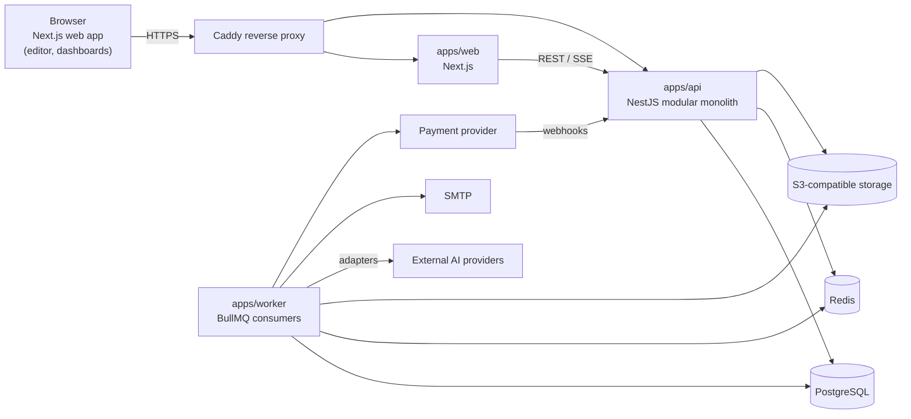

# 01 — Architecture

Derived from TECH-GDP-001 (`11-tech-stack.md`) and the subsystem references in SPEC-GDP-003…010. Where the specs leave a choice open, the choice is recorded in [`05-decisions.md`](05-decisions.md).

---

## 1. Architectural style

- **Modular monolith** (NestJS) for the API + **separate worker process(es)** (BullMQ consumers) sharing domain packages.
- **PostgreSQL** is the system of record (relational tables + JSONB for flexible garment properties, provider metadata, operation params). **No MongoDB.**
- **Redis** = cache, rate limiting, BullMQ transport. Never the only record of a business operation.
- **S3-compatible object storage** for every file (uploads, generated images, SVG, GLB, exports). Postgres stores keys + metadata + checksums + provenance.
- **REST + OpenAPI**, **SSE** for job progress. WebSockets only if real-time collaboration is later justified.
- **Self-hosted with Docker Compose**; only the reverse proxy (Caddy) is public.



## 2. Subsystem map (SS-01 … SS-18)

The specs reference `ARCH-GDP-002` subsystem IDs. That document is **missing from `docs/init/`** (file `02-subsystem-breakdown.md` actually contains a copy of the Tech Pack spec). The map below is reconstructed from the cross-references in SPEC-GDP-003…010 and is authoritative for this plan.

| SS    | Subsystem                           | Backend module (`apps/api/src/modules/…`)    | Shared package                       | Primary spec                 | Built in            |
| ----- | ----------------------------------- | -------------------------------------------- | ------------------------------------ | ---------------------------- | ------------------- |
| SS-01 | Identity & Access                   | `identity`, `organizations`, `authorization` | `contracts`                          | SPEC-009                     | I05–I08, I47        |
| SS-02 | Project Lifecycle                   | `projects`, `reviews`                        | —                                    | SPEC-006                     | I10, I12, I19, I28  |
| SS-03 | Garment Design Model                | `designs`                                    | `garment-model`                      | SPEC-003                     | I11, I12            |
| SS-04 | Editor Interaction                  | (frontend) `apps/web/src/features/editor`    | `editor-core`                        | SPEC-007                     | I15–I19, I27        |
| SS-05 | Artifact Registry                   | `artifacts`                                  | `garment-model`                      | SPEC-003 §11                 | I13, I18            |
| SS-06 | Design Operation & Execution Router | `operations`                                 | `design-operations`                  | SPEC-004 §7–8                | I14, I25            |
| SS-07 | Prompt & Request Compilation        | `compilation`                                | `ai-contracts`                       | SPEC-004 §9–10               | I23                 |
| SS-08 | AI Provider & Orchestration         | `ai-providers`                               | `ai-contracts`                       | SPEC-004 §11–13, §18         | I22, I33            |
| SS-09 | Generation Job Management           | `jobs`                                       | `contracts`                          | SPEC-004 §14–17, §20–21      | I21                 |
| SS-10 | Rendering & Visualization           | `rendering` (+ worker renderers)             | `render-contracts`, `garment-render` | SPEC-010                     | I16, I35–I37        |
| SS-11 | Asset & Storage                     | `assets`                                     | —                                    | TECH §3.6, SPEC-003 §12      | I09                 |
| SS-12 | Validation & Quality                | `validation`                                 | `garment-model` (rules)              | SPEC-003 §15, SPEC-008 §21   | I20, I41            |
| SS-13 | Usage Metering                      | `metering`                                   | —                                    | SPEC-005 §6–8, §13           | I24, I34            |
| SS-14 | Subscription & Billing              | `billing`                                    | —                                    | SPEC-005 §9–12, §14–21       | I24 (lite), I30–I32 |
| SS-15 | Tech Pack & Production Spec         | `techpack`                                   | `techpack-model`                     | SPEC-008                     | I38–I44             |
| SS-16 | Notification                        | `notifications`                              | —                                    | SPEC-006 §8.10, SPEC-009 §19 | I29                 |
| SS-17 | Audit & Observability               | `audit`, `platform/observability`            | —                                    | SPEC-009 §15, TECH §3.11     | I03, I46            |
| SS-18 | Platform Administration             | `admin`                                      | —                                    | various                      | I45                 |

Cross-cutting platform code lives in `apps/api/src/platform/` (config, prisma, logging, outbox, idempotency, errors, request context, authz guard).

## 3. Monorepo layout (target)

Create packages **only when the iteration that needs them arrives** (TECH §4).

```text
ai-designer-v2/
├── CLAUDE.md                     # session memory / entry point for Claude
├── .claude/commands/             # /next-iteration, /finish-iteration, /handoff (installed from docs/plan/claude-commands/)
├── apps/
│   ├── web/                      # Next.js (App Router) — dashboard, editor, admin
│   │   └── src/
│   │       ├── app/              # routes
│   │       ├── features/         # editor, projects, artifacts, billing, techpack, admin…
│   │       ├── components/ui/    # shadcn/ui
│   │       └── lib/              # api client, query client, auth helpers
│   ├── api/                      # NestJS
│   │   └── src/
│   │       ├── platform/         # config, prisma, logging, context, errors, validation (@Endpoint), ids, audit,
│   │       │                     # outbox, idempotency, jobs, concurrency, openapi, authz guard (I07)
│   │       └── modules/          # one folder per module in §2 (+ dev-examples: reference implementation)
│   └── worker/                   # outbox dispatcher, events consumers, durable-job processor, sweeper; later ai, render, export, email…
├── packages/
│   ├── config/                   # tsconfig bases, eslint, prettier, vitest presets
│   ├── contracts/                # zod schemas for API DTOs, events, error codes, permission catalog
│   ├── db/                       # Prisma schema, migrations, seeds, client + platform persistence helpers (ADR-038)
│   ├── logger/                   # shared pino setup: redaction, console + rotating files in logs/ (ADR-036)
│   ├── garment-model/            # canonical garment schema, component catalog, property defs, validation, diff, hash
│   ├── design-operations/        # typed operation definitions + deterministic appliers (pure)
│   ├── editor-core/              # command stack, selection, undo/redo, coordinate mapping (pure TS)
│   ├── garment-render/           # parametric SVG garment templates (pure; used by web + worker)
│   ├── render-contracts/         # render request/result/manifest schemas
│   ├── ai-contracts/             # operation→task, intermediate request, normalized result, adapter interface
│   ├── techpack-model/           # production spec schema, POM, BOM, validation rules (pure)
│   └── test-utils/               # factories, tenant fixtures, fake AI adapter, test containers helpers
├── infra/
│   ├── compose/                  # docker-compose.dev.yml, docker-compose.prod.yml
│   ├── docker/                   # Dockerfiles (api, web, worker)
│   ├── proxy/                    # Caddyfile
│   ├── scripts/                  # backup, restore, seed, reset
│   └── monitoring/               # otel collector, prometheus/grafana (optional)
├── tests/
│   ├── integration/              # cross-module API tests (Postgres/Redis/MinIO via compose)
│   └── e2e/                      # Playwright
└── docs/
    ├── init/                     # original SRS documents (read-only reference)
    ├── plan/                     # THIS plan
    ├── architecture/             # ADR details, diagrams produced during build
    ├── api/                      # generated OpenAPI snapshots
    └── deployment/               # runbooks
```

**Dependency rules (enforced with eslint `import/no-restricted-paths` or dependency-cruiser from I01):**

- `packages/garment-model`, `design-operations`, `editor-core`, `garment-render`, `techpack-model` are **pure TypeScript**: no React, NestJS, Prisma, fetch, or AI-provider code.
- `apps/*` may depend on `packages/*`; packages never depend on apps.
- No circular package dependencies.
- Inside `apps/api`, a module may import another module only via that module's exported `*.service.ts` facade or its events — never its repository/Prisma models directly.

## 4. Core patterns (implemented once, reused everywhere)

### 4.1 Request context & tenancy

Every request resolves a `RequestContext { requestId, principal, organizationId, membership, permissions, authAssurance }` from the session (never from client-supplied org IDs alone). Repositories take `ctx` and **always** filter by `organizationId` for tenant tables. A cross-tenant test suite (I07) fuzzes resource IDs across orgs for every endpoint.

### 4.2 Authorization (PEP/PDP)

- `@RequirePermission('design.generate', { resource: 'project', idParam: 'projectId' })` decorator on **every** controller handler; a test fails the build if a route lacks a declaration (or is explicitly `@Public()`).
- `AuthorizationService.authorize(ctx, action, resource)` → `{ decision, reasonCode, policyVersion, obligations }`. Fail closed.
- Permission catalog lives in `packages/contracts/src/permissions.ts` (`<resource>.<action>`).

### 4.3 Transactional outbox & domain events

Business state change + `outbox_events` row in the **same Prisma transaction**. Worker `outbox-dispatcher` publishes to BullMQ/in-process handlers. Events are versioned (`type`, `schemaVersion`), carry `eventId`, `organizationId`, `correlationId`, `causationId`. All consumers are idempotent (`processed_events` table keyed by consumer + eventId).

### 4.4 Idempotency

Mutating endpoints that can be retried accept `Idempotency-Key` header → `idempotency_keys` table (key, principal, route, request hash, response snapshot, status). Same key + different payload → `IDEMPOTENCY_CONFLICT`.

### 4.5 Optimistic concurrency

Mutable aggregates (working copy, spec draft, project metadata) carry an integer `version`. Mutations send `expectedVersion`; mismatch → `409 CONCURRENT_MODIFICATION` with current version.

### 4.6 Immutable revisions

`design_revisions.snapshot` (JSONB canonical garment state) + `content_hash` (sha256 of canonical JSON). Never updated after insert (DB trigger blocks UPDATE on snapshot/hash columns from I12). Same pattern for artifact revisions, spec revisions, pricing versions, plan versions, template versions, render profiles.

### 4.7 Durable jobs

`jobs` table (generation, render, export, reconciliation…) with state machine + `job_attempts`. BullMQ message carries only `jobId`. Worker loads the job, re-authorizes, executes, persists state transitions. Recovery sweeper re-enqueues stuck/queued jobs after restarts. `outcome_unknown` is a first-class state.

### 4.8 Provenance & status on values

Production- and design-critical property values use the `PropertyValue` envelope from `garment-model`:
`{ value, unit?, status, sourceType, sourceRefs[], confidence?, reviewRequired, confirmedBy?, confirmedAt? }`.

### 4.9 Errors

Uniform error envelope `{ error: { code, message, details?, requestId } }` with stable codes from `packages/contracts/src/errors.ts` (e.g. `PERMISSION_DENIED`, `INVALID_STATE_TRANSITION`, `CONCURRENT_MODIFICATION`, `VALIDATION_BLOCKED`, `IDEMPOTENCY_CONFLICT`, `QUOTA_EXCEEDED`, `UNSUPPORTED_CAPABILITY` …). Client-facing messages never leak secrets or cross-tenant existence (return 404 for inaccessible resources).

### 4.10 Secrets

Provider keys and integration secrets: envelope encryption (AES-256-GCM, per-secret data key wrapped by a master key from the deployment secret store) in `secret_records`; application tables store only `secretRef`. Decryption only inside `ai-providers`/integration services in the worker/API. Never logged, never sent to the browser.

## 5. Key end-to-end flows (where each lands)

| Flow              | Path                                                                                                                                                                                                                                      | Iterations   |
| ----------------- | ----------------------------------------------------------------------------------------------------------------------------------------------------------------------------------------------------------------------------------------- | ------------ |
| Structured edit   | Editor command → `PATCH working-copy` (expectedVersion) → `operations` validates & applies deterministic operation → working copy v+1 → SVG re-renders client-side                                                                        | I14–I18      |
| Commit revision   | Editor → `POST /designs/:id/revisions` → snapshot + hash + lineage + validation summary + outbox `RevisionCommitted`                                                                                                                      | I12, I19     |
| AI generation     | Editor "Generate" → operation (AI strategy) → preflight (entitlement + reservation) → durable job → worker: compile → adapter → normalize → store asset → validate → candidate → SSE → user applies → new working state → metering settle | I21–I25      |
| Design from photo | Upload → asset → interpretation job (multimodal) → proposed garment model with `inferred/proposed` statuses → review wizard → confirmed values → initial revision                                                                         | I26          |
| Approval          | Revision → review request → decision (SoD) → approval record bound to revision → notifications                                                                                                                                            | I28–I29      |
| Tech pack         | Approved revision → spec draft (template) → BOM/POM/construction → validation → review/approve → export job (PDF/XLSX/JSON) → release manifest → supplier grant                                                                           | I38–I43      |
| Billing           | Usage events → ledger → settlement → pricing version → charges → invoice → payment webhook                                                                                                                                                | I24, I30–I34 |

## 6. Frontend architecture

- Next.js App Router, TypeScript strict, Tailwind + shadcn/ui, Lucide icons, TanStack Query for server state, React Hook Form + Zod for forms, **Zustand** (proposed, ADR-015) for editor-local state.
- Two visual modes: **app shell** (dashboard, settings, billing — dense, professional) and **editor workspace** (full-viewport, panel-based, desktop-software feel; dark neutral theme default, light available).
- API client generated from OpenAPI or typed from `packages/contracts` zod schemas (ADR-002).
- Editor canvas: SVG for garment geometry (`packages/garment-render`), Konva overlay for freehand/region/mask tools (I27), React Three Fiber for 3D (I36).
- Auth: HTTP-only secure session cookie; CSRF token for mutating requests; no tokens in localStorage.

## 7. Deployment topology (initial)

Single Linux server via Docker Compose: `caddy`, `web`, `api`, `worker`, `postgres`, `redis`, `objectstore`, (optional) `otel-collector`, `mailpit` (dev only). Internal network for data services; only Caddy exposes 80/443. Worker is designed to move to another machine later (stateless, talks to PG/Redis/S3 only). Details: I48 and `docs/deployment/`.
