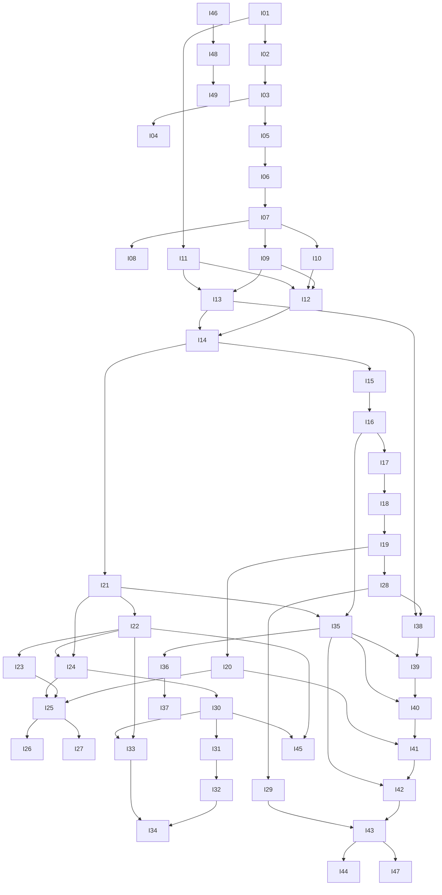

# 04 — Roadmap: Phases, Iterations, Milestones

**49 iterations in 10 phases.** Each iteration is a vertical slice that ends in a working, tested, committed state. One iteration ≈ 1–3 Claude sessions (a "session" = one focused conversation of a few hours of agent work). Estimated total: **85–115 sessions**.

The phases follow the delivery strategy in SRS-GDP-001 §10 and the per-spec "implementation priorities", re-ordered so that every dependency exists before it is needed:

- Security, tenancy, revisions, metering and billing **data models are laid down early** (SRS §10 planning requirement), even when the UI comes later.
- A **fake AI adapter** lets the whole AI pipeline be built and tested before a real provider is chosen.
- 3D starts as a **viewer** (TECH §3.8) after the 2D structured editor is solid.

---

## Phase 0 — Foundation & platform primitives → **M1 Walking skeleton**

| ID  | Iteration                                                                     | Depends on | Sessions | Key output                                                                                                                              |
| --- | ----------------------------------------------------------------------------- | ---------- | -------- | --------------------------------------------------------------------------------------------------------------------------------------- |
| I01 | [Monorepo bootstrap & tooling](iterations/I01-monorepo-bootstrap.md)          | —          | 1        | pnpm/Turborepo workspace, apps/web, apps/api, apps/worker skeletons, packages/config, lint/format/test, git hygiene                     |
| I02 | [Local infrastructure & backend base](iterations/I02-local-infrastructure.md) | I01        | 1–2      | Docker Compose (Postgres, Redis, object store, Mailpit), env schema, Prisma, logging, health checks, worker ↔ Redis                     |
| I03 | [Platform primitives](iterations/I03-platform-primitives.md)                  | I02        | 2        | contracts package, error envelope, request context, audit events, transactional outbox, idempotency keys, durable job skeleton, OpenAPI |
| I04 | [Web app shell & design system](iterations/I04-web-shell.md)                  | I01, I03   | 1–2      | Next.js shell, Tailwind+shadcn theme, app layout, typed API client, Playwright smoke                                                    |

**M1 exit:** `pnpm dev` starts web+api+worker against compose infra; web calls an API health route; a test job round-trips through BullMQ and is persisted.

## Phase 1 — Identity, organizations & access → **M2 Secure multi-tenant base**

| ID  | Iteration                                                                       | Depends on | Sessions | Key output                                                                                                     |
| --- | ------------------------------------------------------------------------------- | ---------- | -------- | -------------------------------------------------------------------------------------------------------------- |
| I05 | [Accounts & authentication](iterations/I05-authentication.md)                   | I03, I04   | 2–3      | Register, verify email, login/logout, sessions (HTTP-only cookie), password reset, rate limits, account states |
| I06 | [Organizations, memberships & invitations](iterations/I06-organizations.md)     | I05        | 2        | Orgs, memberships, invitations, org switcher, ownership continuity                                             |
| I07 | [Authorization engine & tenant isolation](iterations/I07-authorization.md)      | I06        | 2–3      | Permission catalog, roles, PDP/PEP guard on every route, tenant-scoped repositories, cross-tenant test harness |
| I08 | [MFA, step-up, sessions & security audit](iterations/I08-mfa-sessions-audit.md) | I07        | 2        | TOTP MFA, recovery codes, step-up auth, session list/revoke, security audit viewer                             |

**M2 exit:** Two orgs with different roles cannot see each other's data (automated suite), every route declares a permission, privileged actions are audited.

## Phase 2 — Core domain

| ID  | Iteration                                                                            | Depends on    | Sessions | Key output                                                                                                                                                    |
| --- | ------------------------------------------------------------------------------------ | ------------- | -------- | ------------------------------------------------------------------------------------------------------------------------------------------------------------- |
| I09 | [Asset & storage service](iterations/I09-assets-storage.md)                          | I07           | 2        | S3 abstraction, upload/download (signed URLs), validation, Sharp thumbnails in worker, checksums, provenance                                                  |
| I10 | [Projects & lifecycle core](iterations/I10-projects.md)                              | I07           | 2        | Project CRUD, state machine, metadata, list/search, project dashboard UI                                                                                      |
| I11 | [Canonical garment model package](iterations/I11-garment-model.md)                   | I01           | 2–3      | `packages/garment-model`: schema, component catalog, property definitions, units, statuses, relationships, constraints, diff, hash, initial garment templates |
| I12 | [Designs, working copies & immutable revisions](iterations/I12-designs-revisions.md) | I09, I10, I11 | 2–3      | Design create (blank/template), working copy with optimistic concurrency, commit/restore/compare APIs, immutability triggers                                  |
| I13 | [Artifact registry & built-in library](iterations/I13-artifact-registry.md)          | I09, I11      | 2        | Artifacts + immutable revisions, scopes, compatibility rules, search, seeded built-in library                                                                 |

## Phase 3 — Structured 2D editor → **M3 Structured design editor alpha (no AI)**

| ID  | Iteration                                                                          | Depends on | Sessions | Key output                                                                                                                    |
| --- | ---------------------------------------------------------------------------------- | ---------- | -------- | ----------------------------------------------------------------------------------------------------------------------------- |
| I14 | [Design operation router (deterministic)](iterations/I14-operation-router.md)      | I12, I13   | 2        | `packages/design-operations`, operation records, validation, deterministic executor, strategy-selection skeleton, idempotency |
| I15 | [Editor shell, editor-core & autosave](iterations/I15-editor-shell.md)             | I04, I14   | 2–3      | Workspace layout, command stack, undo/redo, save status, autosave + conflict handling                                         |
| I16 | [Parametric 2D garment renderer (SVG)](iterations/I16-svg-renderer.md)             | I11, I15   | 3        | `packages/garment-render`: parametric SVG flats (front/back) for initial categories, hit-testing, zoom/pan/fit, layers        |
| I17 | [Hierarchy, selection & contextual properties](iterations/I17-properties-panel.md) | I16        | 2        | Component tree, synced selection, schema-driven property panel, status/provenance badges, visibility/lock                     |
| I18 | [Artifact browser & structured attachment](iterations/I18-artifact-attachment.md)  | I13, I17   | 2–3      | Library panel, compatibility feedback, attach/replace/detach, placement controls, trims/fabric rendering, save-as-artifact    |
| I19 | [Revision history, commit & comparison UI](iterations/I19-revision-ui.md)          | I18        | 2        | Commit dialog, history panel, structured diff + visual side-by-side/overlay, restore-to-working-copy                          |
| I20 | [Design validation engine & findings UI](iterations/I20-design-validation.md)      | I19        | 2        | Versioned constraint sets, validation runs/findings, inline + summary UI, staleness                                           |

**M3 exit:** A user creates a project, starts a shirt from a template, edits components and properties, attaches a lace artifact to a sleeve hem, sees validation, commits revisions, compares and restores — all without AI.

## Phase 4 — AI execution & metering foundation → **M4 AI-assisted design alpha**

| ID  | Iteration                                                                                  | Depends on    | Sessions | Key output                                                                                                                                          |
| --- | ------------------------------------------------------------------------------------------ | ------------- | -------- | --------------------------------------------------------------------------------------------------------------------------------------------------- |
| I21 | [Generation job management & progress (SSE)](iterations/I21-generation-jobs.md)            | I03, I14      | 2        | Job/attempt state machine incl. `outcome_unknown`, BullMQ queues, recovery sweeper, cancellation, SSE                                               |
| I22 | [AI provider registry, credentials & adapters](iterations/I22-ai-providers.md)             | I21           | 2–3      | Provider/model capability profiles, secret store (envelope encryption), adapter interface, fake adapter, first real adapter(s), error normalization |
| I23 | [Prompt & request compilation, routing](iterations/I23-compilation-routing.md)             | I22           | 2–3      | Task registry, versioned templates, intermediate request, asset prep (resize/mask/roles), compilation records, capability-filtered routing          |
| I24 | [Usage metering & entitlement preflight](iterations/I24-metering-preflight.md)             | I21, I22      | 2–3      | Usage events, append-only ledger, reservations/settlement, provider cost records, default plan + credit allowance, atomic preflight                 |
| I25 | [AI generation in the editor: candidates & apply](iterations/I25-ai-generation-editor.md)  | I20, I23, I24 | 3        | Generate actions, cost/entitlement feedback, progress, candidate gallery, compare/apply, stale protection, output validation                        |
| I26 | [Design initiation from sketch / photo / fabric](iterations/I26-design-initiation.md)      | I25           | 2–3      | Interpretation jobs → proposed structured model with statuses, review & confirm wizard, initial revision                                            |
| I27 | [Region tools, annotations & targeted edits](iterations/I27-region-tools-targeted-edit.md) | I25           | 2–3      | Konva overlay, lasso/brush/polygon, annotations, mask preview, `targeted_image_edit`, preservation disclosure                                       |

**M4 exit:** From a photo or template, a user generates and refines AI visuals of their structured design, sees credit usage, accepts candidates as representations, and nothing is applied without review.

## Phase 5 — Review, approval & notifications → **M5 Review workflow**

| ID  | Iteration                                                         | Depends on | Sessions | Key output                                                                                                                       |
| --- | ----------------------------------------------------------------- | ---------- | -------- | -------------------------------------------------------------------------------------------------------------------------------- |
| I28 | [Review & approval workflow](iterations/I28-review-approval.md)   | I19        | 2        | Submit for review, decisions, comments on components/regions, separation of duties, approval binding & revocation, design status |
| I29 | [Notifications (in-app & email)](iterations/I29-notifications.md) | I28        | 1–2      | Outbox-driven notifications, templates, preferences, retries; wired to reviews, jobs, quotas, security events                    |

## Phase 6 — Subscription, billing & BYOK → **M6 Commercial beta**

| ID  | Iteration                                                                            | Depends on | Sessions | Key output                                                                                                        |
| --- | ------------------------------------------------------------------------------------ | ---------- | -------- | ----------------------------------------------------------------------------------------------------------------- |
| I30 | [Plans, subscriptions, entitlements & budgets](iterations/I30-plans-entitlements.md) | I24        | 2        | Plan versions, subscription lifecycle (no payments yet), entitlements, overage policies, budgets, usage dashboard |
| I31 | [Pricing, charges & invoices](iterations/I31-pricing-invoices.md)                    | I30        | 2        | Pricing catalog versions, charge engine, invoice preview/issue, credit notes & adjustments                        |
| I32 | [Payment integration & subscription lifecycle](iterations/I32-payments.md)           | I31        | 2        | Payment provider adapter, checkout, signed idempotent webhooks, past-due/grace/suspension, refunds                |
| I33 | [Customer-provided API credentials (BYOK)](iterations/I33-byok-credentials.md)       | I22, I30   | 2        | Credential admin UI, validation, ownership-mode routing, no silent fallback, separate metering/pricing            |
| I34 | [Reconciliation & financial operations](iterations/I34-reconciliation.md)            | I32, I33   | 2        | Provider usage reconciliation, unknown-outcome resolution, reservation expiry, discrepancy dashboard, alerts      |

## Phase 7 — Advanced visualization → **M7 2D/3D visualization**

| ID  | Iteration                                                                               | Depends on | Sessions | Key output                                                                                                                  |
| --- | --------------------------------------------------------------------------------------- | ---------- | -------- | --------------------------------------------------------------------------------------------------------------------------- |
| I35 | [Server render pipeline, manifests, cache & exports](iterations/I35-render-pipeline.md) | I16, I21   | 2        | Render jobs/profiles/manifests, SVG→PNG/PDF in worker, versioned cache, technical-flat export, thumbnails, stale indicators |
| I36 | [Interactive 3D viewer](iterations/I36-3d-viewer.md)                                    | I35        | 2        | R3F viewer, GLB/glTF upload & validation, materials/textures, camera presets, capability disclosure, fallback               |
| I37 | [2D/3D component linking & material sync](iterations/I37-2d-3d-sync.md)                 | I36        | 2        | Component-ID ↔ mesh mapping, synchronized selection (S2), color/fabric propagation, sync-level labelling                    |

## Phase 8 — Tech pack & production specification → **M8 Production-ready tech packs**

| ID  | Iteration                                                                                      | Depends on | Sessions | Key output                                                                                                                            |
| --- | ---------------------------------------------------------------------------------------------- | ---------- | -------- | ------------------------------------------------------------------------------------------------------------------------------------- |
| I38 | [Production specification core & BOM](iterations/I38-spec-core-bom.md)                         | I28, I13   | 2–3      | `packages/techpack-model`, spec aggregate & revisions, templates, style identity, design binding, BOM with units/artifact links       |
| I39 | [Measurements, POMs, tolerances & grading](iterations/I39-measurements-grading.md)             | I38, I35   | 2–3      | POM library, measurement table UI, base size, units, tolerances (sym/asym), grade rules, derived values, overrides                    |
| I40 | [Construction, colorways, artwork, labels & quality](iterations/I40-construction-colorways.md) | I39, I35   | 2–3      | Construction sequence, colorway-specific BOM, artwork placements, labels/packaging, quality & compliance evidence, technical callouts |
| I41 | [Specification validation & production readiness](iterations/I41-spec-validation.md)           | I40, I20   | 2        | Versioned rule sets per template, cross-section rules, blocking/warnings, exceptions, staleness, readiness status                     |
| I42 | [Tech pack export (PDF / XLSX / CSV / JSON)](iterations/I42-techpack-export.md)                | I41, I35   | 2–3      | Export jobs, HTML→PDF, spreadsheets, JSON package, draft watermark, integrity checks, export manifests                                |
| I43 | [Spec review, release, change impact & supplier access](iterations/I43-release-supplier.md)    | I42, I29   | 2–3      | Spec review/approval, release manifest, supersede/withdraw, design-change impact assessment, supplier grants & secure links           |
| I44 | [AI-assisted specification drafting](iterations/I44-ai-spec-drafting.md)                       | I43, I23   | 2        | Source-grounded suggestions (BOM, construction, POM mapping), document extraction with attribution, field-level accept/reject         |

## Phase 9 — Administration, observability, hardening, launch → **M9 Production launch**

| ID  | Iteration                                                                                 | Depends on              | Sessions | Key output                                                                                                                     |
| --- | ----------------------------------------------------------------------------------------- | ----------------------- | -------- | ------------------------------------------------------------------------------------------------------------------------------ |
| I45 | [Platform administration console](iterations/I45-admin-console.md)                        | I22, I30                | 2        | Providers/models/routing, pricing & plan publishing, templates, feature flags, operator roles, break-glass                     |
| I46 | [Observability & audit tooling](iterations/I46-observability.md)                          | I03 (any time after M4) | 1–2      | OpenTelemetry traces/metrics, dashboards, audit search UI, alerting                                                            |
| I47 | [Security hardening, API tokens, export & deletion](iterations/I47-security-hardening.md) | I43                     | 2        | API tokens/service identities, headers/CSP, upload scanning, rate-limit review, org export, governed deletion & retention jobs |
| I48 | [Production deployment, backups & runbooks](iterations/I48-deployment.md)                 | I46                     | 2        | Docker images, prod compose, Caddy TLS, secrets, backups + restore drill, migrations runbook                                   |
| I49 | [Release hardening: performance, E2E, accessibility](iterations/I49-release-hardening.md) | I48                     | 2        | k6 load tests vs targets, full-lifecycle Playwright suite, a11y audit, launch checklist                                        |

**After I49:** see [`09-backlog.md`](09-backlog.md) (branch/merge, multi-user co-editing, pattern-linked 3D, cloth simulation, SSO/SCIM, PLM/ERP integrations, multi-currency, marketplace…).

---

## Dependency graph (simplified)

## Recommended execution order

Follow numeric order. Safe reorderings if desired:

- **I11** (pure package) can be done any time after I01 — e.g. in parallel on a second machine during Phase 1.
- **I46** (observability) can be pulled forward any time after M4.
- **I35–I37** (visualization) can run before Phase 6 if visuals matter more than billing for an early demo.
- An **early staging deployment** (subset of I48) can be done right after M4 to demo the product.

Only one iteration should be `in_progress` at a time per branch; if two machines work in parallel, use separate branches and separate iterations with no dependency between them, and record both in `PROGRESS.md`.

## Milestone checklist

| Milestone                   | After | Demo scenario                                                                                             |
| --------------------------- | ----- | --------------------------------------------------------------------------------------------------------- |
| M1 Walking skeleton         | I04   | Web shows API health; test job persists & completes                                                       |
| M2 Secure multi-tenant base | I08   | Register, verify, create org, invite member, roles enforced, MFA, audit log                               |
| M3 Structured editor alpha  | I20   | Template shirt → edit → attach lace → validate → commit → compare → restore                               |
| M4 AI-assisted design alpha | I27   | Photo → interpreted model → confirm → generate visuals → targeted edit → credits consumed                 |
| M5 Review workflow          | I29   | Submit revision → approver (different user) approves → notification; edit after approval needs new review |
| M6 Commercial beta          | I34   | Plan with allowance, overage, invoice, payment webhook, BYOK key used & metered separately                |
| M7 Visualization            | I37   | Technical flat export, 3D viewer with synced selection and fabric color                                   |
| M8 Production tech packs    | I44   | Approved design → spec with BOM/POM/grading/construction → validation → PDF → release → supplier link     |
| M9 Launch                   | I49   | Production deployment with backups, monitoring, perf targets met, E2E green                               |
